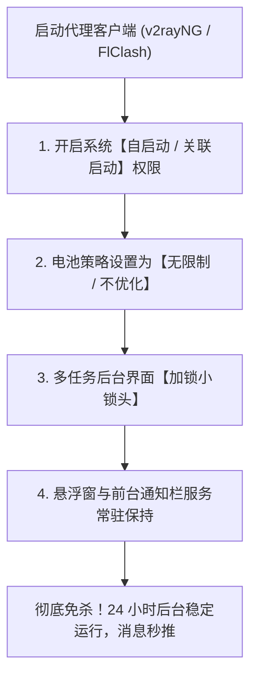
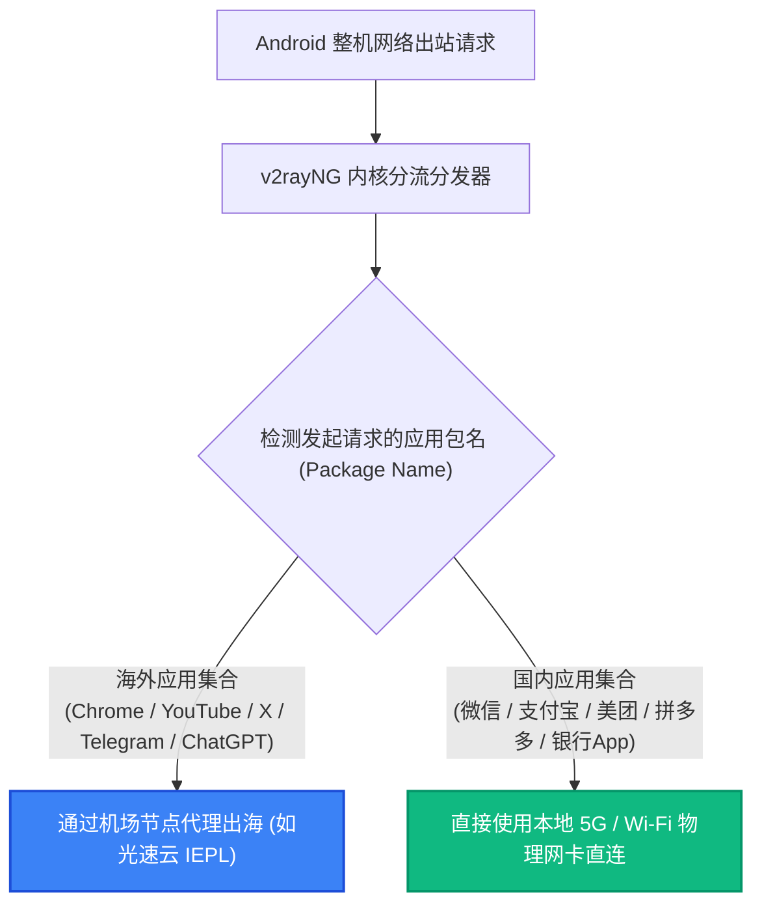

# Android 平台科学上网全攻略：v2rayNG / FlClash 电池保活、应用分流与 Google Play 换区指南

客户端专项 · AmyTelecom 实验室 2026 深度发布

在庞大的开源 Android 生态中，客户端的选择自由度远高于封闭的 iOS，但同时，安卓碎片化与国内各大手机厂商定制系统的激进内存管理机制，也给用户带来了无数痛点：
- 明明开着代理在后台下载文件或听音频，锁屏几分钟后应用就被系统“无情杀掉”，导致下载中断、消息断联；
- 手机开启代理后，国内日常使用的微信、美团、滴滴打车定位漂移，甚至频繁收到银行与证券 APP 的“异地高危登录警告”；
- 很多用户在安装了 Google Play 服务后，频繁遭遇“正在等待下载”、“DF-DFERH-01 错误”，或者因为 IP 不纯净导致被锁在国区无法下载海外软件。

**安卓平台上当下哪款客户端最稳定？如何打破国产手机厂商的“激进杀后台”机制？如何优雅实现“分应用代理”？**

本篇万字专著由 AmyTelecom 实验室移动系统研究组倾力编写，为您系统拆解 Android 代理环境下的保活、分流与 Google 生态闭环方案。

<PagefindSearch />

---

## 1. Android 客户端生态速查与核心选型 (Direct Answer)

| 客户端名称 | 底层内核 | 现代协议支持 (Reality/Hy2) | UI 易用性 | 分应用代理与规则分流 | 推荐度评级 | 适用人群画像 |
|---|---|---|---|---|---|---|
| **v2rayNG** | **Xray-core** | **★★★★★ (首发支持全协议)** | **★★★★☆ (简洁高效，老牌经典)** | **极佳 (单选应用极其直观)** | ★★★★★ (安卓标配首选) | **绝大多数普通用户与追求极速稳定的日常用户** |
| **FlClash** | **Mihomo (Clash.Meta)** | ★★★★★ (全协议) | ★★★★★ (基于 Flutter 开发，极其精美) | ★★★★☆ (标准 Clash 规则) | ★★★★★ (现代高颜值首选) | 喜欢现代化平滑动画、多平台统一界面的颜值党 |
| **NekoBox for Android** | Sing-box-core | ★★★★★ | ★★★☆☆ (偏极客原生) | ★★★★☆ | ★★★★☆ | 习惯 Sing-box 纯粹生态的高级极客 |
| **Clash for Android (CFA)** | 旧版 Clash | **☆☆☆☆☆ (已停更下架)** | ★★★☆☆ | ★★☆☆☆ | **☆☆☆☆☆ (强烈建议卸载)** | 淘汰历史遗留软件，存在兼容性与崩溃风险 |

---

## 2. 攻克安卓最大顽疾：国产定制 ROM 激进杀后台保活指南

国内手机厂商（小米澎湃 HyperOS / MIUI、华为 HarmonyOS / EMUI、vivo OriginOS、OPPO ColorOS）为了在工信部续航评测中冲高分，普遍内置了极其严苛的“电量杀进程算法”。

如果不对代理软件进行深度授权，锁屏后 3 分钟内客户端必定被清理，导致断网。

### 四步彻底防杀保活 SOP（以主流小米/vivo/OPPO 为例）：
1. **解除电池优化**：进入系统 `设置` -> `应用管理` -> 找到 `v2rayNG` 或 `FlClash` -> 点击 `省电策略`，**坚决勾选“无限制”**（严禁选择“智能省电”）；
2. **授予自启动权限**：在应用权限详情页中，将 `自启动` 与 `关联启动` 开关手动开启；
3. **多任务卡片加锁**：从屏幕底部上滑呼出多任务管理后台，长按或向下拉动代理软件卡片，点击 **小锁头图标 🔒** 将其锁定在后台，防止“一键清理内存”时被误杀；
4. **保持前台常驻服务通知**：在客户端设置中，确保开启“前台服务 (Foreground Service)”。Android 规范规定，只要通知栏有活动常驻图标，系统虚拟机就不会在低内存时回收该进程。

---

## 3. 应用级分流 (Per-App Proxy)：让国内软件绝不走代理

对于国内用户而言，让手机上所有流量都走境外节点是极其愚蠢的做法：这不仅会成倍消耗您宝贵的机场流量，还会导致高德地图定位到海外、微信视频通话绕行美国造成严重延迟，甚至引发国内各大银行 APP 的异地登录封控。

**解决方案是开启精确的“分应用代理 (Per-App Proxy)”**：

### v2rayNG 分应用配置两步法：
1. 点击左上角汉堡菜单进入 `设置`；
2. 找到 `分应用代理` 并勾选开启；
3. 点击进入应用选择列表，右上角菜单推荐勾选 **“仅代理所选应用”**，然后在列表中勾选：`Chrome`、`YouTube`、`Gmail`、`Twitter/X`、`ChatGPT`、`Telegram` 以及 `Google Play 商店` 等需要加速的软件；
4. 此时，你的微信与本地生活类应用将 100% 走纯净的本地宽带，彻底根除一切水土不服。

---

## 4. Google 移动服务 (GMS) 与 Play 商店报错排障

很多购买国行安卓手机的用户，在自行安装 Google 服务框架后，经常遇到“Play 商店一直转圈”、“无法更新应用”或者“提示此项目在您所在国家不可用”。

### 解决 SOP：
1. **Google 服务框架前置放行**：在上述“分应用代理”中，务必同时勾选系统组件：**`Google Play 服务 (Google Play Services)`**、**`Google 服务框架 (Google Services Framework)`** 以及 **`Google 账户管理器`**。如果只勾选了商店本身而漏掉了底层服务框架，框架向谷歌服务器同步认证时会遭遇超时；
2. **清除商店污点缓存**：当 Google Play 频繁报错时，进入系统设置 -> 应用管理 -> 强制停止 Google Play 商店 -> 点击清除数据中的 **“清除全部数据”**；
3. **纯净 IP 重新连入**：启动代理客户端，连接一个拥有原生出口的干净美区或日区专线节点（如 [光速云美区节点](/reviews/guangsu)），再次打开 Play 商店，即可秒刷新出国际版完整内容库。

---

## 5. 私有 DNS (Private DNS) 冲突终极排查

自 Android 9 起，安卓系统引入了系统级的 `私人 DNS (Private DNS / DoT)` 功能。部分用户在系统设置里开启了第三方 DoT（如腾讯或阿里的公共 DNS）。

**致命冲突**：当系统级 Private DNS 与代理软件自带的 DNS 模块同时运行时，会导致严重的 DNS 死锁，表现为**手机连着 Wi-Fi 但状态栏显示叹号，提示“已连接但无法访问互联网”**。
- **解决办法**：进入手机 `设置` -> `网络与互联` -> 找到 `私人 DNS`，**将其直接修改为“关闭”状态**，将 DNS 解析决策权完全交由 v2rayNG / FlClash 客户端内置的防污染 DNS 引擎接管。

---

## 6. Android 用户高频 FAQ

### Q1：v2rayNG 测试连接显示 `-1ms` 或超时是为什么？
**解答**：测试延迟显示 `-1ms` 代表该节点无法与测试目标建立 TCP 握手。请检查：
1. 机场订阅是否已经到期或流量耗尽；
2. 手机系统时间是否与北京时间存在超过 60 秒的偏差（TLS 握手对时间极其敏感，误差过大会被服务端强制拒绝）；
3. 是否在更新订阅时遗漏了更新，尝试在客户端点击右上角“更新订阅”。

### Q2：安卓端可以看 Netflix 4K 吗？
**解答**：绝大多数国产国行手机由于未通过 Google 官方的硬件安全认证，硬件 DRM 等级仅为 **Widevine L3**。在 L3 等级下，Netflix 官方出于防录屏盗版考虑，会强制将播放画质限制在 540p/720p。只有国际版三星、Pixel、索尼等原生支持 **Widevine L1** 的旗舰机型，配合优质专线机场，才能在移动端点亮 1080p/4K 极清画质。

---

## 7. 结语与内链导航

只要掌握了正确的系统保活机制与分应用规则，Android 手机将成为世界上最自由、最强悍的跨国数字探索利器。

- **专线物理原理白皮书**：[IEPL vs IPLC 专线内网原理解密与 0 丢包真相](/protocols/iepl-iplc)
- **苹果 iOS 客户端实操**：[iOS Shadowrocket 小火箭免拔卡配置与美区账号指南](/clients/ios)
- **软路由全屋透明代理**：[OpenClash 透明网关与 DNS 防泄漏配置指南](/clients/openwrt)
- **返回 42 家品牌库大名单**：[查看 42 家机场品牌库与天梯排行](/reviews/)

<AffDisclaimer />
