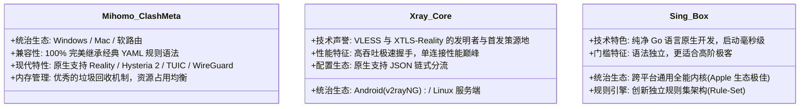

# 全平台客户端下载与内核对比全景指南：官方正版、内核选型与跨端矩阵

客户端技术枢纽 · AmyTelecom 实验室 2026 深度发布

工欲善其事，必先利其器。即使您购买了顶级的高铁级专线机场，如果安装了落后、带有兼容性缺陷或被恶意篡改植入后门的客户端软件，不仅无法发挥出千兆专线的极致性能，还可能面临严重的隐私泄露与设备异常卡顿风险。

随着 2023 年底原版 Clash 核心库停更，整个客户端生态发生了一场翻天覆地的洗牌重构：**Mihomo (原 Clash.Meta)** 与 **Sing-box** 强势崛起，全面接管了现代翻墙协议的统治地位。

本技术枢纽聚合了全平台（Windows、macOS、iOS、Android、OpenWrt 软路由）的官方安全下载渠道、各平台主力软件横评与内核选型矩阵，为您提供权威、无害、永不迷路的客户端落地指南。

<PagefindSearch />

---

## 1. 全平台客户端推荐天梯与官方下载矩阵 (Direct Answer)

| 操作系统 | 实验室第一首选推荐 | 备选推荐方案 | 核心技术内核 | 官方开源下载渠道 (安全无毒) | 深度专项实操手册 |
|---|---|---|---|---|---|
| **Windows** | **Clash Verge Rev** | v2rayN / NekoBox | Mihomo (Clash.Meta) | [GitHub 官方 Releases 仓库](https://github.com/clash-verge-rev/clash-verge-rev/releases) | [Windows 万字配置指南](/clients/windows) |
| **macOS** | **Clash Verge Rev (Mac)** | Surge Mac / Sing-box | 原生 ARM64 Mihomo | [GitHub 官方 aarch64.dmg](https://github.com/clash-verge-rev/clash-verge-rev/releases) | [macOS 万字优化指南](/clients/macos) |
| **iOS / iPadOS** | **Shadowrocket (小火箭)** | Quantumult X / Loon | 专属轻量自研内核 | [美区 App Store (需美区 Apple ID)](https://apps.apple.com/us/app/shadowrocket/id932747118) | [iOS 万字实操指南](/clients/ios) |
| **Android** | **v2rayNG** | FlClash / NekoBox | Xray-core / Mihomo | [GitHub 官方 APK 资产库](https://github.com/2dust/v2rayNG/releases) | [Android 万字保活指南](/clients/android) |
| **软路由 (OpenWrt)** | **OpenClash** | PassWall 2 / SSR-Plus | Mihomo 原生嵌入式 | [GitHub 官方 ipk 仓库](https://github.com/vernesong/OpenClash/releases) | [软路由全屋透明代理指南](/clients/openwrt) |

---

## 2. 核心内核 (Kernel) 三足鼎立特性横向大比拼

在当今的客户端底层，真正负责网络数据加解密与路由分流的是以下三大核心引擎：

---

## 3. 全平台万字专属配置指南矩阵

点击下方卡片，进入对应操作系统的深度手把手图文指南与故障排除 SOP：

  桌面主力
  <h3 style="margin: 0.5rem 0; font-size: 1.25rem;"><a href="/clients/windows">Windows 平台配置终极指南</a></h3>
  

    Clash Verge Rev 安装汉化、Mihomo 内核选择、TUN 虚拟网卡模式实操及系统代理死锁 30 秒一键急救脚本。
  

  <a href="/clients/windows" style="color: #2563eb; font-weight: 600; text-decoration: none;">阅读实操专著 →</a>

  极客利器
  <h3 style="margin: 0.5rem 0; font-size: 1.25rem;"><a href="/clients/macos">macOS 架构优化配置指南</a></h3>
  

    Apple Silicon M1-M4 原生 ARM64 编译版能耗优化、绕过 Gatekeeper 拦截及终端 Git/Homebrew 代理一键开关代码。
  

  <a href="/clients/macos" style="color: #10b981; font-weight: 600; text-decoration: none;">阅读实操专著 →</a>

  移动标杆
  <h3 style="margin: 0.5rem 0; font-size: 1.25rem;"><a href="/clients/ios">iOS Shadowrocket 免拔卡指南</a></h3>
  

    美区 Apple ID 免费免信用卡注册全流程、小火箭扫码导入、智能配置分流、TikTok 免拔卡及后台按需省电优化。
  

  <a href="/clients/ios" style="color: #f59e0b; font-weight: 600; text-decoration: none;">阅读实操专著 →</a>

  开源自由
  <h3 style="margin: 0.5rem 0; font-size: 1.25rem;"><a href="/clients/android">Android 平台保活与分流攻略</a></h3>
  

    攻克小米/华为/OPPO 杀后台机制的四步保活法则、应用级精准分流排除微信银行及 Google Play 报错排障。
  

  <a href="/clients/android" style="color: #8b5cf6; font-weight: 600; text-decoration: none;">阅读实操专著 →</a>

  网关中枢
  <h3 style="margin: 0.5rem 0; font-size: 1.25rem;"><a href="/clients/openwrt">软路由 OpenClash 全屋透明网关配置</a></h3>
  

    x86 工控机选型、主路由与旁路由拓扑优劣、Fake-IP 混合模式免 DNS 污染以及主机游戏 PS5/Switch FullCone NAT 调优。
  

  <a href="/clients/openwrt" style="color: #ef4444; font-weight: 600; text-decoration: none;">阅读实操专著 →</a>

---

## 4. 全局导航与知识内链

- **专线物理拓扑深度解密**：[IEPL vs IPLC 专线内网原理解密与 0 丢包真相](/protocols/iepl-iplc)
- **AI 生产力大模型环境**：[ChatGPT & Claude 原生纯净 IP 选型全攻略](/scenarios/ai-tools)
- **防跑路避坑核心守则**：[机场跑路前兆 10 大信号与防失联守则](/guides/runaway-warning)
- **查看 42 家机场品牌库**：[42 家机场全景天梯榜与专属优惠码](/reviews/)

<AffDisclaimer />
