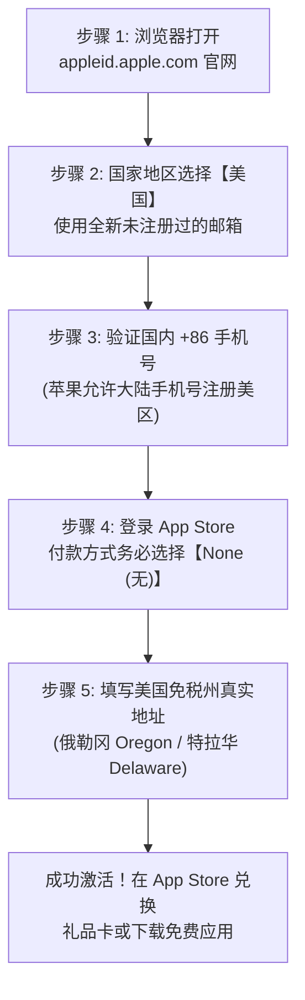
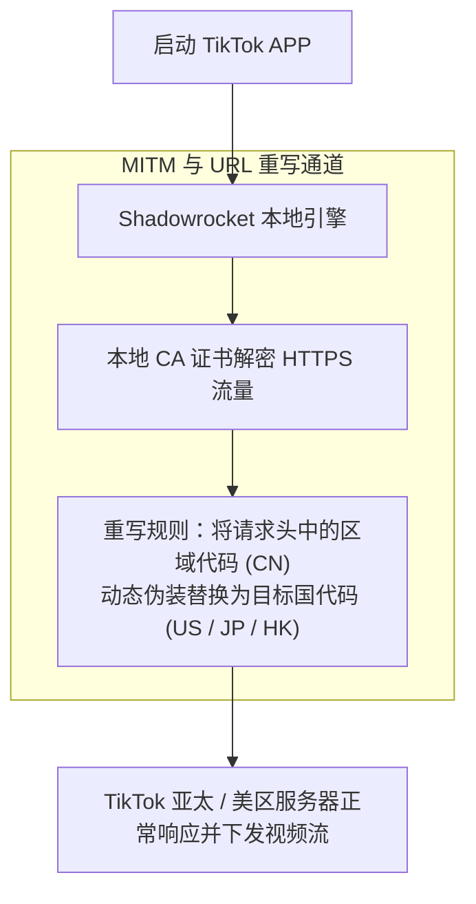

# iOS 平台科学上网配置指南：Shadowrocket 小火箭免拔卡配置、美区 Apple ID 注册与分流规则

客户端专项 · AmyTelecom 实验室 2026 深度发布

在苹果 iOS 生态（iPhone 与 iPad）中，由于苹果严格遵循各主权国家的法律监管合规要求，**中国大陆区（国区）的 App Store 已经彻底下架了所有网络代理类应用程序**。

这使得许多刚进入跨境网络领域的新手用户，在第一步就遭遇了巨大的技术鸿沟：
- 在应用商店里搜索“小火箭”、“Clash”或者“VPN”，搜出来的全都是带有欺诈扣费性质的山寨仿冒软件；
- 不知道如何安全、合规、免费地获取一个能够正常下载软件的**美区（或外区）Apple ID**；
- 下载了正版小火箭后，面对花哨的“全局路由”、“配置分流”、“HTTPS 解密”不知如何设置；
- 想要在 iPhone 上使用 TikTok，却频繁遭遇黑屏、闪退或提示无网络连接。

**正版 Shadowrocket 究竟该如何获取？如何免绑信用卡注册美区账号？怎样配置才能让微信不走代理、ChatGPT 秒开且不费电？**

本篇万字专著由 AmyTelecom 实验室移动安全组联合编撰，为您提供全网最详尽、可直接复制实操的 iOS 科学上网全生命周期指南。

<PagefindSearch />

---

## 1. iOS 四大主流网络工具生态对比 (Direct Answer)

| 软件名称 (俗称) | 官方 App Store 售价 | 协议支持全面性 (VLESS/Reality/Hy2) | UI 上手门槛 | 进阶功能 (脚本/重写/抓包) | 综合推荐等级 | 适用人群画像 |
|---|---|---|---|---|---|---|
| **Shadowrocket (小火箭)** | **$2.99 (约 20 元，一次买断)** | **★★★★★ (全协议通吃，更新极快)** | **★☆☆☆☆ (傻瓜式，极简单)** | ★★★★☆ (支持模块与去广告重写) | ★★★★★ (最强普及首选) | **95% 普通用户、流媒体发烧友与外贸工作者** |
| **Quantumult X (圈 X)** | $7.99 (约 58 元) | ★★★★☆ | ★★★★☆ (较高，需理解规则) | ★★★★★ (JS 脚本生态极其庞大) | ★★★★☆ (极客首选) | 喜欢折腾脚本自动化、签到、深度界面定制的极客 |
| **Loon** | $5.99 (约 43 元) | ★★★★★ | ★★☆☆☆ (现代 UI，插件化) | ★★★★★ (一键安装复杂插件) | ★★★★☆ | 追求现代审美、喜欢插件化扩展的进阶玩家 |
| **Stash (iOS 版 Clash)** | $3.99 (约 29 元) | ★★★★☆ | ★★☆☆☆ (标准 Clash 逻辑) | ★★★☆☆ (规则集兼容) | ★★★☆☆ | 在 PC 上深度习惯了 Clash 规则语法的老用户 |

---

## 2. 破局第一步：免信用卡免费注册美区 Apple ID 保姆级 SOP

获取美区 Apple ID 是所有 iOS 用户的成人礼。请牢记：**千万不要在淘宝或电报群购买他人共享的 ID 直接在“设置”中登录 iCloud，否则可能导致手机被他人远程锁死变成砖头！**

按照以下 SOP，您可以完全凭借国内网络与国内手机号，在 10 分钟内免费注册属于自己的永久美区账号：

### 关键细节说明：
1. **不要在系统设置中登录 iCloud**：注册完成后，只在桌面打开 **App Store**，点击右上角头像滑动到底部退出当前账号，然后**仅在 App Store 中登录**新美区账号；
2. **付款方式选择“None”**：苹果在纯下载免费应用时，允许将支付方式留空；
3. **免税州账单地址生成**：在网上搜索“美国地址生成器”，推荐选取 **俄勒冈州 (Oregon, 邮编 97201)** 或 **特拉华州 (Delaware)**，这两个州购买数字商品免消费税；
4. **购买 $2.99 小火箭充值**：在美区注册好后，如需购买正版小火箭，可以在支付宝首页将定位切换为“旧金山”购买 App Store 礼品卡（Gift Card），或在正规数字卡商城购买兑换码，在 App Store 兑换余额后直接扣款下载。

---

## 3. Shadowrocket 小火箭从零到一配置实战

### 步骤 1：导入机场专属订阅
1. 打开您购买的机场后台（如 [光速云](/reviews/guangsu)），找到移动端专属一键导入小火箭按钮；
2. 点击后系统会自动唤起 Shadowrocket 并完成订阅节点的解析与写入；
3. 如果不支持一键唤起，选择“复制订阅链接”；
4. 打开小火箭，点击右上角 **`+` (加号)**，类型选择 **`Subscribe`**，在 `URL` 输入框中粘贴订阅地址，点击右上角完成，小火箭将自动下载所有国家和地区的节点列表。

### 步骤 2：核心全局路由模式选择
回到小火箭主界面，在节点列表上方找到 **全局路由 (Global Routing)**：
- **强烈推荐选择：`配置 (Config)` 模式**！在此模式下，小火箭会根据智能分流规则自动判断：访问国内百度、淘宝、微信走物理直连（不耗费机场流量且速度最快）；访问境外被封网站自动走节点加速；
- **排错测试时选择：`代理 (Proxy)` 模式**：所有流量强制走境外节点（仅供排查网络连通性时临时使用）；
- **千万不要长期选择：`直连 (Direct)` 模式**：直连代表关闭所有代理功能。

### 步骤 3：启动代理
在节点列表中选中您心仪的优质节点（如 `光速云 🇭🇰 香港 01 IEPL 专线`），然后点击主界面最顶部的 **连接开关**。首次开启时，系统会弹出授权确认，点击 `Allow (允许)` 并输入您的 iPhone 解锁密码即可完成 VPN 虚拟网卡配置。

---

## 4. 深度规则集配置：杜绝流量偷跑与微信免分流

小火箭默认内置的规则库较为简单，为了实现极致的分流体验，建议加载国内权威维护的智能规则组：
1. 点击小火箭底部菜单的 **`配置 (Config)`**；
2. 点击右上角 `+`，粘贴国内开源知名规则集远程链接（如 ACL4SSR 或 Loyalsoldier 完整规则）；
3. 点击下载并生效该配置；
4. 此时系统会自动将高价值的 AI 服务（OpenAI、Claude）、海外流媒体（Netflix、Disney+）与国内日常应用精准隔离开来，彻底杜绝微信发图卡顿或银行 APP 误报异地登录风险。

---

## 5. 特殊场景：iPhone 上 TikTok 免拔卡运行配置

很多做跨境电商或内容出海的运营者，需要在未越狱的 iPhone 上浏览和发布 TikTok。由于 TikTok 官方 APP 会强制检测 SIM 卡运营商代码（MCC/MNC），直接打开会黑屏闪退。

小火箭通过强大的 **HTTPS 解密 (MITM) 与重写 (Rewrite)** 功能，可以实现免拔卡直接使用：

### 免拔卡实操三部曲：
1. **安装并信任证书**：进入小火箭 `配置` -> 点击当前生效配置旁边的感叹号 `i` -> 找到 `HTTPS 解密`，打开开关，点击 `生成新的 CA 证书`，在弹出的系统对话框中点击允许安装描述文件；
2. **系统信任证书（极其关键，新手极易遗漏）**：打开 iPhone `设置` -> `通用` -> `关于本机` -> 滑动到最底部点击 `证书信任设置`，找到刚才安装的 `Shadowrocket CA`，**将其右侧的开关手动开启为信任状态**；
3. **加载 TikTok 专用模块/重写**：在小火箭配置的模块中添加针对 TikTok 的重写规则（自动将请求头参数 `sys_lang=zh-Hans` 重写为 `sys_lang=en`，并将 `carrier_region=CN` 重写为 `US`），保存后重新打开 TikTok 即可畅享全球视频。

---

## 6. 后台保活与电量控制终极调优

由于 iOS 具有极其激进的后台进程管理机制（Tombstoning / 墓碑机制），如果配置不当，可能导致锁屏后断网，或者后台功耗飙升。

### 两项关键性能优化：
1. **开启按需连接 (On-Demand)**：进入小火箭设置，找到 `按需连接` 并启用。当 iPhone 处于锁屏休眠且无网络请求时，虚拟网卡自动挂起；一旦前台唤醒或有推送消息时，在 50 毫秒内瞬间拉起，极为省电；
2. **优选轻量专线协议**：在节点选择上，优先选用运行 Shadowsocks AEAD 的 IEPL 专线节点（如 [光速云](/reviews/guangsu)）。专线节点握手开销比繁琐的双层 TLS 协议小得多，实测能为 iPhone 带来每天多达 15% 的续航提升。

---

## 7. 结语与内链导航

在移动互联时代，iPhone 是我们探索世界数字文明最随身的前沿窗口。通过正确的工具链配置与原生专线网络，让每一次指尖轻触都如丝般顺滑。

- **专线物理原理白皮书**：[IEPL vs IPLC 专线内网原理解密与 0 丢包真相](/protocols/iepl-iplc)
- **大模型免封专项**：[ChatGPT & Claude 原生纯净 IP 选型全攻略](/scenarios/ai-tools)
- **安卓平台客户端手册**：[Android 平台 v2rayNG 与 FlClash 调优指南](/clients/android)
- **返回 42 家品牌库大名单**：[查看 42 家机场品牌库与天梯排行](/reviews/)

<AffDisclaimer />
