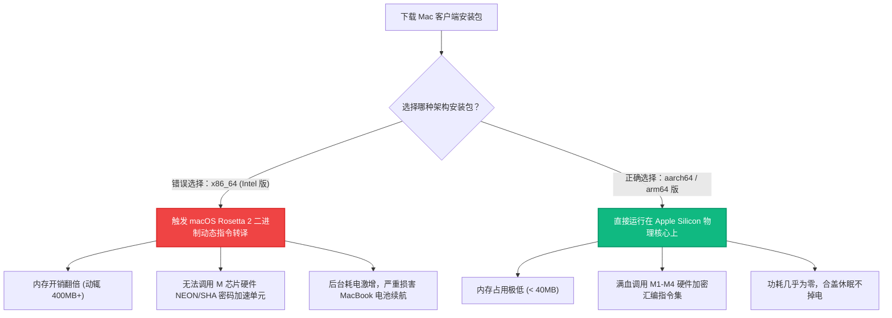

# macOS 平台科学上网配置指南：Apple Silicon M1-M4 架构优化、增强模式与终端代理终极实操

<div class="hero-badge">客户端专项 · AmyTelecom 实验室 2026 深度发布</div>

在 macOS 平台上，用户群体通常对软件的**原生交互美学、能耗表现与开发环境无缝融合**有着极其严苛的追求。

特别是自苹果全面转向自研 **Apple Silicon (M1/M2/M3/M4 系列芯片)** 架构以来，代理客户端的底层编译架构对于笔记本的续航和吞吐性能产生了决定性的分化：
- 许多使用旧版 x86 架构转译（Rosetta 2）运行的客户端，在后台默默吞噬高达 15% 以上的电量，并导致发热和风扇起转；
- 开发者经常面临“浏览器能正常翻墙，但打开终端运行 `brew install`、`git clone` 或 `npm install` 时却频繁报 Connection Timed Out”的痛苦断层；
- 昂贵的 Surge Mac（售价高达数百元）虽然功能强大，但对于普通大众用户而言门槛极高。

**在 Mac 平台上，当下一览众山的免费开源客户端是哪款？如何给 Apple Silicon 芯片配置最省电的原生内核？如何让 macOS 终端一键畅通无阻？**

本篇万字专著由 AmyTelecom 实验室 macOS 架构调优组倾力编写，为您提供从安装绕过 Gatekeeper、ARM64 原生性能优化、终端代理环境变量编写到 DNS 防泄漏的一揽子终极解决方案。

<PagefindSearch />

---

## 1. macOS 客户端生态速查与综合评级 (Direct Answer)

| 客户端名称 | 底层支持内核 | 芯片原生适配 (ARM64) | 商业模式与门槛 | 终端与开发流支持 | 推荐度评级 | 适用人群定位 |
|---|---|---|---|---|---|---|
| **Clash Verge Rev (Mac 版)** | **Mihomo (Clash.Meta)** | **原生支持 Apple Silicon aarch64** | **100% 开源免费** | **极佳 (支持系统级 TUN 接管)** | ★★★★★ (最强综合首选) | **绝大多数普通用户与 Mac 开发者主力首选** |
| **Surge for Mac** | 自研 Surge Engine | 原生 ARM64 | 极其昂贵 ($49.99+) | 业界工业级标杆 (网络抓包/网关) | ★★★★☆ (专业极客) | 预算极其充裕的高级网络工程师与发烧友 |
| **Sing-box for macOS** | Sing-box-core | 原生 ARM64 | 开源免费 / 偏极客命令行 | 极佳 | ★★★★☆ | 追求纯粹简洁、习惯手写 JSON 配置的高级用户 |
| **Shadowrocket (Mac Catalyst)** | 自研内核 | iPadOS 转译运行在 M 芯片上 | 需外区 Apple ID 购买 ($2.99) | 基础接管 | ★★★☆☆ | 已经在 iPhone 上购买了小火箭、图省事的用户 |

---

## 2. 芯片底蕴：为什么必须坚持使用 Apple Silicon 原生 ARM64 编译版？

在安装 Mac 软件时，很多用户不注意区分 `x64` 与 `aarch64 (arm64)` 版本。这种无意识的疏忽会对 M 系列芯片的体验造成严重打击：



---

## 3. Clash Verge Rev macOS 版安装与 Gatekeeper 权限绕过

### 步骤 1：正确安装包获取
访问官方 GitHub Release 仓库，在文件列表中务必选择带有 **`aarch64.dmg`** 后缀的安装包（如果是 2020 年之前的 Intel 处理器老 Mac，则选择 `x64.dmg`）。

### 步骤 2：绕过 macOS“已损坏，无法打开”安全拦截 (Gatekeeper)
由于开源客户端没有每年向苹果支付昂贵的开发者签名证书费用，直接打开时常会弹出：*“无法打开‘Clash Verge’，因为 Apple 无法检查其是否包含恶意软件”*。
**优雅绕过方法**：
1. 打开系统 `终端 (Terminal.app)`；
2. 粘贴输入以下命令并回车，输入您的 Mac 开机密码：
```bash
sudo xattr -r -d com.apple.quarantine /Applications/Clash\ Verge.app
```
3. 此时重新双击打开应用程序中的 Clash Verge，即可直接秒开运行！

### 步骤 3：导入机场订阅并选择专线节点
1. 从机场后台（如 [光速云](/reviews/guangsu)）复制 Clash 订阅链接；
2. 在 Clash Verge 左侧 `订阅` 中粘贴并保存；
3. 右键点击下载好的配置，选择启用；
4. 进入 `代理` 面板，选择 `规则模式 (Rule)`，此时全系统基础网络已配置完毕。

---

## 4. 开发者命脉：终端 Terminal / Git / Homebrew 代理打通终极 SOP

对于使用 Mac 的程序员而言，最大的痛点在于：**系统代理只对 Chrome/Safari 等图形化浏览器生效，macOS 终端（Terminal / iTerm2）默认绝不走系统代理**。
这直接导致 `git clone` 速度只有几 KB、`brew update` 卡死不动、`docker pull` 频繁超时。

### 终极方案：在 `.zshrc` 中配置一键开关函数

macOS Catalina 之后的默认 Shell 均为 `zsh`。我们只需将以下高度优化的脚本追加到您的 `~/.zshrc` 配置文件中：

```bash
# === AmyTelecom 实验室 Mac 终端网络加速一键脚本 ===
function setproxy() {
    # 7890 为 Clash Verge Rev 默认的混合监听端口 (Mixed Port)
    export http_proxy="http://127.0.0.1:7890"
    export https_proxy="http://127.0.0.1:7890"
    export all_proxy="socks5://127.0.0.1:7890"
    echo -e "\033[32m✔ 终端代理已启动！当前 IP 与地理位置：\033[0m"
    curl -s --connect-timeout 3 https://ipinfo.io/json | grep -E 'ip|country|city'
}

function unsetproxy() {
    unset http_proxy
    unset https_proxy
    unset all_proxy
    echo -e "\033[31m✖ 终端代理已关闭！当前恢复为本地直连 IP：\033[0m"
    curl -s --connect-timeout 3 https://ipinfo.io/json | grep -E 'ip|country|city'
}
```

### 生效与使用：
1. 打开终端，输入 `source ~/.zshrc` 使配置生效；
2. 在任何需要高速下载的终端窗口中，敲击命令 **`setproxy`**，终端将立刻显示绿色提示与当前境外节点 IP；
3. 此时无论是 `git clone` 还是 `npm install` 均可瞬间跑满千兆带宽；
4. 当不需要代理时，输入 **`unsetproxy`** 即可瞬间还原。

---

## 5. 增强模式 (TUN) 与 macOS 权限配置

如果您希望彻底告别环境变量的手动配置，让终端、Docker、甚至 Xcode 模拟器全局走代理，建议在 Mac 上开启 **TUN 虚拟网卡模式**：
1. 点击 Clash Verge 左侧 `设置` -> 进入 `内核设置`；
2. 找到 `服务模式 (Service Mode)` 点击安装，在弹出的系统对话框中输入 Mac 开机密码以安装系统级守护进程；
3. 打开 `TUN 模式` 开关，栈模式选择 `gvisor`；
4. 此时 macOS 网络偏好设置中会自动加载虚拟网卡，实现类似硬件级路由器的整机全透明分流。

---

## 6. macOS 故障急救字典

- **现象 1：推出 Clash 后，Safari 提示“您尚未连接到互联网”**
  - **原因**：软件退出时未能成功清理 macOS 网络服务中的 HTTP/HTTPS 代理勾选。
  - **自救**：打开 Mac `系统设置` -> 点击 `Wi-Fi` -> 点击当前连接的 Wi-Fi 旁边的 `详细信息...` -> 切换到 `代理` 标签页，**将右侧所有的代理协议开关全部关闭**，点击好即可立刻恢复正常上网。
- **现象 2：开启代理后 AirDrop (隔空投送) 或局域网剪贴板失效**
  - **原因**：Apple 局域网服务（Bonjour / mDNS）被代理规则误拦截。
  - **自救**：在 Clash 配置文件中检查分流规则，确保 `224.0.0.0/24`、`239.255.255.250` 以及 `apple.com` 局域网发现协议处于 Direct 直连状态。

---

## 7. 结语与内链导航

在 macOS 精致优雅的生态中，拥有一套运行轻盈、架构原生、开发流畅的代理链路，是保障日常心流（Flow State）创作与开发的关键支柱。

- **专线物理原理解密**：[IEPL vs IPLC 专线内网原理解密与 0 丢包真相](/protocols/iepl-iplc)
- **AI 生产力大模型配置**：[ChatGPT & Claude 原生纯净 IP 选型全攻略](/scenarios/ai-tools)
- **Windows 深度使用手册**：[Windows 平台 Clash Verge Rev 深度配置手册](/clients/windows)
- **返回 42 家品牌库大名单**：[查看 42 家机场品牌库与天梯排行](/reviews/)

<AffDisclaimer />
