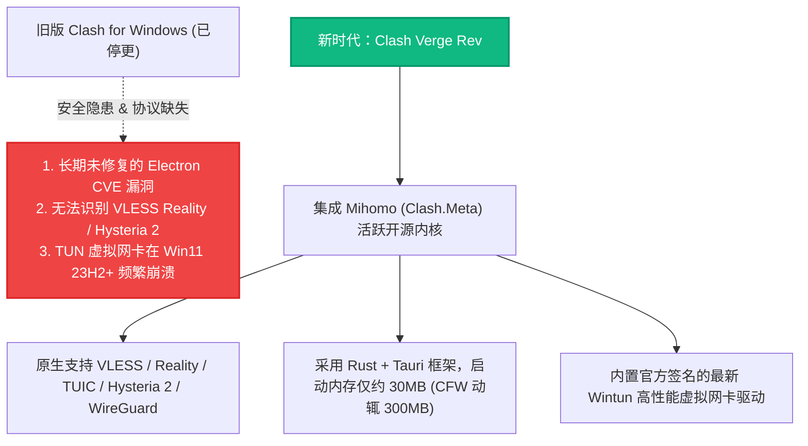
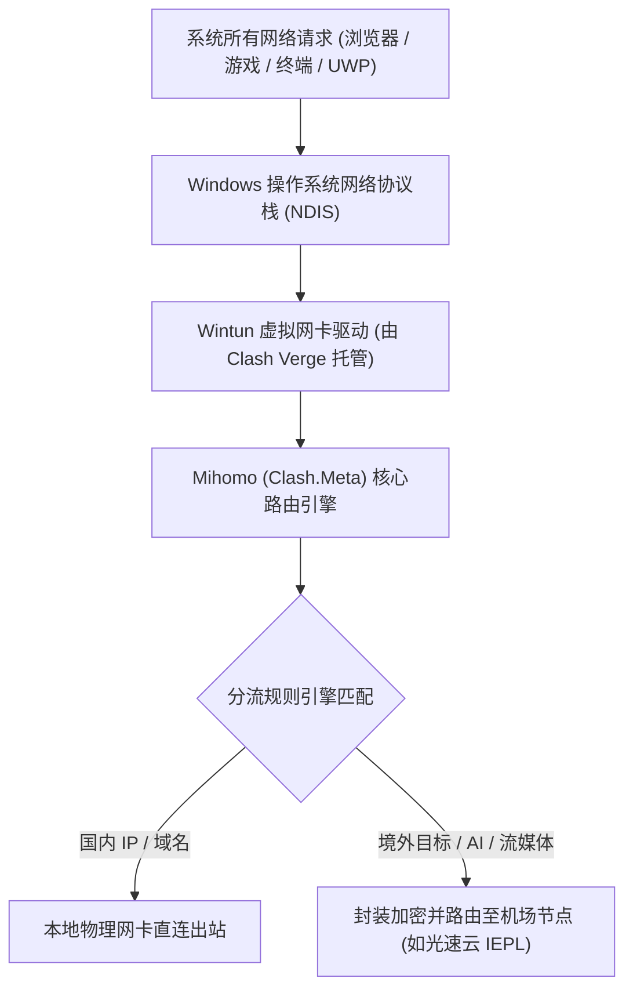

# Windows 平台科学上网终极指南：Clash Verge Rev 深度配置、TUN 模式与系统代理死锁急救

<div class="hero-badge">客户端专项 · AmyTelecom 实验室 2026 深度发布</div>

在 Windows 操作系统上，科学上网客户端经历了从早期无 GUI 的 Shadowsocks-csharp、到曾经风靡一时的 Clash for Windows (CFW)、再到当今以 **Clash Verge Rev** 为绝对主导的新时代。

随着 2023 年底原版 Clash 核心库与 CFW 作者相继注销停更，许多沿用老旧客户端的用户陷入了严重困境：
- 节点列表里的 VLESS Reality 节点和 Hysteria 2 节点无法识别或报语法错误；
- 经常遇到“明明退出了代理软件，浏览器却提示代理服务器拒绝连接，国内所有网页都打不开”的死锁崩溃；
- 电脑上的微软商店应用 (UWP)、Steam 联机游戏、Git 终端或者 Python 脚本无法被普通系统代理捕获。

**Windows 平台当下最安全、最强劲的客户端究竟是哪款？如何开启 TUN 虚拟网卡实现真全局代理？遇到网络死锁该如何自救？**

本篇万字专著由 AmyTelecom 实验室 Windows 平台工程测试组编写，为您提供从安装部署、内核选型、TUN 模式配置到紧急故障排错的全流程实战指南。

<PagefindSearch />

---

## 1. Windows 客户端生态速查与核心选型 (Direct Answer)

| 客户端名称 | 底层驱动内核 | GUI 开发技术栈 | 现代协议支持 (Reality/Hy2) | TUN 虚拟网卡稳定性 | 推荐度评级 | 适用人群定位 |
|---|---|---|---|---|---|---|
| **Clash Verge Rev** | **Mihomo (Clash.Meta)** | Tauri + Rust (内存占用极低) | **★★★★★ (全协议原生支持)** | **★★★★★ (系统级 Wintun 驱动)** | ★★★★★ (最强首选) | **绝大多数普通用户与技术极客主力工具** |
| **v2rayN** | Xray-core / Sing-box | .NET 8 / WPF 原生 | ★★★★★ | ★★★★☆ | ★★★★☆ | 偏好传统列表视图、喜欢精细切换内核的资深老玩家 |
| **NekoBox for Windows** | Sing-box-core | C++ / Qt | ★★★★★ | ★★★★☆ | ★★★★☆ | 追求极简纯粹 Sing-box 规则的用户 |
| **Clash for Windows (CFW)** | 旧版 Clash Premium | Electron (内存开销巨大) | **☆☆☆☆☆ (停更，不支持新协议)** | ★★☆☆☆ (经常驱动冲突) | **☆☆☆☆☆ (强烈建议卸载)** | 淘汰历史遗留软件，存在未修复安全隐患 |

---

## 2. 为什么原版 CFW 必须淘汰？Mihomo 内核的技术飞跃

很多用户因为习惯了 Clash for Windows 的猫咪图标而不愿更换，但从底层工程角度来看，CFW 已经属于“技术危险品”：



---

## 3. Clash Verge Rev 从零到一完整上手指南

### 步骤 1：官方合规开源安装包获取
请务必直接从官方 GitHub Releases 仓库下载，谨防搜索引擎虚假钓鱼广告：
- **官方开源仓库**：`github.com/clash-verge-rev/clash-verge-rev`
- **版本选择**：64 位现代电脑请下载带有 `x64-setup.exe` 的安装包。

### 步骤 2：语言设置与内核确认
1. 启动软件，点击左侧菜单栏底部的 **Settings (设置)**；
2. 在 `Verge Setting` 中将 `Language` 切换为 **简体中文**；
3. 检查 `Clash 内核` 选项，确保当前生效内核为 **Mihomo (Alpha 或 Release)**。

### 步骤 3：导入机场订阅链接并启用
1. 登录您购买的机场后台（如 [光速云](/reviews/guangsu)），找到“便捷导入”并复制 **Clash 订阅链接**；
2. 打开 Clash Verge Rev，进入左侧 **订阅 (Profiles)** 菜单；
3. 将链接粘贴至顶部输入框，点击 **保存 (Save)** 并等待订阅下载完成；
4. 右键点击刚刚下载好的配置卡片，选择 **使用 (Select)**，卡片边框高亮即代表配置激活。

### 步骤 4：代理规则与模式切换
点击左侧 **代理 (Proxies)** 菜单：
- 顶部模式推荐始终选择 **规则 (Rule)** 模式：此时国内网站（百度、淘宝、微信）自动走直连，境外受阻网站（Google、YouTube、ChatGPT）自动走代理；
- 点击策略组右侧的 **雷电图标 (⚡)** 可一键批量测速，挑选延迟最低的绿色优质节点（如香港、日本、美国专线）。

---

## 4. TUN 虚拟网卡模式：突破 UWP 与游戏终端加速

普通系统代理（System Proxy）本质上只是向 Windows 注册表中写入了一个局部 HTTP 代理环境变量。这导致大量底层应用（如 Windows 商店 UWP 应用、Steam 游戏客户端、CMD 终端命令、Docker 容器）完全无视代理。

**解决方案是开启 TUN 虚拟网卡模式**：



### 开启 TUN 模式三步法：
1. **安装服务模式**：进入 `设置` -> `Clash 设置` -> 找到 `服务模式 (Service Mode)`，点击右侧的 `安装` 按钮。安装成功后该项会显示为绿色对勾；
2. **启用 TUN 模式开关**：回到主界面左侧菜单，在顶部或设置中打开 **TUN 模式 (Tun Mode)** 开关；
3. **驱动栈选择**：在高级设置中，`Stack` 模式推荐选择 `gvisor` 或 `mixed`，此时您的整台电脑将处于内核级无感代理状态。

---

## 5. 极速自救：系统代理死锁 30 秒修复手册

很多用户最常遇到的噩梦是：**电脑突然连不上网，QQ 能登录但浏览器任何网页都报“代理服务器拒绝连接”或“DNS 解析失败”**。

这通常是因为电脑在开启代理的状态下遭遇了意外关机、软件崩溃闪退，导致 Windows 注册表中的代理开关未被正常还原，造成了“代理死锁”。

请按照以下 SOP 在 30 秒内迅速恢复网络：


### 命令行终极一键自救脚本 (PowerShell)
如果图形界面找不到，直接按下 `Win + X`，以管理员身份打开 PowerShell，粘贴运行以下命令即可瞬间抹除死锁代理：
```powershell
Set-ItemProperty -Path 'HKCU:\Software\Microsoft\Windows\CurrentVersion\Internet Settings' -Name ProxyEnable -Value 0
Remove-ItemProperty -Path 'HKCU:\Software\Microsoft\Windows\CurrentVersion\Internet Settings' -Name ProxyServer -ErrorAction SilentlyContinue
netsh winsock reset
Write-Host "系统代理已彻底重置恢复，请重启浏览器！" -ForegroundColor Green
```

---

## 6. Windows 用户高频 FAQ

### Q1：Clash Verge Rev 提示“端口冲突 (Port 7890 in use)”怎么办？
**解答**：这通常是因为后台有残留的老版本 Clash 或其他代理软件（如 v2rayN、Fiddler）占用了 7890 端口。解决办法是进入 Clash Verge 设置，将混合端口（Mixed Port）从 7890 修改为其他未占用端口（如 17890 或 20808），然后点击重新加载内核。

### Q2：为什么开启 TUN 模式后局域网共享打印机连不上了？
**解答**：这是因为 TUN 模式默认接管了全网段流量。请进入 Clash Verge 的配置文件设置，在 TUN 配置块中检查是否包含了私有内网保留地址跳过规则（如 `192.168.0.0/16`、`10.0.0.0/8`）。确保局域网广播 IP 处于 Bypass 绕过列表中。

---

## 7. 结语与内链导航

一套优秀的客户端配合一条高品质的专线链路，是 Windows 平台数字生产力的中流砥柱。

- **专线物理原理白皮书**：[IEPL vs IPLC 专线内网原理解密与 0 丢包真相](/protocols/iepl-iplc)
- **AI 工具免封实操**：[ChatGPT & Claude 原生纯净 IP 选型全攻略](/scenarios/ai-tools)
- **macOS 与移动端配置**：[macOS 平台 Apple Silicon 架构优化手册](/clients/macos)
- **返回 42 家品牌库大名单**：[查看 42 家机场品牌库与天梯排行](/reviews/)

<AffDisclaimer />
