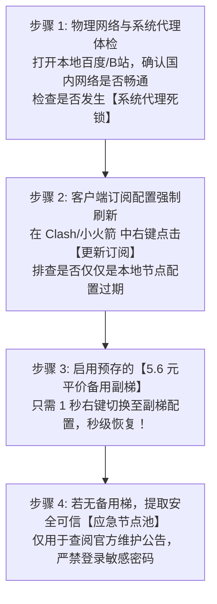
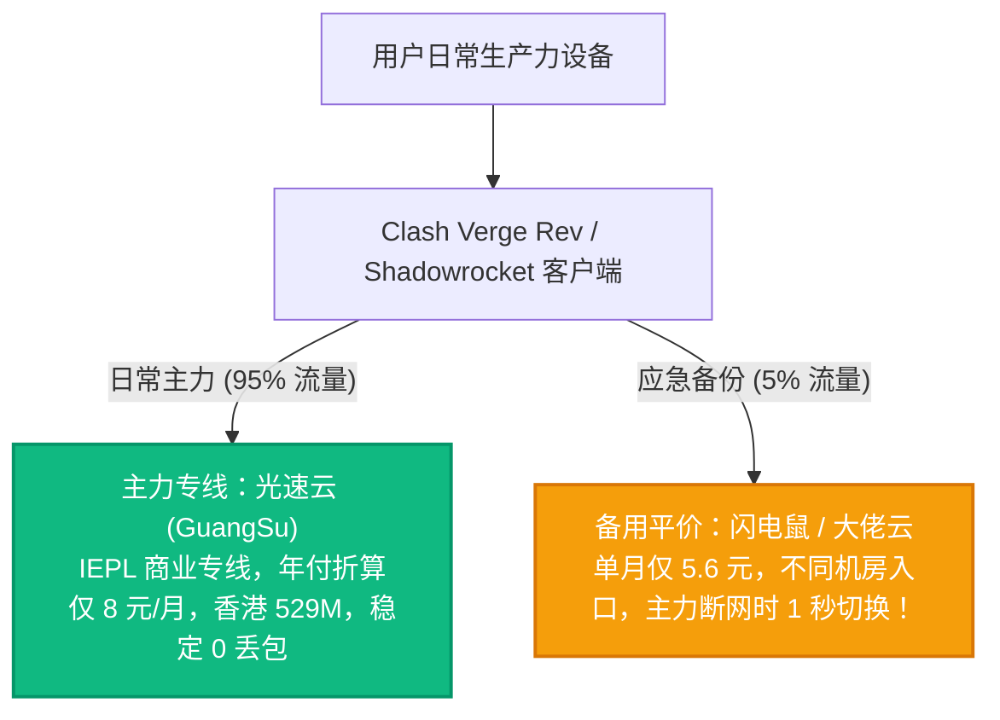

# 应急翻墙节点提取指南与低至 5.6 元商业平替方案：断网急救 SOP

应急急救专项 · AmyTelecom 实验室 2026 深度发布

没有任何一个互联网服务商敢承诺自己的网络能够做到 100.00% 绝对永不宕机。

无论是遭遇国际海底光缆被渔船锚断的不可抗力物理事故、持牌电信运营商的深夜骨干网突发例行检修、还是主力机场服务器遭遇大规模分布式拒绝服务攻击（DDoS），每一个跨国网络用户都有可能在某个关键的工作时刻，突然面临**“所有节点全红超时、连不上外网、客户紧急邮件发不出去”**的绝望窘境。

在这种紧急关头，如何迅速区分究竟是自己电脑的系统代理死锁、还是机场真的断线？如何安全、合规地在 3 分钟内提取临时代理解渴？

本篇专著由 AmyTelecom 实验室运维工程师撰写，为您呈现实战验证过的断网急救手册。

<PagefindSearch />

---

## 1. 突发断网 3 分钟四步自救 SOP (Direct Answer)

---

## 2. 步骤一：排除“虚假断网”——30 秒解决系统代理死锁

很多时候，并不是境外的机场坏了，而是您本地的电脑在意外关机或客户端闪退后，Windows 注册表中的代理开关未被正常还原，造成了“假死锁”（QQ 微信能发消息，但浏览器任何网页都打不开）。

### 极速修复代码：
按下键盘快捷键 `Win + R`，输入 `inetcpl.cpl` 打开 Internet 选项：
1. 点击 `连接` -> 点击右下角 `局域网设置`；
2. **坚决取消勾选“为 LAN 使用代理服务器”**；
3. 勾选“自动检测设置”，点击确定；
4. 此时重新打开浏览器，通常网络便能瞬间恢复。

---

## 3. 步骤二：安全获取公共应急节点规范

如果您手头的主力梯子确实因为上游机房故障而全线断网，且您手头没有任何备用梯，需要临时应急提取节点：

1. **认准 GitHub 开源项目**：优先寻找 Star 数量较多、历史更新频繁的开源节点聚合仓库，不要轻信 Telegram 野鸡频道里散布的带有乱码网址的未知订阅链接；
2. **严格单次使用原则**：应急节点导入客户端后，仅用于登录您主力机场的后台提工单、查看 Telegram 官方维护频道公告、或者查阅紧急资料；
3. **用完立即移除**：事情办妥后，在客户端中直接右键删除该应急配置卡片，切勿让其长期滞留在后台接管您的网络流量。

---

## 4. 彻底解决断网焦虑的终极解药：建立“主备双梯模型”

折腾应急节点终究是治标不治本的下策。网络工程师最核心的准则只有一条：**冗余备份（Redundancy）**。

搭建一套高可用性的跨境网络容灾系统，成本其实低得惊人：

- **主力专线首选**：**[光速云](/reviews/guangsu)**（自建深港 IEPL 专线，专属优惠码 `AMM`），保障日常 4K 串流与 AI 深度对话；
- **副梯备用首选**：**[闪电鼠](/reviews/shandianshu)**（5.6 元/月）或 **[大佬云](/reviews/dalaoyun)**（5.6 元/月），月付几块钱，常备无患，让您的数字生产力真正做到永不断联！

---

## 5. 全局导航与知识内链

- **免费节点三大致命陷阱**：[免费公共代理的三大致命陷阱与黑幕](/free-nodes/risks)
- **免费节点全景支柱页**：[2026 免费节点与公共翻墙代理全景](/free-nodes/)
- **5.6 元平价高性价比榜**：[5.6 元平价高性价比学生党机场推荐榜](/recommendations/budget-ranking)
- **企业专线巅峰榜**：[企业级 IEPL/IPLC 专线推荐榜](/recommendations/iepl-ranking)

<AffDisclaimer />
