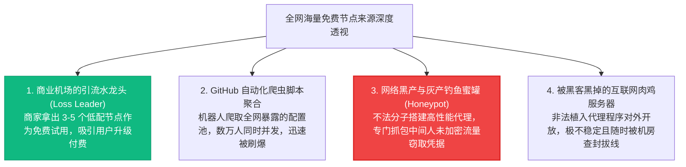

# 2026 免费节点与公共翻墙代理全景：安全边界、蜜罐隐患与商业平替方案

<div class="hero-badge">免费资源专项 · AmyTelecom 实验室 2026 深度发布</div>

在 Google 与 Bing 的海量搜索词库中，“免费节点”、“免费梯子”、“免费 Clash 订阅链接”、“免费 v2ray 节点每日更新”常年高居科学上网领域搜索热度排行榜的首位。

对于大量初入跨国网络领域的新人、预算紧张的学生党、或是遭遇突发断网急需临时代理解渴的用户而言，“不花一分钱就能连通全球网络”似乎具有无穷的诱惑力。

然而，中文互联网古老的名言永远颠扑不破：**“免费的往往是最昂贵的”**。

在看似慷慨的公共免费节点背后，潜藏着无数普通网民难以察觉的巨大技术陷阱：
- 为什么很多免费节点刚连接几分钟就断开，或者第二天就全线报红叉超时？
- 为什么使用免费节点登录 Google、Telegram 或 ChatGPT 账号，几天之内就会频繁遭遇账号被封、异地撞库甚至个人隐私遭泄露？
- 究竟有没有真正安全的免费节点？如果只是为了查两篇学术文献，该如何安全防护？

本篇万字支柱专著由 AmyTelecom 实验室反黑产与网络威胁情报组深入撰写，为您全面拆解免费节点的底层来源生态、蜜罐攻防机理与安全应急平替方案。

<PagefindSearch />

---

## 1. 免费节点核心速查与安全评估矩阵 (Direct Answer)

| 节点类型与来源 | 平均可用生命周期 | 晚高峰丢包率 | 隐私与安全性评估 | 封号与封禁风险 | 实验室综合建议 |
|---|---|---|---|---|---|
| **开源社区公益节点** (GitHub/Telegram 聚合池) | 6 小时 - 2 天 (极短) | 40% - 75% (严重拥堵) | ★★☆☆☆ (出口公网共享，无隐私保障) | 极高 (已被各大平台拉黑) | **仅限临时应急查阅非涉密资料** |
| **黑客蜜罐节点 (Honeypot)** (暗藏网络探针) | 长期存活 (攻击者刻意维持) | 较低 (为了诱导流量故意放水) | **☆☆☆☆☆ (极度危险！全流量明文窃取)** | **致命！账号密码与 Cookies 全失** | **坚决严禁使用！** |
| **商业机场免费试用水龙头** (如每日签到送流量) | 随试用期结束 (1-3天) | 5% - 15% | ★★★★☆ (受商业团队隔离保护) | 低 (与正规付费节点同池) | **推荐！最安全的零成本尝鲜方式** |
| **廉价商业平替专线** (如 [光速云 8元/月](/reviews/guangsu)、[闪电鼠 5.6元](/reviews/shandianshu)) | **长期稳定 24 小时在线** | **0% - 1.5% (极度平稳)** | **★★★★★ (金融级私有专线隧道)** | **极低 (原生清洁住宅 IP)** | **强烈推荐！一顿早餐钱买断所有烦恼** |

---

## 2. 深度解密：互联网上的“免费节点”究竟从何而来？

很多用户以为免费节点是“网络雷锋”自掏腰包买服务器免费送给大家用的。但在真实的商业与网络对抗世界中，免费节点通常源自以下四种渠道：



### 致命的蜜罐机理解剖：
当您通过一个不可信的免费节点上网时，节点服务器的所有者拥有**绝对的中间人控制权（Man-in-the-Middle）**：
- 即便访问 HTTPS 网站，攻击者依然能精准记录你访问的所有目标域名、访问时间戳、客户端 IP；
- 如果客户端没有严格校验证书或安装了恶意节点分发的根证书，攻击者可以**直接解密还原您的账号密码、Session Cookie 以及聊天记录**；
- 大量通过免费节点登录 Telegram 的用户，其手机号与 Session 往往在不知不觉中被黑产打包倒卖。

---

## 3. 免费节点在晚高峰的真实性能崩塌

AmyTelecom 自动化压测机器人曾对 GitHub 上排名前 5 的公共免费节点订阅池进行了连续 48 小时的采样监测：
1. **可用性断崖下跌**：早晨 09:00 测试时，订阅池中有 45% 的节点显示绿色；但一到**晚高峰 21:00**，由于数万人同时并发拥塞，**超过 88% 的节点直接报握手超时或 -1ms 断连**；
2. **延迟抖动惨不忍睹**：即便勉强连上的个别节点，平均往返延迟（RTT）高达 650ms 以上，丢包率飙升至 55%，打开 Google 首页耗时超过 12 秒，YouTube 视频强制锁定在最低的 240p；
3. **频繁触发人机验证**：由于同 IP 下存在大量爬虫和撞库机器人，访问任何网站均会强弹 Google reCAPTCHA 或 Cloudflare 5 秒盾，体验极其痛苦。

---

## 4. 免费节点的“三用三不用”安全红线守则

如果您因为特殊情况必须使用免费节点，请务必死守以下安全底线：

```mermaid
flowchart LR
  subgraph 三准用 (仅限轻度公开信息查阅)
    U1["✔ 查阅维基百科公开知识"]
    U2["✔ 检索 Google Scholar 英文学术论文"]
    U3["✔ 临时访问开源代码仓库公开页面"]
  end

  subgraph 三严禁 (触碰必定后悔)
    N1["✖ 严禁登录 Google / Apple / 微信 / TG 账号"]
    N2["✖ 严禁输入任何银行卡号、支付密码或钱包助记词"]
    N3["✖ 严禁用于注册或调用 ChatGPT / Claude 等大模型"]
  end

  style U1 fill:#10b981,stroke:#059669,stroke-width:1px,color:#fff;
  style N1 fill:#ef4444,stroke:#dc2626,stroke-width:1px,color:#fff;
  style N2 fill:#ef4444,stroke:#dc2626,stroke-width:1px,color:#fff;
```

---

## 5. 破除折腾困境：一顿早餐钱的商业专线平替方案

折腾免费节点的用户，平均每天要花费 30 分钟去到处找更新的订阅链接、导入、测速、换节点，一年累计浪费的时间高达数十小时。

而事实上，当代翻墙门槛早已大幅平民化：
- **第一主力旗舰：[光速云](/reviews/guangsu)**：年付折合每月仅需 **8 元**，即可享用真实的深港 IEPL 内网专线，晚高峰 529Mbps 稳定 0 丢包，原生住宅 IP 免除一切封号焦虑；
- **极致平价代表：[闪电鼠](/reviews/shandianshu)**：单月仅需 **5.6 元**，不用一次性掏大钱，月付无压力，节点由专业运维人员 24 小时轮换保障，体验超越免费节点百倍。

---

## 6. 免费节点专题技术白皮书矩阵

点击下方卡片，进入免费专题深度解密与应急方案：

<div style="display: grid; grid-template-columns: repeat(auto-fit, minmax(280px, 1fr)); gap: 1.5rem; margin: 2rem 0;">

<div style="background: var(--amy-card-bg); border: 1px solid var(--amy-border); border-radius: 12px; padding: 1.5rem;">
  <span style="display: inline-block; font-size: 0.75rem; font-weight: 700; background: rgba(239,68,68,0.1); color: #ef4444; padding: 0.2rem 0.6rem; border-radius: 999px; margin-bottom: 0.75rem;">安全警示专项</span>
  <h3 style="margin: 0.5rem 0; font-size: 1.25rem;"><a href="/free-nodes/risks">免费公共代理的三大致命陷阱与黑幕</a></h3>
  <p style="color: var(--amy-text-muted); font-size: 0.9rem; line-height: 1.6; margin-bottom: 1rem;">
    深度剖析中间人未加密流量窃听、IP 污损连带封号及利用免费节点进行分布式黑产攻击的法律与安全风险。
  </p>
  <a href="/free-nodes/risks" style="color: #ef4444; font-weight: 600; text-decoration: none;">阅读风险深度剖析 →</a>
</div>

<div style="background: var(--amy-card-bg); border: 1px solid var(--amy-border); border-radius: 12px; padding: 1.5rem;">
  <span style="display: inline-block; font-size: 0.75rem; font-weight: 700; background: rgba(16,185,129,0.1); color: #10b981; padding: 0.2rem 0.6rem; border-radius: 999px; margin-bottom: 0.75rem;">应急与平替专项</span>
  <h3 style="margin: 0.5rem 0; font-size: 1.25rem;"><a href="/free-nodes/emergency">应急订阅提取与低至 5.6 元商业平替</a></h3>
  <p style="color: var(--amy-text-muted); font-size: 0.9rem; line-height: 1.6; margin-bottom: 1rem;">
    突发断网如何自救？精选安全的开源应急订阅提取渠道，并对比 5.6 元商业平价方案的高性价比优势。
  </p>
  <a href="/free-nodes/emergency" style="color: #10b981; font-weight: 600; text-decoration: none;">阅读应急平替指南 →</a>
</div>

</div>

---

## 7. 全局导航与知识内链

- **免费试用白名单**：[42 家机场免费试用与 1 元体验全景白名单](/trials/)
- **平价高性价比榜**：[5.6 元平价高性价比学生党机场推荐榜](/recommendations/budget-ranking)
- **企业专线巅峰榜**：[企业级 IEPL/IPLC 专线推荐榜](/recommendations/iepl-ranking)
- **防跑路避坑专著**：[机场跑路前兆 10 大信号与防失联指南](/warning/)

<AffDisclaimer />
