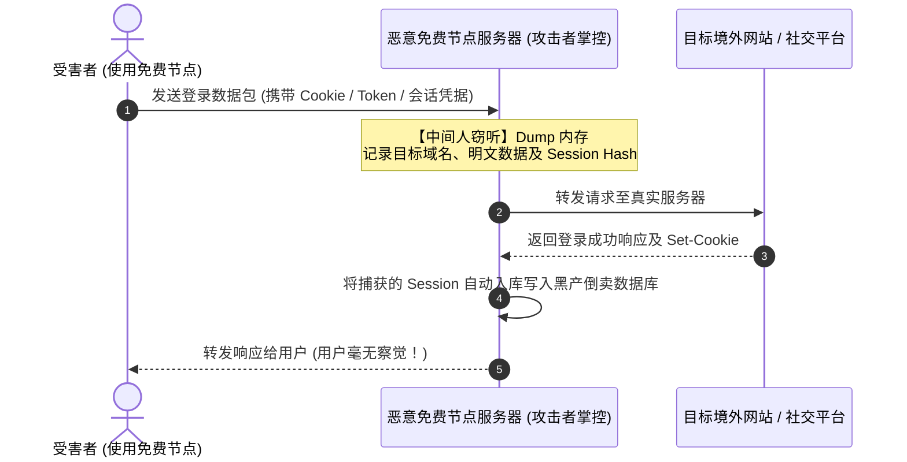

# 免费公共代理的三大致命陷阱与黑幕：中间人抓包、蜜罐探针与连带封号深度解密

威胁情报专项 · AmyTelecom 实验室 2026 深度发布

许多刚刚接触跨境网络的用户往往心存侥幸：“我只是用免费节点随便看看网页，不涉及什么机密，黑客就算抓包能对我造成什么损失呢？”

这种轻视心理，恰恰是网络黑产从业者最渴望看到的猎物状态。

在过去的几年里，AmyTelecom 实验室配合多家网络安全应急团队，处置了大量因使用公共免费节点导致的资产失窃与账号风控案件。

**公共免费节点不仅在体验上极不稳定，更在数据链路层潜藏着三大致命的安全深渊。**

<PagefindSearch />

---

## 1. 致命陷阱一：中间人攻击 (MITM) 与凭据嗅探

当你的电脑或手机接入一个免费节点时，你发送的每一个数据包，物理上都必须经过节点服务器的网卡进行解密转发。

### 真实黑幕剖析：
1. **未加密流量裸奔**：在非 HTTPS 或未严格校验证书的通道中，所有请求的内容（表单密码、私聊消息、访问历史）在节点管理员眼里完全是明文呈现；
2. **Session Hijacking (会话劫持)**：攻击者根本不需要知道你的密码明文！只要通过节点抓包获取了你在 Google、Twitter、Telegram 或币安上的登录身份凭证（Session Cookie / Bearer Token），攻击者即可在自己的浏览器中直接克隆你的登录状态，绕过两步验证（2FA）并接管你的账号；
3. **恶意注入脚本**：部分恶劣的免费代理会动态篡改 HTML 响应，向用户浏览的网页中强行插入恶意挖矿脚本（Crypto Miner）或虚假钓鱼弹窗，诱导用户下载木马程序。

---

## 2. 致命陷阱二：IP 声誉彻底破产与全平台连带封禁

免费节点的 IP 地址通常长期暴露在公共 GitHub 仓库和 Telegram 频道中，每天有成千上万个恶意脚本、爬虫工具和黑产机器人在利用这些 IP 发起暴力破解、垃圾邮件轰炸和自动化注册。

### 带来的毁灭性后果：
- **IP 欺诈分高达 99 (Max Risk)**：全球知名威胁情报库（Spamhaus、Cloudflare Threat Intelligence、MaxMind）早已将这些 IP 列入最高危黑名单；
- **AI 账号秒级封停**：如果你在免费节点上登录 OpenAI、Claude 或 Midjourney，平台的自动化风控系统会在毫秒级时间内检测到该请求来自一个“已被列入欺诈黑名单的脏 IP”，直接触发静默封号（Account Suspended），充值的会员费用全数打水漂；
- **全网疯狂弹验证码**：即使仅仅使用 Google 搜索，也会频繁弹出极其复杂的九宫格人机验证，甚至直接报错 `403 Forbidden`。

---

## 3. 致命陷阱三：安全蜜罐与法律连带风险

并非所有的免费节点都由民间极客搭建。在复杂的网络攻防博弈中，相当一部分长期存活、速度奇快、带宽异常充裕的“高质量免费节点”，实际上是**专业机构或黑产团伙特意布置的网络蜜罐（Honeypot）**。

- **行为轨迹全量审计**：蜜罐服务器会配置高精度的流量分析探针，完整记录每一个接入 IP 的真实来源、MAC 地址指纹、访问的目的地与上线下线时间，形成详尽的取证日志；
- **充当黑产跳板与连带责任**：部分不法分子将免费节点作为“代理链”的前置跳板。当黑客利用该节点向第三方发起勒索攻击或入侵时，机房排查日志往往会追溯到同时使用该节点的普通用户的真实 IP，引发无妄之灾。

---

## 4. 彻底脱离风险的黄金法则

1. **绝对不在免费节点上登录任何需要账号密码的系统**；
2. **切勿安装任何声称“免费加速”但要求安装自定义根证书 (Root CA) 的可疑软件**；
3. **建立理性的成本认知**：每月只需花费几元钱（如 [光速云](/reviews/guangsu) 或 [闪电鼠](/reviews/shandianshu)），即可获得完全属于自己的独立专线通道与干净住宅 IP，彻底斩断一切安全与隐私隐患。

---

## 5. 全局导航与知识内链

- **免费节点应急指南**：[应急订阅提取与低至 5.6 元商业平替](/free-nodes/emergency)
- **免费节点全景支柱页**：[2026 免费节点与公共翻墙代理全景](/free-nodes/)
- **避坑防跑路专著**：[机场跑路前兆 10 大信号与防失联指南](/warning/)
- **返回 42 家品牌库**：[42 家机场综合推荐天梯总览](/recommendations/)

<AffDisclaimer />
