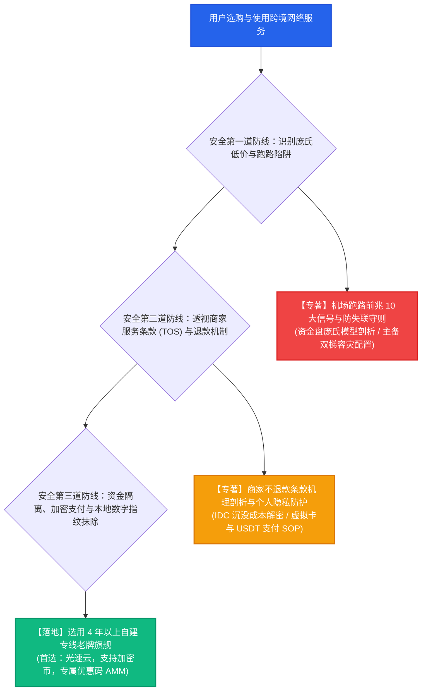

# 机场避坑与安全指南总览：资产保全、商业防诈与个人隐私防线

安全避坑枢纽 · AmyTelecom 实验室 2026 深度发布

在庞大而隐秘的跨境网络消费市场中，伴随高速连接需求的，往往是良莠不齐的商家信誉、暗藏猫腻的霸王条款、甚至是恶意卷款潜逃的庞氏资金盘骗局。

很多刚接触科学上网的用户，因为缺乏对行业底层运作规律的深刻认知，常常在冲动消费中踩中巨坑：
- 看到“超低价大促销”便一口气充值数年，结果不到三个月商家直接删库失联；
- 遭遇服务不可用时试图申请退款，却发现面临“概不退款”的冰冷拒绝；
- 在注册与支付时使用真实个人信息和实名支付宝，为日后的金融反洗钱风控和隐私泄露埋下严重隐患。

**科学上网，安全永远是第一位的生产力前提。**

本枢纽聚合了 AmyTelecom 实验室历年撰写的安全防范专著，为您系统筑起涵盖**“事前资金防损”、“事中规则避坑”与“事后隐私防御”**的全闭环安全护城河。

<PagefindSearch />

---

## 1. 跨境网络安全三维防御架构

---

## 2. 避坑安全深度技术白皮书矩阵

点击下方卡片，进入由 AmyTelecom 实验室安全测试组撰写的深度技术专著：

  资金安全专项
  <h3 style="margin: 0.5rem 0; font-size: 1.25rem;"><a href="/guides/runaway-warning">机场跑路前兆识别与防失联守则</a></h3>
  

    深度剖析 5 元 1000G 资金盘庞氏模型的必然崩塌轨迹。归纳 10 大跑路前兆异动信号，提供主备双梯 1 秒容灾切换实操。
  

  <a href="/guides/runaway-warning" style="color: #ef4444; font-weight: 600; text-decoration: none;">阅读万字技术专著 →</a>

  商业与隐私专项
  <h3 style="margin: 0.5rem 0; font-size: 1.25rem;"><a href="/guides/refund-privacy">商家不退款条款机理与隐私防护</a></h3>
  

    揭秘 IDC 预付带宽沉没成本与反黑产逻辑。提供 USDT 加密货币支付、瑞士 Proton 匿名邮箱及 WebRTC 穿透封堵方案。
  

  <a href="/guides/refund-privacy" style="color: #10b981; font-weight: 600; text-decoration: none;">阅读万字技术专著 →</a>

---

## 3. 全局导航与知识内链

- **专线物理原理解密**：[IEPL vs IPLC 专线内网原理解密与 0 丢包真相](/protocols/iepl-iplc)
- **AI 生产力选型指南**：[ChatGPT & Claude 原生纯净 IP 选型全攻略](/scenarios/ai-tools)
- **全平台客户端配置**：[Windows / macOS / iOS / Android / OpenWrt 客户端手册](/clients/)
- **查看 42 家机场品牌库**：[42 家机场全景天梯榜与专属优惠码](/reviews/)

<AffDisclaimer />
