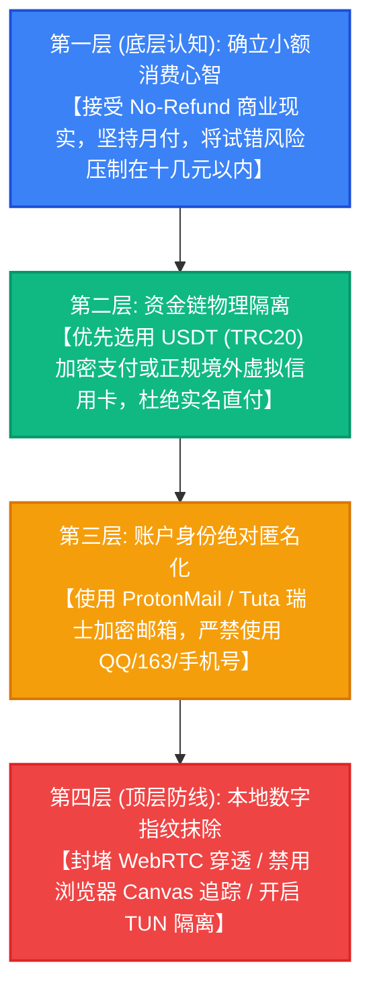
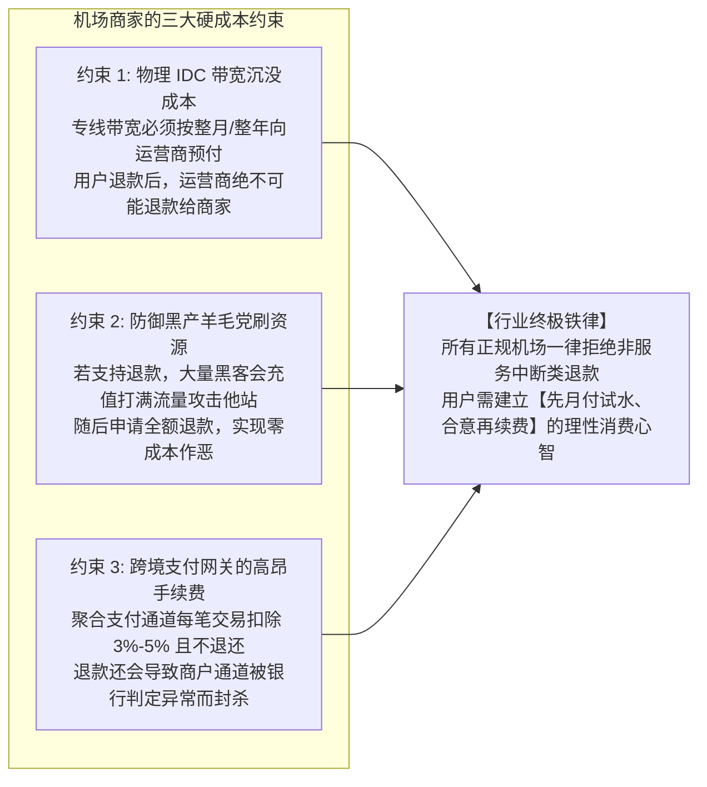
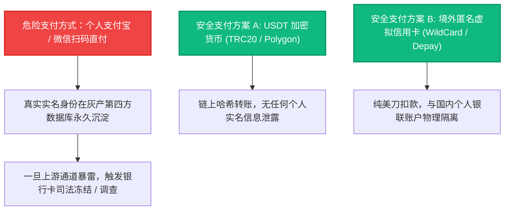

# 商家不退款条款机理剖析与个人数字隐私防护：虚拟卡、加密货币支付与反向指纹追踪抹除

避坑安全专项 · AmyTelecom 实验室 2026 深度发布

在购买跨境网络加速服务时，几乎每一位用户都会在商家的服务条款（TOS - Terms of Service）最显眼处看到这样一条“冷酷”的声明：**“由于数字商品的特殊性，服务一经开通或售出，概不支持任何形式的退款”**。

不少新手消费者对此感到愤愤不平：“凭什么电商网购都有 7 天无理由退款，机场却强制不退款？这是霸王条款吗？”
而在支付与注册环节，更多用户则在无意识中犯下了致命的隐私安全错误：
- 直接使用绑定了自己身份证的个人支付宝或微信扫码直付；
- 使用自己最常用的 QQ 邮箱或网易 163 邮箱作为机场登录账号；
- 全网使用同一套密码，导致某家小型机场数据库被黑客“脱裤（数据泄露）”后，连带个人其他账号遭遇毁灭性撞库。

**为什么机场行业普遍坚守“不退款”铁律？背后有怎样的财务与黑产防范逻辑？如何在购买与使用机场的全流程中，做到真正的“数字痕迹零暴露”？**

本篇万字专著由 AmyTelecom 实验室数字取证与隐私工程安全组联合编撰，为您全面拆解机场商业规则真相，并交付一套金融级的个人隐私防护防御方案。

<PagefindSearch />

---

## 1. 核心选型结论与个人隐私安全金字塔 (Direct Answer)

为了保护每一位跨国网络用户的财产与人身信息安全，AmyTelecom 实验室提出以下“隐私防御四层金字塔”：

---

## 2. 商业解密：为什么 99% 的机场都坚决执行“一律不退款”？

表面上看，“概不退款”似乎是商家的傲慢。但只要深入机房底层的真实运营成本账目，就会发现这是由**基础设施沉没成本**与**对抗网络黑产恶意滥用**共同决定的必然法则：

### 深度剖析三大不可调和的矛盾：
1. **上游机房的预付账期约束**：无论是向中国电信租用广州 BGP 入口，还是采购深港物理 IEPL 陆缆光纤，机房合同均要求**“先付款、后开通，且按月按年锁定”**。商家已经将这笔真金白银转交给了电信运营商，用户如果使用三天后申请退款，这笔沉没成本只能由商家完全自掏腰包承担；
2. **防范黑客与爬虫的恶意“零元购”**：如果支持无理由退款，某些从事黑灰产的黑客团队会编写自动化脚本，购买月付套餐后在两小时内利用千兆带宽跑满数万次扫描或爬取海量数据，随后立即发起退款。若无退款门槛，机场的服务器资源将在数日内被黑产羊毛党彻底薅秃瘫痪；
3. **支付通道被封的系统性风险**：第三方跨境聚合支付通道对“退款率（Refund Rate）”有着极其严苛的监控。一旦商户退款率超过 1%，支付机构的风控系统会自动冻结该商户后台的所有沉淀资金，导致全站资金链瞬间断裂。

---

## 3. 支付环节的生死防线：告别实名直付的高危隐患

这是绝大多数普通用户最容易忽略、却最具破坏性的潜在危机！

国内很多平价小机场接入了所谓的“个人免签二维码”或“第四方聚合支付”。
- 当你掏出手机打开支付宝或微信扫描二维码付款时，**你的真实姓名、支付宝账号、交易流水单号已经完完整整地被记录在了第四方收款平台的数据库中**；
- 一旦该机场或第四方收款通道因涉及其他涉诈洗钱案件被司法经侦机关立案侦查，该收款通道名下的所有往来账户均会触发**大数据关联查询甚至银行卡反洗钱风控冻结（司法冻结 6 个月）**！

### 推荐安全支付实操指南：
1. **USDT (TRC20) 加密货币支付（最高安全级别）**：在主流交易所或去中心化钱包中准备少量 USDT，在购买机场（如 [光速云](/reviews/guangsu) 等支持加密货币的成熟大站）时直接通过波场 TRC20 链上转账。整个交易记录仅存在于区块链公链上，彻底斩断任何现实实名身份关联；
2. **隔离小额支付卡**：如果实在只能使用支付宝，建议开通一张专门用于小额日常消费的二类银行电子账户（单日限额数百元），且不要在卡内存放任何大额资金。

---

## 4. 账户注册防御：四步彻底切断数字指纹追踪

为了防止因机场数据库泄漏导致个人信息失窃，请务必执行以下注册防护规范：

### 规范 1：坚决摒弃国内邮箱，选用瑞士加密邮箱
严禁使用含有个人真实信息的 QQ 邮箱（直接暴露 QQ 号）、163 邮箱或手机号注册任何机场！
推荐免费注册 **ProtonMail (`proton.me`)** 或 **Tuta (`tuta.com`)**：
- 注册 Proton 邮箱无需任何手机号或实名手机短信验证；
- 邮箱服务器位于永久中立国瑞士，物理磁盘全盘加密，支持端到端零知识传输。

### 规范 2：全平台独立密码（使用密码管理器）
不要使用与自己的 Apple ID、微信、淘宝相同的日常密码。使用 Bitwarden、1Password 或系统自带钥匙串生成 **16 位以上的高强度完全随机密码**（如 `aK9#mQ2$zL8@pW4!`），即使某家小机场被拖库，其他任何账户依然安如泰山。

### 规范 3：禁用客户端日志上传与 WebRTC 穿透
在客户端（如 Clash Verge Rev、v2rayNG）设置中：
1. 将 `日志级别 (Log Level)` 从 `Debug/Info` 修改为 **`Silent` 或 `Error`**，防止本地磁盘持续记录访问过的敏感域名；
2. 在 Chrome 浏览器安装隐私插件（如 WebRTC Control），彻底禁用非代理接口的 UDP 探测，杜绝真实局域网 IP 与公网 IP 外泄。

---

## 5. 隐私与安全高频 FAQ

### Q1：光速云 (GuangSu) 在隐私安全方面做得怎么样？
**解答**：作为本站第一首选主推的旗舰品牌，[光速云](/reviews/guangsu) 在隐私合规方面表现出众：
1. 支持纯匿名 Proton 邮箱注册，无需任何手机实名；
2. 网站后台已全面升级为数据库加密存储，密码经过高强度 Argon2/Bcrypt 哈希单向不可逆加密；
3. 提供 USDT 加密货币专属通道与专属优惠码 `AMM`，极大保障了高价值专业用户的资金与身份绝对隐秘性。

---

## 6. 结语与内链导航

在信息时代，隐私不是做贼心虚的掩饰，而是每一位现代数字公民理应捍卫的尊严与基本人权。

- **专线物理原理解密**：[IEPL vs IPLC 专线内网原理解密与 0 丢包真相](/protocols/iepl-iplc)
- **跑路前兆避坑守则**：[机场跑路前兆 10 大信号与防失联指南](/guides/runaway-warning)
- **AI 生产力大模型环境**：[ChatGPT & Claude 原生纯净 IP 选型全攻略](/scenarios/ai-tools)
- **返回 42 家品牌库大名单**：[查看 42 家机场品牌库与天梯排行](/reviews/)

<AffDisclaimer />
