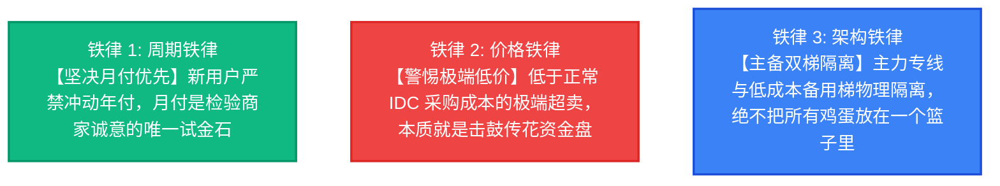
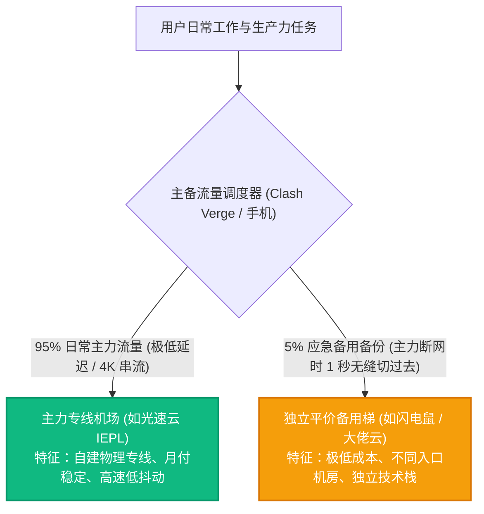

# 机场跑路前兆识别与防失联守则：资金盘庞氏模型剖析、10 大危险信号与双备份容灾指南

<div class="hero-badge">避坑安全专项 · AmyTelecom 实验室 2026 深度发布</div>

在跨境网络翻墙领域，“机场跑路”是每一个老玩家心头挥之不去的阴影。

从早期轰动全网的“速鹰 666”、“速蛙云”、“喵帕斯”，到几乎每个月都在默默蒸发的大量不知名小型作坊，翻墙机场的生命周期往往短得惊人——据统计，市场上超过 70% 的新兴低价机场在运营不到一年时间内便会以“卷款消失”、“上游拔线”或“域名失联”而告终。

每一次跑路背后，都是成千上万名提前支付了一年甚至数年会员费的无辜用户在网络维权群里欲哭无泪、怒骂维权无门。

**为什么机场会频繁跑路？为什么“5 元一个月 1000G 带宽”在数学上注定是庞氏骗局？商家在卷款跑路前有哪些极其反常的危险信号？如何建立坚不可摧的“双备份容灾体系”？**

本篇万字专著由 AmyTelecom 实验室反黑产与网络经济学研究组倾力编撰，为您彻底掀开机场灰产背后的真实财务底牌，筑牢个人资产与网络连接的绝对安全防线。

<PagefindSearch />

---

## 1. 核心避险法则与安全品牌速查 (Direct Answer)

为了让急于选购机场的用户迅速避开巨坑，我们首先给出防跑路安全三大铁律：



| 品牌安全等级 | 典型特征 | 跑路风险评估 | 支付周期建议 | 代表品牌参考 |
|---|---|---|---|---|
| **第一级：老牌合规主力** | 稳定运营 4 年以上，自建 IEPL 专线，拥有独立技术运维团队 | **极低 (< 1%)** | 推荐月付，熟客可考虑大周期年付 | **[光速云](/reviews/guangsu)** (2020老牌至今) |
| **第二级：成熟商业梯队** | 运营 2-3 年，节点动态调度，客服工单响应在数小时内 | **较低 (约 5%)** | 建议以月付或季度付为主 | **[速界](/reviews/sujie)**、**[微风网络](/reviews/weifeng)** |
| **第三级：平价新秀观察期** | 5.6 元档位，运营时间 1 年左右，用户量快速增长中 | **中等 (约 20%)** | **坚决严禁年付，仅限单月小额支付** | **[闪电鼠](/reviews/shandianshu)**、**[大佬云](/reviews/dalaoyun)** |
| **第四级：野鸡快餐小作坊** | 成立不足半年，群主匿名，常年举办买一送一骨折促销 | **极高 (> 70%)** | 随时卷款蒸发，不要充值任何金额 | 各类 TG 频道野鸡小广告 |

---

## 2. 经济学解剖：为什么“5 元 1000G”在数学上注定跑路？

很多小白用户经常问：“为什么有些机场一个月只要几块钱，流量给到 1000G 甚至无限量，他们难道不赚钱吗？”
答案是：**他们从一开始就没打算长期提供服务，而是在玩一场精密的“庞氏资金盘（Ponzi Scheme）”**。

```mermaid
flowchart TD
  subgraph 真实的 IDC 物理成本 (硬约束)
    C1["国内 BGP 入口机房带宽: 约 15-25 元/Mbps/月"]
    C2["跨境 IEPL 商业专线带宽: 约 60-120 元/Mbps/月"]
    C3["海外落地机房服务器租金 + IP 采购"]
  end

  subgraph 庞氏低价机场的跑路轨迹
    T1["阶段 1: 推出超低价套餐 (5元/月，50元终身)<br>疯狂在各大论坛发帖拉新"] --> T2["阶段 2: 早期少量用户涌入，利用前人资金补贴带宽<br>营造虚假极速口碑"]
    T2 --> T3["阶段 3: 用户暴增，带宽成本呈几何级数爆炸<br>服务器严重超载，晚高峰卡死"]
    T3 --> T4["阶段 4: 蓄意发起【双十一/春节终极大促】<br>收割最后一波大额年费"]
    T4 --> T5["【终局】拔掉网线，删除数据库，解散群组，携款潜逃！"]
  end

  style T5 fill:#ef4444,stroke:#dc2626,stroke-width:3px,color:#fff;
```

### 数学账本算给你看：
1. 一条真正的 **1Gbps (千兆) IEPL 专线**，向持牌运营商正规采购的月度支出高达 **数万元人民币**；
2. 如果商家卖 5 元/月，他需要至少 **1 万名以上** 付费用户才能勉强打平专线与服务器租金成本；
3. 但 1 万名用户如果同时在晚高峰看视频，1Gbps 带宽人均只能分到 **0.1Mbps (相当于 10KB/s)**，网络必定瞬间瘫痪；
4. 为了不瘫痪，商家就必须虚标参数、进行百倍甚至千倍的疯狂“超卖（Overselling）”；
5. **当新涌入用户的会费无法覆盖老用户的带宽账单时，资金链断裂是唯一的物理宿命**。卷款潜逃不是商家的临时起意，而是从套餐定价那一秒起就写好的终局剧本。

---

## 3. 机场跑路前兆：10 大高危信号深度透视

根据 AmyTelecom 实验室对过去三年数十起重大跑路事件的样本追踪，商家在彻底人间蒸发前，往往会表现出以下 10 大特征：

| 危险序号 | 异动信号表现 | 危险指数 | 底层真实黑幕分析 |
|---|---|---|---|
| **信号 1** | **突然发起反常的“骨折级”促销** (如买一年送一年、终身 1折) | 🚨🚨🚨🚨🚨 | **这是最经典的跑路回光返照信号！** 意图在关门前收割最后一茬大额年付现金流。 |
| **信号 2** | **官方 Telegram 交流群开启“全员禁言”** 或开启严格慢速模式 | 🚨🚨🚨🚨🚨 | 大量节点故障引发用户抱怨，管理人员无法解决，为了掩盖真相直接封堵言论。 |
| **信号 3** | **节点大面积超时红叉，借口“上游被打”持续 2 周以上** | 🚨🚨🚨🚨☆ | 实际上是因为欠费被 IDC 上游机房强制停机拔线，商家根本无力或不愿续费。 |
| **信号 4** | **工单客服从“几分钟响应”恶化为“已读不回”** | 🚨🚨🚨🚨☆ | 核心运维团队已经解散或开始准备转移资产，仅留机器人应付。 |
| **信号 5** | **频繁更换官网域名与收款账户** | 🚨🚨🚨☆☆ | 收款通道因高频洗钱或投诉被第三方支付机构持续冻结，资金链处于崩溃边缘。 |
| **信号 6** | **悄悄取消所有“单月付”选项，仅保留年付或三年付** | 🚨🚨🚨🚨🚨 | 彻底放弃长期运营，全力强迫新老用户进行长期锁定充值。 |
| **信号 7** | **管理团队核心成员在群内公开吵架或退群** | 🚨🚨🚨🚨☆ | 股东分赃不均、跑路分歧表面化，通常在数天之内服务就会猝死。 |
| **信号 8** | **突然宣布“全面被黑客脱裤勒索”，要求用户等待** | 🚨🚨🚨☆☆ | 很多不良站长自导自演“被黑”戏码，为合情合理跑路提供免责借口。 |
| **信号 9** | **大幅削减主力专线节点，全部换成廉价公网直连** | 🚨🚨🚨☆☆ | 专线已经退租，用廉价公网 VPS 勉强支撑表面门面。 |
| **信号 10** | **网站后台的用户总数、流量审计等公开统计组件突然被隐藏** | 🚨🚨☆☆☆ | 试图掩盖老用户大量流失的真实运营颓势。 |

---

## 4. 用户容灾工程：构建“主备双梯”永不失联体系

对于将跨境网络作为核心工作武器的外贸业务员、跨境电商运营者、AI 算法工程师以及留学生而言，网络断联半天可能就意味着成千上万的经济损失。

**建立坚不可摧的“双梯容灾体系”是唯一解法**：



### 双梯配置实操 SOP：
1. **主备品牌必须完全独立**：千万不要购买同一家集团旗下的“马甲子品牌”，因为上游专线一旦被拔，两个马甲会同时猝死。主梯选用 **[光速云](/reviews/guangsu)** 这种成熟稳定的 IEPL 老牌，副梯选用第二梯队的按量计费套餐或 5.6 元小额平价机场；
2. **在客户端中合并配置**：在 Clash Verge Rev 或 Shadowrocket 中同时下载并保存两个订阅配置。一旦主力梯子遇到突发骨干网维护，鼠标右键只需 1 秒钟即可切换至副梯，从容应对一切网络黑天鹅事件。

---

## 5. 避坑问答 FAQ

### Q1：如果不幸遇到机场跑路，还有可能退款或者报警维权吗？
**解答**：**基本不可能**。绝大多数机场运营者均使用境外匿名身份、Proton 匿名邮箱、并通过境外虚拟币或第三方第四方聚合支付接口结算。国内公安机关对此类未持牌跨境代理服务的交易在法律层面通常不予民事经济纠纷立案，甚至存在涉行政处罚的风险。因此，唯一的止损手段就是**坚持月付，将潜在损失死死锁定在一顿快餐钱之内**。

---

## 6. 结语与内链导航

在充满不确定性的网络丛林中，清醒的理性认知是最好的护身符。拒绝脱离物理成本常识的低价贪婪，选择透明、稳健、经得起时间检验的老牌服务商。

- **专线物理原理解密**：[IEPL vs IPLC 专线内网原理解密与 0 丢包真相](/protocols/iepl-iplc)
- **商家条款与隐私保护**：[机场不退款条款辨析与个人数字隐私防护](/guides/refund-privacy)
- **场景选型全景指南**：[场景选型知识库：AI 与 4K 真实需求匹配](/scenarios/)
- **查看 42 家机场品牌库**：[42 家机场全景天梯榜与专属优惠码](/reviews/)

<AffDisclaimer />
