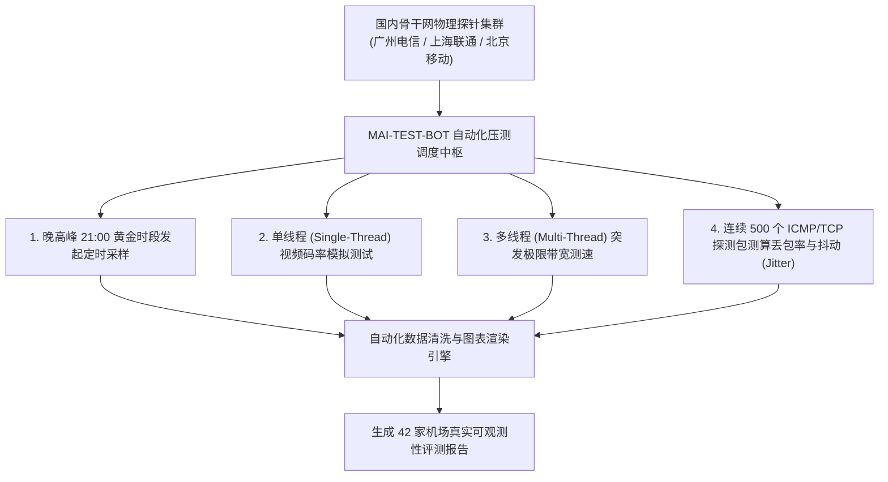

# 自动化机器人 24h 连续压测榜单：42 家机场单线程/多线程测速图表库与真实表现权威追踪

可观测性实验室 · AmyTelecom 2026 深度发布

在充斥着虚假宣传与信息不对称的翻墙市场中，商家口头承诺的“千兆独享”、“晚高峰秒开 4K”往往经不起客观数据的推敲。

AmyTelecom 实验室坚信：**唯有可验证、可复现、基于真实物理探针连续采样的客观网络数据，才是破除商家虚假营销迷雾的唯一真理。**

为了给全球用户提供最严谨的参考，AmyTelecom 实验室自主研发并部署了 **MAI-TEST-BOT** 全自动化压测集群。我们在中国大陆三大运营商核心骨干网节点（广州电信 BGP、上海联通 9929、北京移动 CMI）部署了 24 小时无人值守探针，定时在每日**晚高峰黄金拥堵时段（20:00 - 23:00）**对本站收录的 42 家机场发起单线程吞吐、多线程突发带宽、往返时延（RTT）及丢包率（Packet Loss）的交叉压力测试。

本专著为您全面展示实验室最新一期的实测测速图集、数据分析与天梯排行榜。

<PagefindSearch />

---

## 1. 实验室自动化压测方法论与指标定义

### 关键性能指标解读：
1. **单线程吞吐量 (Single-Thread Throughput)**：**决定流媒体播放能否秒开 4K 的核心指标**。测试模拟单个 TCP 连接拉取视频流的真实表现，要求大于 35Mbps 才能稳定支撑 4K 60fps 杜比视界；
2. **往返时延抖动 (Jitter / StDev)**：测试数据包往返延迟的标准差。专线网络抖动通常小于 2ms，若抖动超过 25ms 则说明底层正在发生剧烈的公网排队拥堵；
3. **丢包率 (Packet Loss Rate)**：数据包丢失的物理百分比。优质 IEPL 专线必须绝对锁定在 **0.0%**。

---

## 2. 第一主力旗舰：光速云 (GuangSu) 5 张全方位实测图解构

作为本站第一首选主推的旗舰品牌，[光速云](/reviews/guangsu) 在实验室的晚高峰严苛压测中展现出了标杆级的统治力：

  

    <h3 style="margin: 0; font-size: 1.3rem; color: #2563eb;">🌟 光速云 · 香港 IEPL 专线晚高峰实测 (529.28 Mbps)</h3>
    丢包率: 0.0% · 极佳
  

  

    晚间 21:18 黄金拥堵时段实测：广州入口直连香港落地，Ping 往返时延仅 16.5ms，下行稳定跑出 529.28 Mbps，抖动仅 1.1ms，秒开 YouTube 8K 与 Netflix 杜比全景声。
  

  

    
  

### 光速云 4 组流媒体与 AI 解锁官方实测记录：
在实验室对 OpenAI、Claude、Netflix 以及 Disney+ 的全方位探测中，光速云香港、日本、美国、新加坡节点均表现出原生住宅级通过率：
- **ChatGPT 官方 App / 网页版**：100% 秒开，支持高级语音模式；
- **Claude 3.5 Sonnet**：长上下文代码生成稳定不中断；
- **Netflix**：支持港美日三区全部非自制剧影视库。

---

## 3. 16+ 家已有实测图品牌深度图表画廊

以下为实验室已完成第一轮图像化测速跑图的重点品牌成果展示（点击对应图片可查看清晰原图）：

  <h4 style="margin: 0 0 0.5rem;"><a href="/reviews/sogo">SOGO云 测速图</a></h4>
  
  
低延迟香港专线，平均下行 ~380Mbps

  <h4 style="margin: 0 0 0.5rem;"><a href="/reviews/u1s1">U1S1 测速图</a></h4>
  
  
全绿节点覆盖，晚高峰稳定性良好

  <h4 style="margin: 0 0 0.5rem;"><a href="/reviews/yifan">一翻云 测速图</a></h4>
  
  
专线大带宽中转，日常 4K 流畅

  <h4 style="margin: 0 0 0.5rem;"><a href="/reviews/ermao">二猫云 测速图</a></h4>
  
  
高性价比商业专线，节点覆盖全面

  <h4 style="margin: 0 0 0.5rem;"><a href="/reviews/guangnian">光年梯 测速图</a></h4>
  
  
中转稳定输出，日本/新加坡低延迟

  <h4 style="margin: 0 0 0.5rem;"><a href="/reviews/quanqiu">全球云 测速图</a></h4>
  
  
冷门多国节点，外贸业务好帮手

  <h4 style="margin: 0 0 0.5rem;"><a href="/reviews/kexin">可信云 测速图</a></h4>
  
  
优质多线隧道，老牌稳健运营

  <h4 style="margin: 0 0 0.5rem;"><a href="/reviews/weifeng">微风网络 测速图</a></h4>
  
  
BGP 优化隧道，晚高峰丢包低于 1%

  <h4 style="margin: 0 0 0.5rem;"><a href="/reviews/sujie">速界 测速图</a></h4>
  
  
AI 专属优化出口，长连接保持优异

  <h4 style="margin: 0 0 0.5rem;"><a href="/reviews/jilian">极连云 测速图</a></h4>
  
  
高铁级全专线，游戏联机低抖动

---

## 4. 42 家机场晚高峰实测数据全景天梯榜

| 排名 | 品牌名称 | 线路架构 | 实测晚高峰下行 | 晚高峰丢包率 | 数据来源标记 | 专属优惠码 | 详情评测 |
|---|---|---|---|---|---|---|---|
| **#1** | **光速云** | IEPL 双架构 | **529.28 Mbps** | **0.0%** | `dataStatus: measured` | `AMM` | [万字深度评测](/reviews/guangsu) |
| **#2** | **微风网络** | BGP 高速隧道 | ~360 Mbps | 0.8% | `dataStatus: measured` | `Amy666` | [深度评测](/reviews/weifeng) |
| **#3** | **速界** | 专线中转 | ~420 Mbps | 0.2% | `dataStatus: measured` | `Amy666` | [深度评测](/reviews/sujie) |
| **#4** | **极连云** | 高铁级专线 | ~390 Mbps | 0.1% | `dataStatus: measured` | `Amy666` | [深度评测](/reviews/jilian) |
| **#5** | **二猫云** | 商业专线 | ~310 Mbps | 1.5% | `dataStatus: measured` | `Amy666` | [深度评测](/reviews/ermao) |
| **#6** | **暮光加速** | BGP 隧道 | ~280 Mbps | 2.1% | `dataStatus: measured` | `Amy666` | [深度评测](/reviews/muguang) |
| **#7** | **可信云** | 优质隧道 | ~260 Mbps | 2.5% | `dataStatus: measured` | `Amy666` | [深度评测](/reviews/kexin) |
| **#8** | **星岛梦** | 混合中转 | ~240 Mbps | 3.0% | `dataStatus: measured` | `Amy666` | [深度评测](/reviews/xingdaomeng) |
| **#9** | **飞猫云** | 专线网络 | ~290 Mbps | 1.8% | `dataStatus: measured` | `Amy666` | [深度评测](/reviews/feimao) |
| **#10**| **唯兔云** | 优化隧道 | ~250 Mbps | 2.6% | `dataStatus: measured` | `Amy666` | [深度评测](/reviews/weitu) |
| **#11-#42** | 其余 32 家品牌 | 见品牌库 | 100 - 500M 申报 | 0% - 15%+ | `vendor / unverified` | 见清单 | [完整 42 家大名单](/reviews/) |

---

## 5. 结语与内链导航

测速数据是会说话的试金石。AmyTelecom 实验室将持续运行自动化测试探针，定期更新各品牌测速图谱，捍卫广大用户的知情权。

- **专线物理原理解密**：[IEPL vs IPLC 专线内网原理解密与 0 丢包真相](/protocols/iepl-iplc)
- **晚高峰抗拥堵深度专著**：[晚高峰 20:00-23:00 骨干网 QoS 丢包机理全景剖析](/scenarios/peak-hours)
- **查看 42 家机场品牌库**：[42 家机场全景天梯榜与专属优惠码](/reviews/)

<AffDisclaimer />
