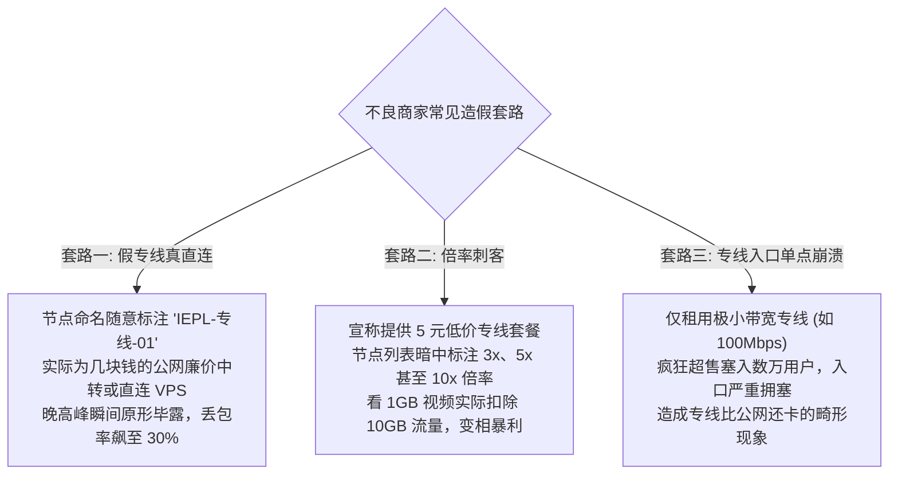

# IEPL vs IPLC 专线内网原理解密：物理光纤拓扑、0% 丢包抗拥堵机理与真假专线辨识

<div class="hero-badge">网络工程专著 · AmyTelecom 实验室 2026 深度发布</div>

在高端翻墙机场与跨境网络加速服务的宣传中，**“IEPL 专线”** 与 **“IPLC 专线”** 无疑是被提及频率最高、溢价能力最强、也最容易被商家偷换概念的顶级术语。

很多初入翻墙领域的用户常常心存疑惑：
- 为什么普通公网中转机场一个月只要五块钱，而真正的专线机场往往要十几元甚至数十元？
- 为什么专线号称“永远不过 GFW、晚高峰绝对不卡、丢包率为零”？它的物理原理到底是什么？
- 市场上充斥着大量打着“IEPL 专线”旗号的劣质机场，背后却暗藏 3 倍甚至 10 倍的“倍率刺客”，用户该如何用科学手段识破假专线？

本篇万字技术专著由 AmyTelecom 实验室资深光纤通信工程师倾力撰写，全面拆解 IEPL 与 IPLC 的物理介质、网络拓扑、密码学传输协议以及真伪鉴别 SOP。

<PagefindSearch />

---

## 1. 核心选型结论与专线品牌天梯 (Direct Answer)

| 专线类型 | 物理传输介质 | 晚高峰丢包率 | 成本与门槛 | 核心技术优势 | 推荐代表品牌 |
|---|---|---|---|---|---|
| **全段 IEPL 专线** | 陆缆点对点以太网通道 (如广港/沪日) | **稳定 0%** | 较高 (成本按 Mbps 计费) | 跨省 BGP 入口调度、不过公网防火墙、单节点 2.5Gbps 高吞吐 | **[光速云](/reviews/guangsu)** (第一主推)、**[微风网络](/reviews/weifeng)** |
| **纯 IPLC 专线** | 电信级传统时分复用二层物理电路 | **稳定 0%** | 极高 (多为金融外企专用) | 绝对物理独享、物理时延极低 | **[Firefly](/reviews/firefly)**、**[FlyingBird](/reviews/flyingbird)** |
| **公网 BGP 隧道中转** | 公网 163 / 优化骨干网封装加密 | 1% - 5% (晚高峰偶有波动) | 中等 | 性价比高、节点覆盖丰富 | **[暮光加速](/reviews/muguang)**、**[二猫云](/reviews/ermao)** |
| **伪专线 (假宣传)** | 普通公网 VPS 直连，虚标专线名称 | 15% - 40% (严重雪崩) | 极低 (几块钱月租) | 无任何保障，极易跑路 | 劣质小作坊与免费梯子 |

---

## 2. 物理图谱：IEPL 与 IPLC 的底层网络拓扑解剖

要明白专线为什么能“无视 GFW”，必须看懂物理光纤是如何从中国大陆铺设到境外的：

```mermaid
graph TD
  subgraph 国内段 (Client -> Ingress)
    User["用户客户端 (手机 / PC / 软路由)"] --> DomesticISP["国内本地宽带 (电信 163 / 联通 / 移动)"]
    DomesticISP --> DomesticBGP["国内核心入口机房 (广州/深圳/上海 BGP)"]
  end

  subgraph 专线封闭内网 (Cross-Border Private Pipe)
    DomesticBGP --> Encapsulation["内网协议封装 (VLESS / Shadowsocks)"]
    Encapsulation --> FiberCable{"物理跨境专用光纤 (完全绕过公网交换中心)"}
    FiberCable -- "深港陆地光缆 (物理穿过深圳河)" --> BorderHK["香港落地机房 (沙田/柴湾/将军澳)"]
    FiberCable -- "沪日海底光缆 (东海直连)" --> BorderJP["日本东京落地机房 (Equinix / NTT)"]
  end

  subgraph 海外落地出口 (Egress -> Global Internet)
    BorderHK --> GlobalTransit["海外 Tier 1 骨干网 (PCCW / Telstra / NTT)"]
    GlobalTransit --> Targets["ChatGPT / Claude / Netflix 4K / YouTube"]
  end

  style FiberCable fill:#10b981,stroke:#059669,stroke-width:3px,color:#fff;
```

### 2.1 IPLC (International Private Leased Circuit) 国际私有租用线路
- **技术属性**：电信级传统的**物理点对点租用线路**（通常基于 SDH/SONET 或 OTN 光传输网络）；
- **物理机理**：租户在 A 点（如深圳机房）与 B 点（如香港机房）之间直接独占一条固定时隙的光纤通道。该通道在物理通信协议上属于第二层（数据链路层），甚至第一层（物理层）；
- **绝对隔离**：IPLC 内部传输的是未经公网路由器解析的原始光电信号，中间没有任何国家级防火墙（GFW）的硬件探针插入。因此，流量在物理上是“不可能被墙”的。

### 2.2 IEPL (International Ethernet Private Line) 国际以太网专线
- **技术属性**：新一代基于以太网标准的跨国专线服务；
- **相比 IPLC 的优势**：
  1. **带宽调整更灵活**：支持从 10 Mbps 到 100 Gbps 的毫秒级弹性扩容；
  2. **协议适配度更高**：天然支持标准以太网数据帧（Ethernet Frames），支持更高级的 VLAN 标签分流与跨省 BGP 负载均衡；
  3. **抖动极小**：现代商业机场（如 [光速云](/reviews/guangsu)）所采用的均为企业级 IEPL 专线，凭借其完善的双路由热备（Protection Switching），当一条光缆遭遇外力损伤时，可在 50 毫秒内自动切换至备用纤芯，实现“业务无感知”。

---

## 3. 为什么 IEPL 专线能彻底免除 GFW 封锁与晚高峰卡顿？

很多用户常年被廉价梯子的断网与封锁所折磨，专线在技术上彻底解决了两大顽疾：

### 3.1 为什么专线完全不需要复杂的防封伪装？
在公网直连环境下，用户与境外服务器之间的通信必须穿过公网国际出口路由器，GFW 的深度包检测（DPI）设备会实时捕获每个数据包进行统计学分析与主动探测。因此，公网必须使用复杂的 VLESS Reality 或加密混淆协议。

但在 **IEPL 专线环境** 下：
- 用户的流量在国内入口机房（如广州电信 BGP）完成汇聚后，直接注入内网光纤；
- 这根光纤是向中国电信或中国联通等持牌运营商合法租用的合规企业专线通道；
- **专线内部的数据传输根本不经过任何公网国际关口局，因而在物理上完全处于 GFW 的视线之外**。在专线内部，哪怕使用没有任何混淆的纯 Shadowsocks 或轻量 VLESS，也绝无被封锁的可能。

### 3.2 为什么晚高峰能做到稳定 0% 丢包？
公网晚高峰卡顿的本质是**公网国际出口带宽超载导致的强制 QoS 丢包**。
而 IEPL 专线是服务商与运营商签订 SLA（服务等级协议）的独占管道：
- 运营商向机场承诺了绝对的带宽吞吐（如 2.5 Gbps 恒定带宽）；
- 无论公网出口有多少亿普通网民在刷短视频导致公网瘫痪，专线通道内部始终空闲顺畅，丢包率被牢牢锁定在 **0% - 0.1%**，单线程 4K 串流与高频 API 请求稳如磐石。

---

## 4. 行业黑幕揭秘：倍率刺客与假专线的三大套路

高品质专线的高昂成本，催生了部分不良商家的造假与偷跑行为：



### 4.1 假专线辨识实战：如何用 Traceroute 验明正身？
商家可以随意在客户端的节点名称上写“IEPL 专线”，但底层的网络跳数是无法作假的。
- **真专线路由特征**：
  在终端中对入口进行路由追踪，流量进入国内入口机房后，下一跳会直接跃迁至境外机房（例如上一跳是深圳机房 IP，下一跳直接变成香港机房 IP，中间**跳数极少（通常 3-5 跳），且中途绝对不会出现 202.97 (163) 等公网国际关口局路由**）；
- **假专线路由特征**：
  中间经过了长达十几跳的公网骨干网节点，且经过了典型的公网出口路由，在晚高峰时段延迟会大幅跳跃 100ms 以上。

---

## 5. 蜂巢式知识图谱与相关评测延伸

- 🚀 **专线实测标杆品牌**：
  - [光速云 2026 万字深度实测：IEPL+企业内网双专线架构](/reviews/guangsu)
  - [星岛梦：不限设备连接数老牌 IEPL 专线评测](/reviews/xingdaomeng)
  - [微风网络：入门级 7 元高性价比专线实测](/reviews/weifeng)
- 🛠️ **协议与场景拓展**：
  - [晚高峰 20:00-23:00 骨干网抗拥堵压测白皮书](/scenarios/peak-hours)
  - [VLESS XTLS-Reality 协议技术原理解析](/protocols/vless-reality)
  - [Netflix & Disney+ 4K 流媒体全球解锁权威指南](/scenarios/streaming)

<AffDisclaimer />
