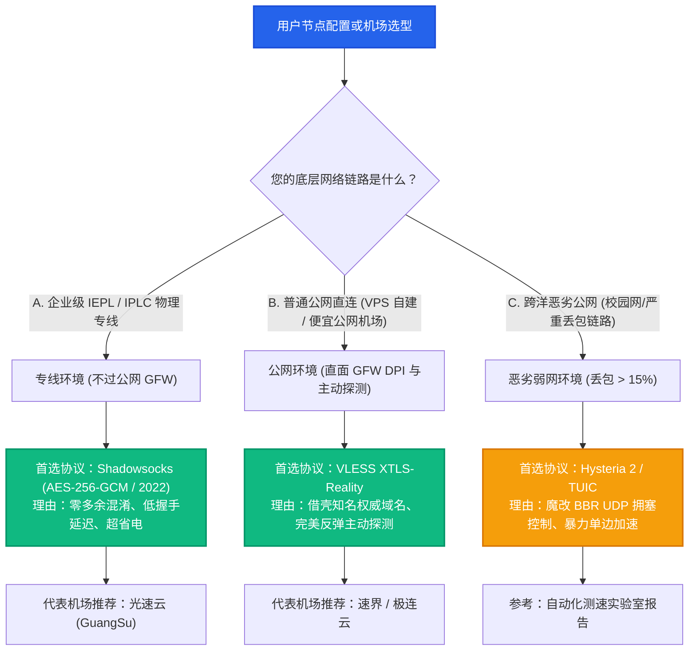

# 代理协议全景技术解构：密码学攻防、底层开销与场景选型指南

协议技术枢纽 · AmyTelecom 实验室 2026 深度发布

在当代跨境网络生态中，“协议（Protocol）”是决定数据能否安全穿越国际边界、能否抵御防火墙深度包检测（DPI）、以及在终端设备上是否省电抗卡顿的核心灵魂。

许多用户在面对客户端配置中琳琅满目的协议缩写（VLESS、Reality、Shadowsocks、Trojan、Hysteria 2、TUIC、VMess）时，常常感到无所适从：
- 究竟哪种协议最不容易被封锁？
- 为什么专线机场（如 [光速云](/reviews/guangsu)）主打 Shadowsocks，而自建节点大家都在吹捧 Reality？
- 为什么在晚高峰时期，号称基于 UDP 的 Hysteria 2 偶尔会遭遇运营商断流？

本技术枢纽聚合了 AmyTelecom 实验室历年撰写的万字白皮书，为您建立起一套清晰、立体、基于底层通信原理的协议认知图谱。

<PagefindSearch />

---

## 1. 全球主流跨境代理协议全景速查天梯

下表汇总了 2026 年活跃于主流机场与极客自建生态中的核心协议特性：

| 协议名称 | 典型协议层 | 防封锁与抗主动探测能力 | CPU 计算负载与功耗 | 弱网与高丢包适应力 | 最适适用场景 | 核心技术专著 |
|---|---|---|---|---|---|---|
| **IEPL/IPLC 商业专线** | 物理二层/三层内网 | **绝对免疫 (物理不过 GFW)** | **极低 (无需重度加密)** | **极致平稳 (丢包稳定 0%)** | **商业机场主力骨干** (首选 [光速云](/reviews/guangsu)) | [阅读万字解密专著](/protocols/iepl-iplc) |
| **VLESS XTLS-Reality** | TCP + 伪装 TLS | **公网第一 (借用权威 SNI)** | 极低 (0-RTT 内存直通) | 依赖底层公网质量 | **公网直连自建 / 防失联备用节点** | [阅读万字解密专著](/protocols/vless-reality) |
| **Shadowsocks (AEAD)** | 纯随机对称加密 | 公网直连易被封；专线内网无敌 | **极低 (支持 AES-NI 加速)** | 良好 | **专线机场内部节点首选** | [阅读万字解密专著](/protocols/shadowsocks-trojan) |
| **Trojan / Trojan-Go** | 标准 HTTPS 模仿 | 良好 (需自备合规域名与证书) | 中等 (完整 TLS 握手) | 依赖底层 TCP 握手 | 传统公网自建个人节点 | [阅读万字解密专著](/protocols/shadowsocks-trojan) |
| **Hysteria 2 / TUIC** | UDP (QUIC 魔改) | 良好 (暴力多倍发包抢占带宽) | 中等 (UDP 加密计算) | **极强 (恶劣高丢包环境救星)** | 跨洋劣质网络抢救速度 | [技术词典解析](/observatory/network-glossary) |
| **VMess (传统 V2Ray)** | 动态特征混淆 | **极低 (特征已被机器学习识别)** | 较高 | 较差 | 历史淘汰遗产，强烈不建议选用 | - |

---

## 2. 协议选型决策树：您究竟该选用哪种协议？

---

## 3. 协议专项深度技术白皮书矩阵

点击下方专著卡片，进入各协议专题万字深度剖析：

  专线技术白皮书
  <h3 style="margin: 0.5rem 0; font-size: 1.25rem;"><a href="/protocols/iepl-iplc">IEPL vs IPLC 专线内网原理解密</a></h3>
  

    深度剖析国际商业以太网专线 (IEPL) 与传统私有物理专线 (IPLC) 底层架构，揭秘不过公网 GFW 真相、测速抖动实测与真假专线辨识。
  

  <a href="/protocols/iepl-iplc" style="color: #10b981; font-weight: 600; text-decoration: none;">阅读万字技术专著 →</a>

  公网抗封王者
  <h3 style="margin: 0.5rem 0; font-size: 1.25rem;"><a href="/protocols/vless-reality">VLESS XTLS-Reality 终极伪装解密</a></h3>
  

    详细解密借壳借用知名权威域名 SNI 机制，公私钥 ShortId 认证与面对 GFW 主动探测时的绝杀握手重定向机制。
  

  <a href="/protocols/vless-reality" style="color: #2563eb; font-weight: 600; text-decoration: none;">阅读万字技术专著 →</a>

  经典协议演进
  <h3 style="margin: 0.5rem 0; font-size: 1.25rem;"><a href="/protocols/shadowsocks-trojan">Shadowsocks AEAD vs Trojan 演进史</a></h3>
  

    从 2012 年流密码被破译到现代 AEAD 重放防御，实测 AES-256-GCM 与 ChaCha20 在各类硬件上的 CPU 能耗开销。
  

  <a href="/protocols/shadowsocks-trojan" style="color: #f59e0b; font-weight: 600; text-decoration: none;">阅读万字技术专著 →</a>

---

## 4. 全局导航与知识内链

- **AI 生产力大模型环境配置**：[ChatGPT & Claude 原生纯净 IP 选型全攻略](/scenarios/ai-tools)
- **晚高峰压测与抗拥堵解析**：[晚高峰 20:00-23:00 骨干网 QoS 丢包机理全景剖析](/scenarios/peak-hours)
- **客户端全景配置指南**：[Windows / macOS / iOS / Android / OpenWrt 客户端使用手册](/clients/)
- **网络工程名词词典**：[从 AS4134 到 Zero-RTT 的 100+ 术语深度全解](/observatory/network-glossary)
- **查看 42 家机场品牌库**：[42 家机场全景天梯榜与专属优惠码](/reviews/)

<AffDisclaimer />
