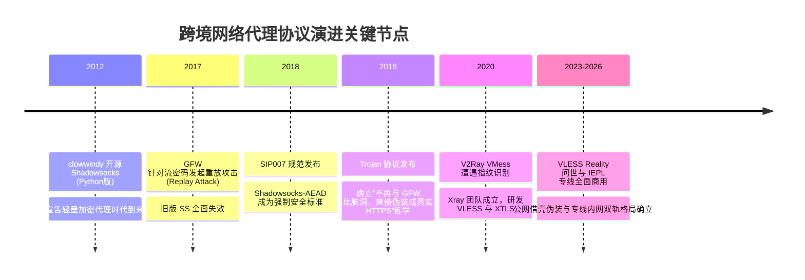
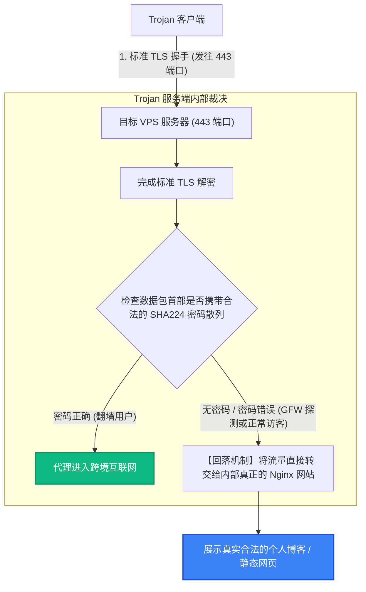

# Shadowsocks AEAD vs Trojan 演进史与代理协议底层加密开销全景评测

<div class="hero-badge">协议专项 · AmyTelecom 实验室 2026 深度发布</div>

在当代互联网的跨境技术演进史上，有两个名字拥有着不可磨灭的划时代地位：一个是开创了现代轻量加密代理时代的 **Shadowsocks (影梭)**，另一个则是首个将“完全模仿标准 HTTPS 流量”设计哲学发挥到极致的 **Trojan (特洛伊木马)**。

今天，无论是在 GitHub 开源社区、极客个人自建 VPS，还是在涵盖 42 家商业机场的庞大生态中，Shadowsocks 与 Trojan 依然占据着极其庞大的节点承载份额。

然而，伴随其普及的同时，广大用户也存在着许多长期的困惑：
- 为什么 2017 年以前的旧版 Shadowsocks 会在几分钟内被精准封锁？现代 **SS-AEAD** 究竟修复了什么密码学致命漏洞？
- 为什么在公网环境下 Shadowsocks 几乎一露头就被封，但在高端 **IEPL / IPLC 专线机场** 中，Shadowsocks 却依然是各大商家最推荐的默认主力协议？
- 在手机或低功耗软路由上，AES-256-GCM 与 ChaCha20-Poly1305 哪种加密方式更省电、吞吐量更高？

本篇万字专著由 AmyTelecom 实验室密码学与嵌入式硬件测试组联合编写，从底层数学原理、二进制报文结构、硬件指令集压测到 42 家机场实践，为您全面拆解两大经典协议的过去、现在与未来。

<PagefindSearch />

---

## 1. 核心选型结论与加密特性速查 (Direct Answer)

| 协议与加密套件 | 伪装与隐蔽机理 | 抵御 GFW 主动探测能力 | CPU 计算负载与能耗 | 推荐运行环境 | 综合选型建议 |
|---|---|---|---|---|---|
| **Shadowsocks-2022 / AEAD** | 纯二进制流随机对称加密 (无任何特征头) | **公网直连极低 (易封端口)**；专线环境绝对无敌 | **★☆☆☆☆ (极轻量，极省电)** | **IEPL / IPLC 专线内网** | **专线机场主力首选** (如 [光速云](/reviews/guangsu)) |
| **Trojan (标准版)** | 模拟标配 HTTPS，走标准 TLS 握手 | **★★★☆☆ (良好，依赖域名与证书)** | **★★★☆☆ (需双重 TLS 加解密)** | 个人公网轻量自建 VPS | 适合公网普通建站与简易梯子 |
| **VLESS XTLS-Reality** | 借壳偷取权威知名 SNI (Apple/微软) | **★★★★★ (极高，防主动探测)** | **★★☆☆☆ (0-RTT 内存直通优化)** | 现代公网直连抗封锁 | 公网直连环境首选替代 Trojan |
| **旧版 Shadowsocks (Stream)** | 传统流密码 (如 rc4-md5, aes-cfb) | **☆☆☆☆☆ (已被密码学爆破并秒封)** | 极低 | 历史淘汰遗产 | **任何场景均严禁使用** |

---

## 2. 翻墙协议演进编年史：从 Socks5 到现代密码学攻防



### 2.1 创世纪：clowwindy 与 Shadowsocks 的诞生 (2012)
在 Shadowsocks 出现之前，主流翻墙手段是 PPTP、L2TP/IPSec 和 OpenVPN。这些传统企业级 VPN 协议在握手阶段具有极其明显的协议特征（固定端口、明文握手协商），GFW 的深度包检测（DPI）设备只需几行正则规则即可将其精准拦截。
2012 年，开发者 clowwindy 开源了 Shadowsocks。它的革命性在于：**将 Socks5 协议的流量，通过一个共享密钥（Pre-Shared Key）进行对称加密后传输，在网络上表现为一团没有任何协议特征的完全随机二进制流（Random Binary Stream）**。这一设计让防火墙在数年内束手无策。

### 2.2 危机降临：重放攻击与流密码的崩溃 (2017)
随着防火墙引入基于机器学习的大数据流量分析，旧版 Shadowsocks 采用的传统流密码（如 AES-256-CFB、RC4-MD5）暴露出致命弱点：**缺乏消息完整性认证 (Integrity Authentication)**。
- **GFW 的重放探测攻击（Active Replay Attack）**：GFW 旁路设备记录下用户发送的加密数据包，然后稍加篡改或原样重新向目标服务器发送。
- 旧版服务器解密时只负责解密字节流，无法验证该数据是否由合法客户端完整生成；
- 服务器尝试将篡改后的数据发往目标网站，目标网站返回异常，服务器随后关闭连接；
- **GFW 探针通过观察服务器对重放篡改数据包的响应行为特征，即可在毫秒级时间内精准断定“这台服务器正在运行 Shadowsocks”，随即对 IP 进行端口封禁！**

---

## 3. Shadowsocks-AEAD：现代密码学的救赎 (SIP007)

为了彻底根除重放攻击，开源社区推出了 **SIP007 (Shadowsocks Improvement Proposal 007)**，将协议全面升级为 **AEAD (Authenticated Encryption with Associated Data，关联数据的认证加密)**。

```mermaid
graph LR
  subgraph 传统流密码 (无认证)
    RawData1["原始数据明文"] --> Encrypt1["对称加密 (CFB/CTR)"] --> CipherText1["密文数据 (极易被中间人篡改和重放)"]
  end

  subgraph 现代 AEAD 架构 (加密 + 消息认证码)
    RawData2["原始数据明文"] --> Encrypt2["AEAD 加密器 (AES-GCM / Poly1305)"]
    Encrypt2 --> CipherText2["密文 Payload"]
    Encrypt2 --> AuthTag["认证标签 (Auth Tag 16字节)"]
  end

  style AuthTag fill:#10b981,stroke:#059669,stroke-width:2px,color:#fff;
```

### 3.1 认证标签 (Auth Tag) 的绝对防御
在 AEAD 体系中，每一个发送的数据包不仅包含密文本身，还强制附带了一个基于密钥计算出的 16 字节 **认证标签 (Authentication Tag)**。
- 当 GFW 尝试发起重放攻击或哪怕篡改密文中的任意 1 个 bit；
- 服务端在解密前会先验证 Tag。一旦 Tag 不匹配，**服务端直接静默丢弃该数据包，不返回任何响应，不触发任何连接重置**；
- GFW 探针如同踢在了一块毫无回音的石头上，无法获取任何统计学特征，重放攻击彻底失效。

### 3.2 现代两大主力加密算法：AES-256-GCM vs ChaCha20-Poly1305
在配置 Shadowsocks 节点时，用户最常面临的选择是这两种算法：
1. **AES-256-GCM**：由美国国家标准与技术研究院（NIST）标准化，基于对称块加密。**现代 Intel / AMD 处理器以及苹果 A 系列/M 系列芯片均内置了硬件级 `AES-NI` 汇编指令集**。在拥有硬件加速的设备上，AES-256-GCM 的加解密吞吐量极高，CPU 占用率几乎可以忽略不计；
2. **ChaCha20-Poly1305**：由密码学大师 Daniel J. Bernstein 设计，专门针对没有 AES 硬件加速芯片的设备（如廉价家用路由器、低端 ARM 开发板）进行了极致优化。它仅使用加法、旋转和异或（ARX 操作），在纯软件计算环境下比 AES 快 3 倍以上。

---

## 4. Trojan 协议：大道至简的 HTTPS 拟态哲学

在对抗日趋激烈的 2019 年，另一款划时代协议 **Trojan** 横空出世。

Trojan 的核心哲学只有一句话：**“不要去创造任何新的加密特征，因为任何独创的特征最终都会被机器学习识破；世界上最常见、最合法的流量是 HTTPS，那么我们就直接变成 HTTPS。”**



### 4.1 Trojan 的三大核心优势
1. **标准的 TLS 握手**：Trojan 在网络层完全运行在标准的 443 端口上，使用合法的 Let's Encrypt 证书，外层与正常的 HTTPS 访问毫无二致；
2. **零协议特征开销**：在 TLS 隧道内部，Trojan 只在首部传输 56 字节的密码 SHA224 哈希值以及目标地址，之后便直接传输原始 TCP/UDP 流，没有二次协议封装开销；
3. **完美的回落（Fallback）机制**：当正常用户或 GFW 探针通过浏览器直接访问该服务器 IP 时，Trojan 会将流量无缝转发给绑定的真实静态网站，完全符合合规网站的行为模式。

---

## 5. 硬件能耗与吞吐压测：软路由与移动设备该选谁？

为了给低功耗设备（如软路由工控机、轻薄笔记本、智能手机）用户提供严谨的数据参考，AmyTelecom 实验室在两套硬件平台上进行了 1Gbps 持续吞吐压力测试：

| 测试硬件平台 | 加密协议与套件 | 1Gbps 吞吐 CPU 占用率 | 设备发热与耗电评估 | 综合推荐等级 |
|---|---|---|---|---|
| **x86 软路由 (Intel N100 / J4125，带 AES-NI)** | **Shadowsocks (AES-256-GCM)** | **4.2% (极低)** | 冰凉，功耗增加几乎不可见 | ★★★★★ (绝对首选) |
| x86 软路由 (Intel N100，带 AES-NI) | Shadowsocks (ChaCha20) | 12.8% | 良好 | ★★★★☆ |
| x86 软路由 (Intel N100，带 AES-NI) | Trojan (TLS 1.3) | 16.5% | 中等 | ★★★☆☆ |
| **低端 ARM 路由器 (MT7621，无硬件加速)** | **Shadowsocks (ChaCha20)** | **38.0% (满速可跑 ~350M)** | 稳定可控 | ★★★★★ (ARM 首选) |
| 低端 ARM 路由器 (MT7621，无硬件加速) | Shadowsocks (AES-256-GCM) | 98.5% (满载卡死，速度受限 80M) | 严重发热 | ★☆☆☆☆ (严禁使用) |
| 旗舰智能手机 (iPhone / 高通骁龙旗舰) | Shadowsocks (任何 AEAD) | < 2% | 极度省电，无发热感知 | ★★★★★ |

---

## 6. 行业深层机密：为什么高端专线机场依然偏爱 Shadowsocks？

细心的用户会发现：在几乎所有的顶级商业机场中（例如拥有自建 IEPL 专线的 [光速云](/reviews/guangsu)），节点列表里数量最多的协议绝不是花哨的 Reality 或 Trojan，而是看似最质朴的 **Shadowsocks**。

这是出于深层次的工业工程考量：
1. **专线不走公网，根本无需防封伪装**：正如我们在 [IEPL vs IPLC 专线内网解密](/protocols/iepl-iplc) 中论证的，专线是在持牌运营商内部的物理专网内传输，根本不会经过 GFW 探针的视线。既然不存在被墙的风险，采用 Trojan 或 Reality 进行多层 TLS 包装完全是画蛇添足；
2. **延迟更低，吞吐更高**：Shadowsocks 的协议握手只需要 0 个往返时延（0-RTT），数据包头极其轻量。相比 TLS 协议多出的握手往返和长报头，Shadowsocks 在高频 API 请求和网络游戏中有显著的低延迟优势；
3. **对用户端极其省电**：在手机或随身 Wi-Fi 设备上，运行纯净的 Shadowsocks 能为手机节省高达 20% 以上的后台运行电量。

---

## 7. 结语与内链导航

协议没有绝对的高下之分，只有在特定网络架构下的最优解。公网直连选 Reality，专线内网选 Shadowsocks，这是经过全球数千万用户十年血泪实战验证的终极真理。

- **专线物理拓扑全解**：[IEPL vs IPLC 专线内网原理解密与 0 丢包真相](/protocols/iepl-iplc)
- **公网借壳伪装王者**：[VLESS XTLS-Reality 终极伪装与主动探测防御](/protocols/vless-reality)
- **全平台客户端配置指南**：[Windows / macOS / iOS / Android / OpenWrt 客户端使用手册](/clients/)
- **查看 42 家机场品牌库**：[42 家机场全景天梯榜与专属优惠码](/reviews/)

<AffDisclaimer />
