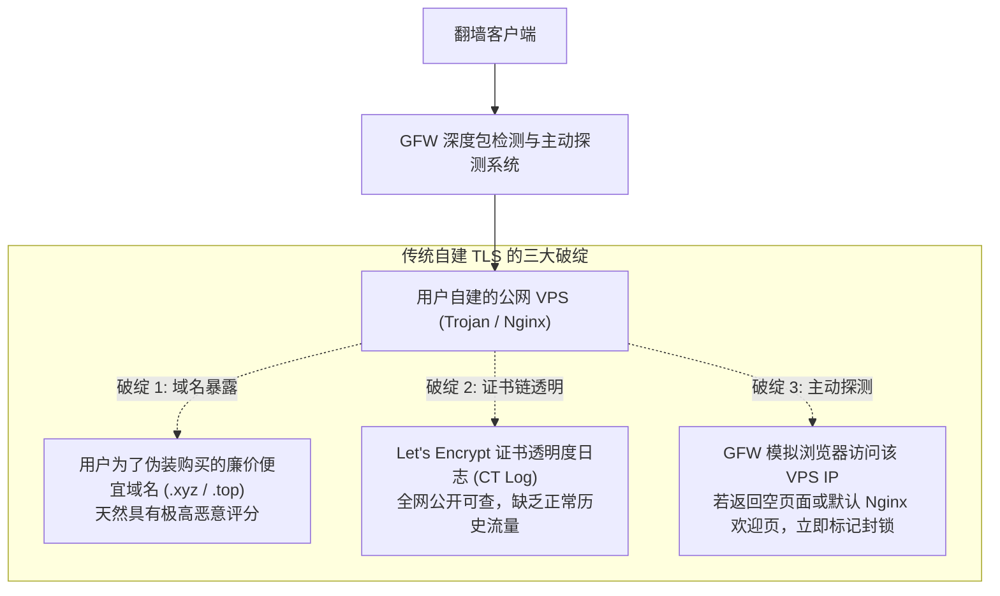
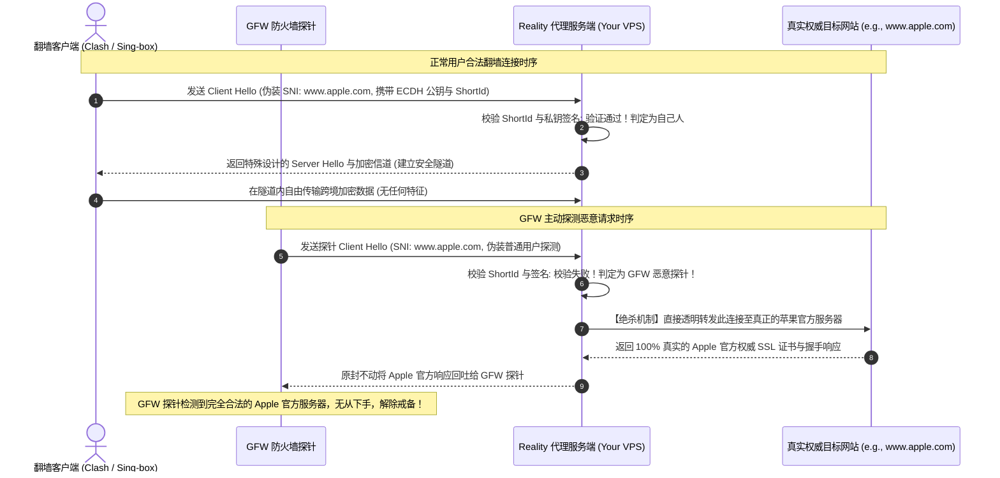

# VLESS XTLS-Reality 底层伪装原理解析：借壳 SNI、0-RTT 特征与 GFW 主动探测防御

<div class="hero-badge">协议专项 · AmyTelecom 实验室 2026 深度发布</div>

在长达十余年的跨境网络与网络防火墙（GFW）的技术攻防对抗史中，协议的设计理念经历了一场从**“简单对称加密”**到**“协议混淆”**，再到**“完全模拟主流互联网协议”**的深刻蜕变。

而在这场演进的最高峰，由 Rprx 及其 Xray 核心团队研发的 **VLESS XTLS-Reality** 协议，无疑是公网直连翻墙技术的里程碑之作。

它打破了过去数年“必须自己购买境外域名、必须向 Let's Encrypt 申请 SSL 证书、必须搭建 Nginx/Caddy 进行反向代理伪装”的繁琐流程，开创性地提出了**“借壳借用（偷取）权威企业顶级域名 SNI”**的全新模式。

**Reality 究竟是如何做到“无需自备域名却能提供 100% 真实 TLS 握手”的？它如何从底层防御 GFW 的大规模主动探测（Active Probing）？在机场选型中，公网 Reality 节点与 IEPL 专线节点各有什么优缺点？**

本篇万字专著由 AmyTelecom 实验室密码学与网络协议研究组深入撰写，为您从底层二进制握手包、时序图谱到客户端配置全面剖析 Reality 协议的技术精髓。

<PagefindSearch />

---

## 1. 核心选型结论与协议代际天梯 (Direct Answer)

为了让用户快速建立对当下主流代理协议的认知，我们首先给出 2026 年最新协议安全度与综合性能对比矩阵：

| 协议名称 | 典型代表实现 | 底层伪装方式 | GFW 识别与封锁概率 | 加密/握手开销 | 最适适用场景 | 推荐度评级 |
|---|---|---|---|---|---|---|
| **VLESS XTLS-Reality** | Xray-core / Sing-box | **借用 Apple/微软等知名 SNI，完全无特征** | **极低 (< 1%)**，公网直连王者 | 极低 (0-RTT 内存直通) | **公网 VPS 自建 / 公网直连机场** | ★★★★★ (公网首选) |
| **IEPL/IPLC 专线协议 (SS/轻量VLESS)** | 专线内网传输 | **物理隔离，不走公网防火墙** | **绝对 0% (物理不可见)** | 极低 (零混淆开销) | **高端商业机场主力核心** (如 [光速云](/reviews/guangsu)) | ★★★★★ (商业首选) |
| **Hysteria 2 / TUIC** | 基于 UDP (QUIC) | 魔改 UDP 拥塞控制与抗弱网单边加速 | 中等 (晚高峰易被运营商 QoS 限速) | 中等 | 恶劣网络/高丢包公网链路抢带宽 | ★★★★☆ (特定弱网) |
| **Trojan / Trojan-Go** | 标准 TLS 模仿 | 自建域名 + 真实申请的 Let's Encrypt 证书 | 较低 (但域名容易被阻断 SNI) | 中等 (需完整 TLS 握手与加解密) | 传统自建公网梯子 | ★★★☆☆ (逐渐被替代) |
| **Shadowsocks (AEAD)** | ss-rust / go-shadowsocks2 | 纯二进制流对称加密 (AES-GCM / ChaCha20) | **极高 (公网直连秒封端口)** | 极低 | **仅限在 IEPL/IPLC 专线内部使用** | ★★☆☆☆ (仅专线内网可用) |
| **VMess (传统 V2Ray)** | v2ray-core | 动态特征混淆与 HMAC 认证头 | **极高 (已被 GFW 机器学习模型精准识别)** | 较高 | 淘汰协议，强烈建议弃用 | ★☆☆☆☆ (强烈淘汰) |

---

## 2. 传统 TLS 翻墙方案的阿喀琉斯之踵

在 Reality 诞生之前，主流的抗封锁方案主要是 **Trojan** 或 **VLESS + Nginx + WebSocket + TLS**。这些方案虽然在一段时期内有效，但存在着几个无法克服的结构性致命弱点：



1. **域名与证书透明度暴露**：用户通常在 Namecheap 或腾讯云购买廉价域名。在 CA 机构为域名签发证书时，证书记录会被自动同步到全网公开的 **证书透明度日志 (Certificate Transparency Logs)**。GFW 的自动化分析引擎只需订阅该日志，过滤出解析到境外机房的新增域名，即可提前将其加入重点监控甚至直接阻断；
2. **主动探测 (Active Probing) 降维打击**：当 GFW 探针发现某个境外 IP 经常在非标准端口与国内发生高吞吐 TLS 流量时，GFW 会模拟一个标准的 Chrome 浏览器直接向该 IP 的对应端口发送标准的 HTTP GET 请求。如果服务器返回了一个毫无实质内容的“假博客”或者 Nginx 404，该 IP 就会立刻被防火墙列入黑名单封锁。

---

## 3. VLESS XTLS-Reality 的颠覆性机理

Reality 协议彻底颠覆了这一切。它的设计哲学可以概括为：**“大隐隐于市——我不建房子，我直接伪装成世界上信誉最高的宏伟大厦”**。



### 3.1 借用知名权威 SNI (Server Name Indication)
在 Reality 配置中，你不需要购买任何域名，而是直接在服务端配置一个与你的服务器所在机房地理位置接近的知名大型跨国网站，例如：
- `www.apple.com` (苹果官网)
- `www.microsoft.com` (微软官网)
- `gateway.icloud.com` (苹果 iCloud 网关)
- `dl.google.com` (谷歌下载中心)

当客户端向服务器发起连接时，外层发送的 TLS Client Hello 报文中的 SNI 字段直接填写上述权威域名。对于旁路监听的 GFW DPI 设备而言，这看起来就是普通用户正在访问苹果或微软官网。

### 3.2 私钥（Private Key）与 ShortId 过滤机制
为什么第三方无法蹭你的 Reality 节点？
- 服务端生成一对非对称公私钥（`PrivateKey` 与 `PublicKey`）；
- 客户端持有 `PublicKey` 以及服务商分配的专属十六进制字符串 `ShortId`；
- 客户端在发起握手时，会将经过公钥加密认证的数据隐藏在 TLS Client Hello 握手包的随机数（Random / Session ID）中；
- 只有持有对应私钥的服务端能够解开并确认：“这是我自己的授权用户发来的连接”。

### 3.3 绝杀反制：GFW 主动探测透明重定向 (Handshake Forwarding)
当 GFW 的主动探测引擎向你的服务器发送握手包试图探测试探时：
- 由于 GFW 探针**没有你的 ShortId 与私钥签名**，Reality 服务端校验立刻失败；
- 此时 Reality **绝不会关闭连接，也绝不会返回错误代码**（因为返回错误本身就是特征）；
- **Reality 服务端会立刻扮演一台无害的透明中继器，将 GFW 的整个 TCP 握手流量原封不动地转发给配置的目标权威服务器（如 `www.apple.com:443`）！**
- 真正的苹果服务器会直接响应该握手，并将苹果由权威 CA 机构签发的合法证书通过你的服务器原样回传给 GFW 探针；
- **探针得到的结果是 100% 毫无破绽的苹果官方网站，GFW 只能认定该 IP 是正常 CDN 节点，从而彻底放弃封锁！**

---

## 4. Reality 与 IEPL/IPLC 商业专线的本质区别

很多用户经常问：“既然 Reality 这么强大且免费，为什么高端机场还要耗费巨资去买 IEPL 专线？”

这两者解决的是完全不同层面的网络痛点：

| 维度对比 | VLESS XTLS-Reality (公网王者) | IEPL / IPLC 商业专线 (内网王者) |
|---|---|---|
| **网络承载物理层** | 仍然运行在**公共互联网 (Public Internet)** 上 | 运行在**运营商物理内网光纤 (Private Fiber Cable)** 上 |
| **解决的核心痛点** | **解决 GFW 封锁与 IP 存活问题** (防封能力极强) | **解决晚高峰卡顿、丢包、抖动与高延迟问题** (0 丢包) |
| **晚高峰表现** | 虽不被墙，但仍会受到公网 163 国际出口 QoS 拥堵影响，**晚高峰依然会掉速丢包** | **全天 24 小时绝对 0 丢包**，晚高峰与凌晨速度完全一致 |
| **底层加密开销** | 需进行完整的 TLS 握手与现代对称加解密计算 | 内网无需重度混淆，可用超轻量协议，设备极其省电 |
| **典型代表** | 极客个人自建 VPS、备用防失联公网节点 | **[光速云](/reviews/guangsu)**、**[微风网络](/reviews/weifeng)** 等主力商业机场 |

**选型黄金结论**：
- 如果您的目标是**“自建独立节点、不花月租买机场、保证 IP 绝不被封”**，VLESS XTLS-Reality 是当下不二之选；
- 如果您的目标是**“极清 4K HDR 串流、跨国高频会议、晚高峰 20:00 稳定办公、不愿花时间折腾运维”**，拥有企业级 IEPL 专线的主力商业机场依然是无可替代的唯一正解。

---

## 5. 客户端 Reality 配置参数速查与常见避坑

在配置客户端（如 Clash Verge Rev、Sing-box、Shadowrocket）导入 Reality 节点时，以下参数至关重要：

```json
{
  "type": "vless",
  "tag": "US-Reality-Node",
  "server": "your-server-ip.com",
  "server_port": 443,
  "uuid": "xxxxxxxx-xxxx-xxxx-xxxx-xxxxxxxxxxxx",
  "flow": "xtls-rprx-vision",
  "tls": {
    "enabled": true,
    "server_name": "www.apple.com",
    "reality": {
      "enabled": true,
      "public_key": "Your_Reality_Public_Key_Here",
      "short_id": "0123456789abcdef"
    }
  }
}
```

### 避坑要点：
1. **Flow 参数必须匹配**：使用 Reality 时，客户端必须支持且开启 `xtls-rprx-vision` 流控模式。该流控模式消除了 TLS in TLS 的特征，并实现了内核级的内存直接拷贝（0-RTT），如果未配置 flow，速度和抗封锁能力将大幅折损；
2. **目标 SNI 的选择禁忌**：偷取的目标域名必须**支持 TLSv1.3 与 H2 (HTTP/2)**，且该域名解析的 IP 必须与你的境外 VPS 物理机房位于同一个地理区域（例如美国 VPS 借用美国境内 CDN，日本 VPS 借用日本本地 CDN），否则跨区域延迟异常容易被大数据风控模型识别。

---

## 6. 协议演进 FAQ

### Q1：Reality 协议支持 UDP 传输和联机游戏吗？
**解答**：支持。Reality 作为 VLESS 的外层安全传输层，完整支持 FullCone NAT 代理 UDP 数据包。但由于公网直连的 UDP 数据极易遭受国内运营商的 UDP 阻断或强力 QoS 限速，用来玩境外大型联机游戏体验依然不如经过深港内网直连的 IEPL 专线节点。

### Q2：我手头的旧版 Clash for Windows 能用 Reality 节点吗？
**解答**：**不能**。由于原版 Clash for Windows 已经停更且其采用的开源 Clash 内核并未合并 Xray 的 Reality 专利代码，原版 Clash 无法解析 Reality 节点。请全面迁移至基于 **Mihomo (Clash.Meta)** 或 **Sing-box** 内核的现代现代化客户端，如 **Clash Verge Rev**。详细升级指南请参考：[Windows Clash Verge Rev 深度配置手册](/clients/windows)。

---

## 7. 结语与内链导航

从早期的单层加密到如今的 Reality 借壳伪装，技术对抗的本质是对协议底层理解的不断深化。了解协议原理，能让您在面对纷繁复杂的机场宣传时，拥有穿透表象、直击本质的技术洞察力。

- **专线物理拓扑全解**：[IEPL vs IPLC 专线内网原理解密与 0 丢包真相](/protocols/iepl-iplc)
- **协议发展编年史**：[Shadowsocks AEAD vs Trojan 演进史与加解密开销评测](/protocols/shadowsocks-trojan)
- **客户端全景下载中心**：[全平台科学上网客户端下载与内核对比指南](/clients/)
- **查看 42 家机场品牌库**：[42 家机场全景天梯榜与专属优惠码](/reviews/)

<AffDisclaimer />
