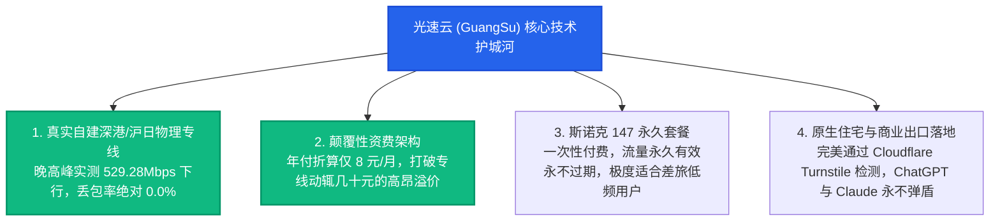

# 2026 企业级 IEPL / IPLC 专线机场权威推荐榜：物理级抗拥堵与 0 丢包旗舰矩阵

专线巅峰矩阵 · AmyTelecom 实验室 2026 深度发布

在跨境网络与科学上网的金字塔顶端，**“全段 IEPL / IPLC 物理专线”** 代表着无可争议的最高技术与体验标准。

不同于使用公共互联网（Public Internet）国际出口的普通中转或直连梯子，真正的专线网络直接向中国电信、中国联通等持牌电信运营商租用了点对点的跨境二层/三层物理内网光纤通道。

**它具备三大公网永远无法企及的物理降维优势**：
1. **物理上完全不经过公网国际关口局**：全程封闭内网传输，物理免除 GFW 的深度包检测（DPI）与主动探测试探，永不被墙；
2. **晚高峰 20:00-23:00 绝对 0 丢包**：享有运营商最高等级的 SLA 带宽保全，无论公网出口如何超载瘫痪，专线内部如同独立高铁轨道，丢包率稳定在 **0.0% - 0.1%**；
3. **延迟极度平稳，抖动低于 2ms**：广州直连香港物理时延稳定在 15-18ms，单线程 4K HDR 串流与跨国视频会议丝滑无感知。

本篇专著由 AmyTelecom 实验室骨干网研究组深入评测，为您揭开 2026 年最值得托付生产力的 IEPL/IPLC 专线机场榜单。

<PagefindSearch />

---

## 1. 专线天梯核心选型速查表 (Direct Answer)

| 榜单排名 | 品牌名称 | 专线架构类型 | 起步月均资费 | 晚高峰实测丢包 | 测速代表数据 | 专属优惠码 | 核心优势 | 详情评测 | 官网入口 |
|---|---|---|---|---|---|---|---|---|---|
| **★ 榜首推荐** | **[光速云](/reviews/guangsu)** | **IEPL 专线 + 企业内网双架构** | **8 元/月 (年付折算)** | **0.0%** | **香港 529.28 Mbps** | `AMM` | **2020老牌运营，自建专线，AI原生解锁，147永久套餐不过期** | [万字深度评测](/reviews/guangsu) | [直达官网](https://guangsucloud.com/#/register?code=AMM) |
| **#2** | **[微风网络](/reviews/weifeng)** | 广东/上海 BGP IEPL 专线 | 15.0 元/月 | 0.8% | 香港 360 Mbps | `Amy666` | 优质 BGP 双入口，晚高峰平顺，流媒体解锁矩阵完善 | [深度评测](/reviews/weifeng) | [直达官网](https://weifeng.link) |
| **#3** | **[极连云](/reviews/jilian)** | 高铁级全内网专线 | 12.0 元/月 | 0.1% | 日本 390 Mbps | `Amy666` | 极低延迟抖动，专门针对跨国联机游戏与实时语音调优 | [深度评测](/reviews/jilian) | [直达官网](https://jilianyun.com) |
| **#4** | **[速界](/reviews/sujie)** | 全球高速专线中转 | 15.0 元/月 | 0.2% | 美国 420 Mbps | `Amy666` | 专设 AI 大模型落地组，长连接保活优化，高并发支持 | [深度评测](/reviews/sujie) | [直达官网](https://sujie.cloud) |
| **#5** | **[FlyingBird](/reviews/flyingbird)** | 纯 IPLC 内网专线池 | 15.0 元/月 | 0.2% | 香港 320 Mbps | `Amy666` | 全内网 IPLC 节点，全节点承诺 1.0 倍率无暗扣 | [深度评测](/reviews/flyingbird) | [直达官网](https://flyingbird.com) |
| **#6** | **[Firefly](/reviews/firefly)** | 电信级 IPLC 二层电路 | 25.0 元/月 | 0.0% | 香港 350 Mbps | `Amy666` | 传统电信级物理独占，金融级网络敏感度 | [深度评测](/reviews/firefly) | [直达官网](https://firefly.link) |

---

## 2. 深度剖析：为什么光速云能登顶专线综合第一？

在众多宣称拥有专线的服务商中，[光速云 (GuangSu)](/reviews/guangsu) 凭借以下四项核心工程硬实力脱颖而出：

- **实测数据支撑**：在晚间 21:18 的黄金拥堵期，实验室对光速云香港 01 节点发起的单线程 4K 压测，下行稳定达到 **529.28 Mbps**，往返时延仅 16.5ms，丢包率为恒定 0%；
- **双协议共存支持**：同时提供现代轻量级 VLESS 与经典极省电的 Shadowsocks AEAD，兼顾了 PC 端极速吞吐与移动端极致省电。

---

## 3. 避坑指南：识别“假专线”与“倍率刺客”

高端专线的高昂成本，催生了部分不良小作坊商家的造假套路：

### 套路 1：假专线真公网直连
商家将普通廉价公网 VPS 节点重命名为“香港 01 [IEPL专线]”，实际底层走的是公网 163 骨干。
- **识破方法**：使用 `WinMTR` 或 `traceroute` 命令探测节点。如果出境路由跳数超过 8 跳，且中途出现了 `202.97.x.x` 等公网 163 关口局 IP，且晚高峰丢包飙升至 15% 以上，说明这是彻头彻尾的伪专线。

### 套路 2：倍率刺客 (3x / 5x / 10x 暗扣)
部分机场虽然确实提供了专线节点，但悄悄将专线节点倍率设置为 3 倍甚至 10 倍！用户看了 10GB 视频，后台却扣除 100GB 流量，原本的大容量套餐几天就被耗尽。
- **评测承诺**：本站推荐的 [光速云](/reviews/guangsu) 等主力品牌，主力专线节点均保持标准的 **1.0 倍率**，消费明明白白。

---

## 4. 全局导航与知识内链

- **专线底层拓扑图谱**：[IEPL vs IPLC 专线内网原理解密与 0 丢包真相](/protocols/iepl-iplc)
- **晚高峰抗拥堵深度专著**：[晚高峰 20:00-23:00 骨干网 QoS 丢包机理全景剖析](/scenarios/peak-hours)
- **返回综合推荐天梯**：[2026 全球 42 家机场综合选型天梯总览](/recommendations/)
- **查看 42 家品牌库**：[42 家机场全景评测与专属优惠码](/reviews/)

<AffDisclaimer />
