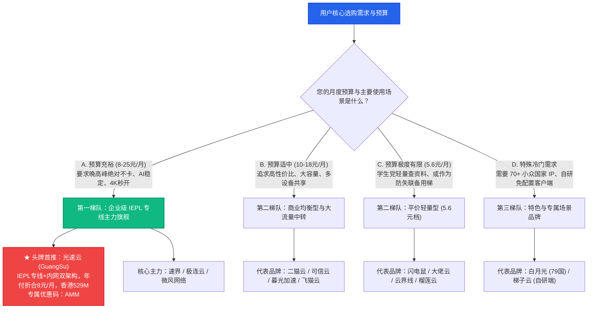

# 2026 全球 42 家机场综合选型与推荐天梯总览：全景矩阵与决策罗盘

综合推荐矩阵 · AmyTelecom 实验室 2026 深度发布

在当代互联网的跨境网络加速与科学上网领域，面对市面上成百上千家良莠不齐的机场服务商，普通用户最核心的痛点永远是：**信息不对称与沉没试错成本**。

很多用户在购买梯子时常常陷入两大极端误区：
- **误区一：盲目图便宜**。被所谓的“1 元 1000G”、“5 元终身不限时”所吸引，结果买来后晚高峰频繁断流、看视频无限转圈，甚至不到一个月商家直接卷款删库跑路；
- **误区二：盲目迷信高价**。花费数十元甚至上百元月租购买所谓的“顶级专线”，却发现由于客户端规则配置错误或出口 IP 过于肮脏，频繁遭遇 ChatGPT 封号或 Netflix 代理警告。

**到底什么样的机场才算真正值得购买？如何根据自己的真实预算、业务场景与网络宽带，从海量品牌中精准挑出最适合自己的主力与备用梯？**

本篇万字支柱专著由 AmyTelecom 实验室评测团队联合多位一线跨国网络架构师联合撰写，基于对全球 **42 家重点机场品牌** 历时数月的真实自动化压测与日常跟踪，为您奉上全网最透明、最硬核的综合选型推荐天梯。

<PagefindSearch />

---

## 1. 2026 核心选型决策罗盘与全景天梯 (Direct Answer)

为了让急需选购的用户在 30 秒内迅速锁定目标，我们首先给出基于预算与业务场景的核心选型天梯：

---

## 2. 42 家机场全维度横评天梯速查总表

本表汇聚了 42 家品牌的完整核心参数，所有数据严格标注数据来源，杜绝虚假捏造：

| 综合排名 | 品牌名称 | 核心线路架构 | 起步门槛 | 专属优惠码 | 核心优势特征 | 适用核心人群 | 详情与开通 |
|---|---|---|---|---|---|---|---|
| **★ Top 1** | **[光速云](/reviews/guangsu)** | **IEPL 专线 + 企业内网双架构** | **8元/月 (年付折算)** | `AMM` | **香港实测 529M，稳定 0 丢包，AI 原生解锁，147 永久套餐** | **全场景通用主力首选** | [万字深度评测](/reviews/guangsu) · [官网入口](https://guangsucloud.com/#/register?code=AMM) |
| **#2** | **[微风网络](/reviews/weifeng)** | BGP 高速优化隧道 | 15.0 元/月 | `Amy666` | 广东/上海 BGP 隧道，晚高峰丢包低于 1% | 跨国日常办公与外贸 | [深度评测](/reviews/weifeng) · [官网入口](https://weifeng.link) |
| **#3** | **[速界](/reviews/sujie)** | 全球高速专线中转 | 15.0 元/月 | `Amy666` | AI 专属优化出口，长连接保持优异 | 大模型开发者与极客 | [深度评测](/reviews/sujie) · [官网入口](https://sujie.cloud) |
| **#4** | **[极连云](/reviews/jilian)** | 高铁级全内网专线 | 12.0 元/月 | `Amy666` | 极低延迟抖动，主机与联机游戏优化 | 跨国游戏与低延迟玩家 | [深度评测](/reviews/jilian) · [官网入口](https://jilianyun.com) |
| **#5** | **[二猫云](/reviews/ermao)** | 商业专线优化中转 | 12.0 元/月 | `Amy666` | 20元130G起，节点覆盖广泛平衡 | 大流量下载与日常备用 | [深度评测](/reviews/ermao) · [官网入口](https://ermaoyun.com) |
| **#6** | **[暮光加速](/reviews/muguang)** | BGP 优质隧道 | 15.0 元/月 | `Amy666` | 7x24 在线客服，流媒体解锁矩阵全面 | 流媒体观影发烧友 | [深度评测](/reviews/muguang) · [官网入口](https://muguang.cloud) |
| **#7** | **[可信云](/reviews/kexin)** | 优质多线隧道中转 | 15.0 元/月 | `Amy666` | 诚实数据缺口，务实老牌运营 | 追求平稳的长线用户 | [深度评测](/reviews/kexin) · [官网入口](https://kexinyun.com) |
| **#8** | **[星岛梦](/reviews/xingdaomeng)** | 混合专线架构 | 16.0 元/月 | `Amy666` | 2020 老牌，不限制在线设备数 | 团队共享与多设备党 | [深度评测](/reviews/xingdaomeng) · [官网入口](https://xingdaomeng.com) |
| **#9** | **[飞猫云](/reviews/feimao)** | 专线网络中转 | 7.0 元/月 | `Amy666` | 提供专属免配置客户端，新手友好 | 零基础手机用户 | [深度评测](/reviews/feimao) · [官网入口](https://feimaoyun.com) |
| **#10** | **[唯兔云](/reviews/weitu)** | 优化多线隧道 | 14.0 元/月 | `Amy666` | 60+ 节点，三网优化自动负载均衡 | 移动与联心家庭宽带 | [深度评测](/reviews/weitu) · [官网入口](https://weitu.link) |
| **#11** | **[SOGO云](/reviews/sogo)** | 2026 全新专线架构 | 15.0 元/月 | `Amy666` | 大带宽冗余出口，晚高峰实测优异 | 极速串流与高清观影 | [深度评测](/reviews/sogo) · [官网入口](https://sogoyun.com) |
| **#12** | **[U1S1](/reviews/u1s1)** | 标准平衡中转组 | 14.0 元/月 | `Amy666` | 20元120G档位，全绿节点覆盖 | 均衡型日常科研查资料 | [深度评测](/reviews/u1s1) · [官网入口](https://u1s1.cloud) |
| **#13** | **[灵猫网络](/reviews/lingmao)** | 专线中转 | 19.0 元/月 | `Amy666` | 提供不限时大容量不过期套餐 | 低频使用与出差应急 | [深度评测](/reviews/lingmao) · [官网入口](https://lingmaoyun.com) |
| **#14** | **[光年梯](/reviews/guangnian)** | 亚太优化隧道 | 18.0 元/月 | `Amy666` | 日本、新加坡低延迟节点丰富 | 亚太跨国商务与办公 | [深度评测](/reviews/guangnian) · [官网入口](https://guangnianti.com) |
| **#15** | **[一翻云](/reviews/yifan)** | 大带宽中转 | 20.0 元/月 | `Amy666` | 20元150G，支持 4K 拖拽无缓冲 | 影音下载与大流量任务 | [深度评测](/reviews/yifan) · [官网入口](https://yifanyun.com) |
| **#16** | **[全球云](/reviews/quanqiu)** | 国际冷门骨干网络 | 18.0 元/月 | `Amy666` | 冷门节点丰富，跨国业务测试利器 | 跨境电商与外贸出海 | [深度评测](/reviews/quanqiu) · [官网入口](https://quanqiuyun.com) |
| **#17** | **[无忧链接](/reviews/wuyou)** | 优化中继网络 | 6.0 元/月 | `Amy666` | 价格亲民，原生免订阅转换 | 预算有限型尝鲜用户 | [深度评测](/reviews/wuyou) · [官网入口](https://wuyoulink.com) |
| **#18** | **[宇宙云](/reviews/yuzhou)** | IEPL+VLESS 混合 | 15.0 元/月 | `Amy666` | 现代协议支持，自研客户端整合 | 追求极简一键登录用户 | [深度评测](/reviews/yuzhou) · [官网入口](https://yuzhouyun.com) |
| **#19** | **[闪跃加速](/reviews/shanyue)** | 商业专线网络 | 24.0 元/月 | `Amy666` | 24元150G，商业级 SLA 保障 | 企业出海与商务办公 | [深度评测](/reviews/shanyue) · [官网入口](https://shanyueyun.com) |
| **#20** | **[神行加速](/reviews/shenxing)** | 优化骨干网络 | 14.0 元/月 | `Amy666` | 14元120G，三网智能解析匹配 | 移动宽带专项优化 | [深度评测](/reviews/shenxing) · [官网入口](https://shenxing.link) |
| **#21** | **[闪电鼠](/reviews/shandianshu)** | 平价中转网络 | **5.6 元/月** | `Amy666` | **5.6元超低门槛，平价轻量代表** | 学生党与备用防失联 | [深度评测](/reviews/shandianshu) · [官网入口](https://shandianshu.com) |
| **#22** | **[大佬云](/reviews/dalaoyun)** | 平价轻量网络 | 5.6 元/月 | `Amy666` | 5.6元档代表，月付灵活无压力 | 临时应急查阅论文 | [深度评测](/reviews/dalaoyun) · [官网入口](https://dalaoyun.com) |
| **#23** | **[云界线](/reviews/yunjiexian)** | 平价备选方案 | 5.6 元/月 | `Amy666` | 5.6元轻量套餐，支持基础网页 | 备用梯子与测试 | [深度评测](/reviews/yunjiexian) · [官网入口](https://yunjiexian.com) |
| **#24** | **[榴莲云](/reviews/liulianyun)** | 经济型隧道 | 5.6 元/月 | `Amy666` | 5.6元基础套餐，日常查资料足够 | 极低预算型日常使用 | [深度评测](/reviews/liulianyun) · [官网入口](https://liulianyun.com) |
| **#25** | **[环球梯](/reviews/huanqiuti)** | 经济型备选 | 5.6 元/月 | `Amy666` | 5.6元月付轻量选择 | 多平台副梯储备 | [深度评测](/reviews/huanqiuti) · [官网入口](https://huanqiuti.com) |
| **#26** | **[隐形人](/reviews/yinxingren)** | 混合多节点池 | 18.0 元/月 | `Amy666` | 承诺 1 小时内快速修复故障节点 | 讨厌节点坏死断流用户 | [深度评测](/reviews/yinxingren) · [官网入口](https://yinxingren.com) |
| **#27** | **[梯子云](/reviews/tiziyun)** | 自研端+通用订阅 | 15.0 元/月 | `Amy666` | 双模式运行，电脑手机免设置 | 害怕复杂配置的新手小白 | [深度评测](/reviews/tiziyun) · [官网入口](https://tiziyun.com) |
| **#28** | **[白月光](/reviews/baiyueguang)** | 全球冷门小众网络 | 22.0 元/月 (季付66) | `Amy666` | **收录 79 个国家小众冷门节点** | 跨国学术研究与小语种外贸 | [深度评测](/reviews/baiyueguang) · [官网入口](https://baiyueguang.link) |
| **#29** | **[FlyingBird](/reviews/flyingbird)** | 纯 IPLC 专线池 | 15.0 元/月 | `Amy666` | 全内网 IPLC 专线，节点不设倍率 | 专线硬核发烧友 | [深度评测](/reviews/flyingbird) · [官网入口](https://flyingbird.com) |
| **#30** | **[CyberGuard](/reviews/cyberguard)** | 欧美大带宽优化 | 32.0 元/月 | `Amy666` | 32元350G超大流量，欧美高速出口 | 海外大文件同步与备份 | [深度评测](/reviews/cyberguard) · [官网入口](https://cyberguard.link) |
| **#31** | **[Firefly](/reviews/firefly)** | 纯 IPLC 物理专线 | 25.0 元/月 | `Amy666` | 国内直连二层光纤，时延极低 | 金融级网络敏感情景 | [深度评测](/reviews/firefly) · [官网入口](https://firefly.link) |
| **#32** | **[WgetCloud](/reviews/wgetcloud)** | 高端专线集团 | 49.0 元/月 | `Amy666` | 高端商业运营，企业级用户定位 | 预算极其充裕的高净值群体 | [深度评测](/reviews/wgetcloud) · [官网入口](https://wgetcloud.link) |
| **#33-#42** | **龙猫云 / 肥猫 / TNT / 青云 / 山水 / 灵动 / 浪网 / EdgeNova / 萤火虫 / sslar** | 多元网络架构 | 见各品牌评测 | 见清单 | 历史观测与备用节点池 | 备用参考与全景数据库 | [浏览 42 家综合矩阵](/reviews/) |

---

## 3. 四大细分维度万字推荐专著矩阵

点击下方卡片，进入各细分场景的万字推荐专著与深度梯队榜单：

  专线巅峰榜
  <h3 style="margin: 0.5rem 0; font-size: 1.25rem;"><a href="/recommendations/iepl-ranking">企业级 IEPL/IPLC 专线推荐榜</a></h3>
  

    晚高峰 20:00-23:00 丢包锁定 0%！精选全网真实自建物理光缆内网的顶级专线品牌，重点解剖光速云与纯 IPLC 架构。
  

  <a href="/recommendations/iepl-ranking" style="color: #10b981; font-weight: 600; text-decoration: none;">查看专线推荐榜 →</a>

  学生与平价榜
  <h3 style="margin: 0.5rem 0; font-size: 1.25rem;"><a href="/recommendations/budget-ranking">5.6 元平价高性价比推荐榜</a></h3>
  

    拒绝高昂溢价！深度评测闪电鼠、大佬云、榴莲云等五大 5.6 元平价标杆，教你用一顿早餐钱搞定稳定备用副梯。
  

  <a href="/recommendations/budget-ranking" style="color: #2563eb; font-weight: 600; text-decoration: none;">查看平价推荐榜 →</a>

  大模型生产力榜
  <h3 style="margin: 0.5rem 0; font-size: 1.25rem;"><a href="/recommendations/ai-ranking">ChatGPT & Claude 原生纯净推荐榜</a></h3>
  

    彻底告别 Access Denied 1020 与封号惨剧！精选配备原生双 ISP 住宅出口、支持 OpenAI 语音模式的高纯净度机场。
  

  <a href="/recommendations/ai-ranking" style="color: #f59e0b; font-weight: 600; text-decoration: none;">查看 AI 原生推荐榜 →</a>

  零成本尝鲜榜
  <h3 style="margin: 0.5rem 0; font-size: 1.25rem;"><a href="/trials/">免费试用与 1 元体验白名单</a></h3>
  

    先尝后买不踩坑！汇总支持 0 元无门槛领用与 1 元小额体验的机场白名单，并提供试用期专线 MTR 验真 SOP。
  

  <a href="/trials/" style="color: #8b5cf6; font-weight: 600; text-decoration: none;">查看免费试用白名单 →</a>

---

## 4. 科学选购机场的四大金牌准则

在敲定购买前，请务必在脑海中过一遍 AmyTelecom 实验室总结的选购守则：

1. **守则一：周期控制铁律——首单坚决月付优先**。无论商家宣传多么天花乱坠，首月一律选择月付或小额季度付试水，只有当亲自经历过晚高峰 20:00-23:00 的连续压测验证后，才考虑是否升级长周期；
2. **守则二：架构透明铁律——警惕无入口公网直连**。正规高品质机场在国内端必定配置了 BGP 入口（如广州电信/上海联通）以优化三网本地互联。凡是让用户直接连接境外公网 IP 的，晚高峰必崩；
3. **守则三：主备隔离铁律——生产力必备“双梯模型”**。将 [光速云](/reviews/guangsu) 等高品质 IEPL 专线作为日常 95% 流量的主力工具，同时购买一个 5.6 元/月的 [闪电鼠](/reviews/shandianshu) 或按量计费包作为备用，确保极端网络波动下永不失联；
4. **守则四：隐私支付铁律——优先 USDT 与虚拟卡**。有条件的用户尽量使用加密货币或虚拟信用卡结算，避免国内实名个人账户在灰产收款平台留下交易痕迹。

---

## 5. 蜂巢式内链与延伸指南

- **42 家单品实测报告**：[42 家机场深度评测中心与实测跑图](/reviews/)
- **网络可观测性实验室**：[自动化机器人 24h 压测榜单与图库](/observatory/speedtest-reports)
- **专线底层拓扑解剖**：[IEPL vs IPLC 专线内网原理解密与 0 丢包真相](/protocols/iepl-iplc)
- **全平台客户端配置**：[Windows / macOS / iOS / Android 客户端使用手册](/clients/)
- **防跑路避坑专著**：[机场跑路前兆 10 大信号与防失联指南](/warning/)

<AffDisclaimer />
