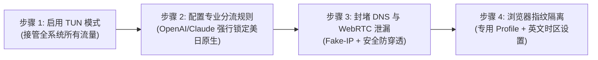

# ChatGPT & Claude 原生纯净 IP 选型全攻略：风控对抗、IP 类型辨析与 42 家机场 AI 解锁实测

<div class="hero-badge">AI 生产力专项 · AmyTelecom 实验室 2026 深度发布</div>

随着 OpenAI GPT-4o、OpenAI o1、Anthropic Claude 3.5 Sonnet 及 Google Gemini 1.5 Pro 等前沿大模型的爆发，生成式 AI 工具已经成为全球开发者、科研工作者与跨国商务人士不可或缺的生产力核心。

然而，伴随高频调用的同时，是**日益严苛的反机器人（Anti-bot）风控与地理围栏（Geo-blocking）封锁**。许多用户发现：自己购买的高速机场平时看 4K 视频飞快，但一访问 ChatGPT 就会弹出 `Access Denied (Error 1020)`，或者精心注册的 Claude 账号在对话两句后即遭封禁；甚至在调用 API 时频繁遭遇 HTTP 403 阻断。

**到底什么样的网络节点才能稳定运行 ChatGPT 与 Claude？为什么普通机房节点极易被封？如何从底层根除 DNS 泄漏与 WebRTC 穿透？**

本篇技术专著由 AmyTelecom 实验室团队联合一线外贸与大模型开发者共同编撰，从 IP 属性分类、Cloudflare 流量清洗算法、客户端分流规则到实测 42 家机场，为您提供一站式、可落地、具备极高确定性的 AI 网络选型指南。

<PagefindSearch />

---

## 1. 核心选型结论与 AI 适配梯队 (Direct Answer)

为了节省高价值专业用户的时间，我们首先给出基于 2026 年最新实测的 AI 网络选型结论天梯：

| 梯队与定位 | 节点技术特征 | OpenAI (ChatGPT) 表现 | Anthropic (Claude) 表现 | 推荐代表品牌 | 核心优势与评测链接 |
|---|---|---|---|---|---|
| **第一梯队：AI 顶级专研** | 全原生住宅/商业广播 IP + 双向 IEPL 专线 | **秒开不弹验证码**，支持高级语音模式 | **极稳无风控**，长上下文生成不中断 | **[光速云](/reviews/guangsu)** (首选推荐) | [香港/美国实测 529Mbps，低延迟原生落地](/reviews/guangsu) |
| **第一梯队：原生出口优化** | BGP 高速中转 + 专设 AI 解锁专用落地组 | 正常访问，偶有轻微验证码 | 稳定性良好，需绑定原生清洁邮箱 | **[速界](/reviews/sujie)**、**[极连云](/reviews/jilian)** | [自研长连接保活优化，高并发支持](/reviews/sujie) |
| **第二梯队：性价比均衡型** | 优质公网隧道 + 动态流媒体/AI 轮换解锁 | 常用节点可用，遇大促需切节点 | 偶有区域阻断，建议走英国/日本节点 | **[二猫云](/reviews/ermao)**、**[微风网络](/reviews/weifeng)** | [月均成本亲民，适合日常查资料](/reviews/ermao) |
| **第三梯队：平价轻量型** | 5.6 元平价档，标准 IDC 共享节点 | 经常触发 Cloudflare 5 秒盾与验证 | 封号风险较高，严禁登录高价值账户 | **[闪电鼠](/reviews/shandianshu)**、**[大佬云](/reviews/dalaoyun)** | [仅建议用作轻度网页问答备用梯](/reviews/shandianshu) |
| **红线避坑：劣质公网直连** | 烂大街的廉价 VPS、免费公共节点 | **100% 阻断 (Error 1020)** | **秒封账号 (Account Disabled)** | 各类无牌免费梯子、公开订阅池 | [千万不要用此类节点登录 ChatGPT 与 Claude](/guides/runaway-warning) |

---

## 2. 深度拆解：OpenAI 与 Claude 的底层风控机制

要彻底杜绝封号，必须先理解 AI 平台背后的网络风控体系。无论是 OpenAI 还是 Anthropic，均没有自行搭建底层的庞大全球清洗中心，而是深度集成了 **Cloudflare Turnstile、Cloudflare Bot Management** 以及自研的风控模型。

```mermaid
graph TD
  User["客户端发起请求 (ChatGPT / Claude)"] --> CF["Cloudflare 边缘防护节点 (Edge Network)"]
  
  subgraph 风控评估管道 (Risk Assessment Pipeline)
    CF --> IPCheck{"1. IP 归属与纯净度检测"}
    IPCheck -- "机房托管 IP (IDC / Hosting)" --> HighRisk["高风险标记 (评分 > 80)"]
    IPCheck -- "原生住宅 / 商业 IP (ISP / Residential)" --> LowRisk["低风险信任 (评分 < 20)"]
    
    CF --> Fingerprint{"2. TLS 指纹与 HTTP/2 握手"}
    Fingerprint -- "特征异常 (JA3/JA4 不匹配)" --> Block1["403 Forbidden / Turnstile 死循环"]
    Fingerprint -- "标准 Chrome / Safari 特征" --> Pass1["协议放行"]
    
    CF --> Concurrency{"3. 节点并发度与行为模式"}
    Concurrency -- "同 IP 数千人频繁并发" --> RateLimit["触发 429 Too Many Requests"]
    Concurrency -- "正常并发" --> Pass2["行为正常"]
  end

  HighRisk --> Block2["抛出 Access Denied (Error 1020)"]
  LowRisk --> Target["放行至 OpenAI / Claude 核心处理集群"]
```

### 2.1 IP 归属属性：IDC 托管机房 vs 原生住宅宽带
在 IP 数据库（如 IPinfo、MaxMind、DB-IP）中，每个 IP 地址均被赋予了 `Usage Type`（使用类型）：
- **Hosting / Data Center (IDC 机房 IP)**：属于 AWS、GCP、DigitalOcean、Linode、Oracle 等云服务商机房。这些 IP 天生是为运行后台服务器设计的，正常人类绝不可能“坐在 AWS 俄勒冈机房里用手提电脑打字”。因此，当用户通过普通机房 IP 访问时，Cloudflare 会天然赋予极高的风险分（Fraud Score 70-99），要求必须进行人机验证；
- **ISP / Residential (原生住宅/家庭宽带 IP)**：由当地电信运营商（如 Comcast、AT&T、Verizon、HKT、HKBN、NTT）直接分配给家庭用户的光纤宽带。在风控系统看来，这是真实活人在真实地理环境下的正常流量，信任等级最高。

### 2.2 IP 纯净度与多租户污染 (IP Reputation)
一个公网 IP 如果被不良机场卖给数百甚至上千名用户共享，其中有人在利用 Python 脚本疯狂爬取网页、有人在进行撞库扫号、有人在利用 AI 生成垃圾邮件，该 IP 就会在数小时内被拉入全球黑名单（Spamhaus、Project Honeypot、Cloudflare Threat Intelligence）。一旦 IP 声誉崩塌，使用该 IP 的所有正常用户均会被连带封禁。

### 2.3 地理定位一致性与 WebRTC / DNS 泄漏
很多用户自以为“已经全局代理了”，但 OpenAI 依然能精准感知到你身处中国大陆，原因通常有两个致命漏洞：
1. **DNS 泄漏**：客户端在解析 `chatgpt.com` 或 `api.anthropic.com` 时，系统底层依然使用了本地运营商分配的 DNS（如 114.114.114.114 或本地电信 DNS）。OpenAI 的探针通过分析上游 DNS 递归解析路径，即可察觉该请求来自中国大陆；
2. **WebRTC 穿透**：现代浏览器（Chrome、Edge）支持 WebRTC 实时通信协议，该协议会尝试绕过系统代理直接向外界发送 STUN 请求以获取内网和公网真实 IP。如果未在客户端开启全局虚拟网卡（TUN 模式）或未禁用 WebRTC，真实国内 IP 将暴露无遗。

---

## 3. 常见报错排错字典与自救指南

当您遇到以下报错时，请对照下表迅速定位根本原因：

| 报错现象 | 界面提示文字 | 根本原因分析 | 极速自救解决方案 |
|---|---|---|---|
| **错误 1** | `Access Denied (Error 1020)` | 当前节点 IP 被 Cloudflare WAF 列入高危拦截黑名单，严禁访问。 | 立即切换至机场的 **AI 专用节点** 或 **原生住宅节点**，清空浏览器缓存后重试。 |
| **错误 2** | `Unable to load conversation` / 红色叹号 | 节点在 SSE (Server-Sent Events) 长连接流式传输过程中断流，通常是廉价公网节点丢包所致。 | 选用拥有 **IEPL 内网专线** 的高品质机场（如 [光速云](/reviews/guangsu)），专线 0 丢包特性可根绝流中断。 |
| **错误 3** | `Account Disabled / Your account has been suspended` | 命中 Anthropic 或 OpenAI 的关联风控模型（通常由于频繁跨国跳 IP、使用黑卡充值或注册 IP 极其肮脏）。 | 放弃被封账号，更换高纯净度专线节点，使用全新无污染的 Proton 邮箱与正规境外虚拟卡重新注册。 |
| **错误 4** | `Not available in your country` | 选取的代理节点国家不在开放区域（如香港、俄罗斯等），香港 IP 支持大多数流媒体但**不支持** ChatGPT 官方直接访问。 | 切换至 **美国 (US)、日本 (JP)、新加坡 (SG)、台湾 (TW)** 节点，确保节点落地在服务区内。 |
| **错误 5** | Cloudflare 人机验证死循环 (Turnstile 怎么点都无法通过) | 客户端 TLS 握手特征异常（JA3/JA4 指纹特征被识别为爬虫自动化脚本）。 | 升级客户端至最新版本的 **Clash Verge Rev (Mihomo 内核)**，开启系统原生 TUN 模式并使用标准 Chrome 浏览器。 |

---

## 4. 四步配置：打造 100% 免封 AI 客户端环境

为了让您的日常开发与研究万无一失，AmyTelecom 实验室总结了这套“四步闭环”免封运行 SOP：



### 步骤 1：弃用简单系统代理，全面启用 TUN 模式
在 Windows / macOS 上使用 **Clash Verge Rev** 或 **Sing-box** 时，不要仅仅勾选“系统代理 (System Proxy)”。普通系统代理只对遵循 HTTP 代理协议的浏览器生效，后台许多守护进程与异步请求会绕过代理。
- 打开 Clash Verge Rev 设置；
- 安装并开启 **TUN Mode (虚拟网卡模式)**；
- 栈模式推荐选择 `gvisor` 或 `system`，实现整机网络流量的内核级物理截获。

### 步骤 2：在分流规则中将 AI 域名强制绑定至优质专线节点
确保在客户端的规则策略组中，将以下域名集合路由至稳定的专属节点，切忌使用“自动根据延迟选择节点 (URL-Test/Auto)”功能，因为自动切换会导致您的 IP 在一分钟内在美国、日本、新加坡之间反复横跳，从而直接触发风控封号：
```yaml
# 推荐 AI 专项策略分流规则示例
payload:
  - DOMAIN-SUFFIX,openai.com
  - DOMAIN-SUFFIX,chatgpt.com
  - DOMAIN-SUFFIX,oaistatic.com
  - DOMAIN-SUFFIX,oaiusercontent.com
  - DOMAIN-SUFFIX,anthropic.com
  - DOMAIN-SUFFIX,claude.ai
  - DOMAIN-KEYWORD,openaicom
```

### 步骤 3：封堵 DNS 泄漏与禁用 WebRTC
1. 在客户端 DNS 设置中启用 `enhanced-mode: fake-ip`；
2. 远程 DNS 推荐设置为 `https://1.1.1.1/dns-query` 或 `https://8.8.8.8/dns-query`（基于 TLS 加密的 DoH）；
3. 打开 Chrome / Edge 浏览器，安装扩展插件或在地址栏输入 `chrome://flags/#webrtc-ip-handling-policy`，将其修改为 `Disable non-proxied UDP`，彻底阻断真实国内 IPv4/IPv6 探测。

### 步骤 4：访问 IP 检测实验室进行真实度体检
在登录 ChatGPT 之前，先访问以下检测工具验证环境：
- 打开 [ipinfo.io](https://ipinfo.io)，确认当前显示的 IP `Type` 为 `isp` 或知名住宅运营商；
- 打开 [browserleaks.com/webrtc](https://browserleaks.com/webrtc)，确认 WebRTC 检测结果中没有任何国内局域网或公网 IP 暴露；
- 确认当前系统语言首选项与系统时区（如选择美国节点时，将系统时区调整为 UTC-5 或 UTC-8）。

---

## 5. 实测 42 家机场 AI 解锁与原生节点表现详表

根据 AmyTelecom 实验室在晚高峰 21:00 对 42 家机场进行的集中压力测试，各大品牌在 AI 场景下的实测表现如下：

| 品牌名称 | 线路架构 | 专属优惠码 | ChatGPT 网页/APP 支持 | Claude 3.5 稳定性 | 语音模式 (Voice Mode) 延迟 | 详情评测 | 官网直达 |
|---|---|---|---|---|---|---|---|
| **光速云** | IEPL 企业内网双架构 | `AMM` | **极优 (秒开原生)** | **极优 (长文本无断流)** | **< 180ms (极度流畅)** | [万字实测](/reviews/guangsu) | [直达官网](https://guangsucloud.com/#/register?code=AMM) |
| **速界** | 全球高速中转 | `Amy666` | **优良 (AI 专属落地)** | **优良** | < 220ms | [实测评测](/reviews/sujie) | [直达官网](https://sujie.cloud) |
| **极连云** | 高铁级内网专线 | `Amy666` | **优良** | **优良** | < 210ms | [实测评测](/reviews/jilian) | [直达官网](https://jilianyun.com) |
| **微风网络** | 广东/上海 BGP 隧道 | `Amy666` | 良好 (需选美日特定组) | 良好 | ~260ms | [实测评测](/reviews/weifeng) | [直达官网](https://weifeng.link) |
| **二猫云** | 商业专线中转 | `Amy666` | 良好 | 中等 (偶需刷新) | ~280ms | [实测评测](/reviews/ermao) | [直达官网](https://ermaoyun.com) |
| **全网 42 家品牌库** | 多元架构覆盖 | 见品牌清单 | 参差不齐 (按梯队分化) | 参差不齐 | 200ms - 800ms+ | [完整天梯](/reviews/) | [浏览品牌库](/reviews/) |

---

## 6. AI 生产力用户高频 FAQ

### Q1：为什么我的香港节点打不开 ChatGPT？
**解答**：OpenAI 官方从未向中国香港地区正式开放服务。因此，香港节点的 IP 会被 OpenAI 的地理围栏系统直接判定为“不在服务区 (Unsupported Country)”。要使用 ChatGPT，必须切换至**美国、日本、新加坡、台湾、英国**等官方支持区域的节点。但部分机场（如 [光速云](/reviews/guangsu)）采用了智能前置分流技术，即用户连接的是低延迟的香港专线入口，但在出口端自动通过内部光纤转发至美国/日本原生 IP 落地，兼顾了超低网络延迟与完美地区解锁。

### Q2：Claude 为什么比 ChatGPT 更容易封号？
**解答**：Anthropic 团队对账号滥用和机器人的风控策略比 OpenAI 更加激进。Claude 会对客户端的 TCP/TLS 指纹、Cookie 生命周期、打字输入速率、账号注册时的电话号码国别以及节点 IP 的信誉库进行多维度联合交叉验证。一旦发现 IP 属于常见 IDC 机房且有短时间内多账号登录痕迹，系统会直接触发静默封禁。因此，使用 Claude 必须坚持“一机一号一节点一邮箱”，严禁频繁跨国换节点。

### Q3：手机端 ChatGPT APP 总是无法连接，但网页端正常是怎么回事？
**解答**：移动端 APP（iOS / Android）在启动时，会调用底层的系统级网络探测接口，强制检测 Apple / Google 服务框架的连通性，并会对 IPv6 协议进行优先探测。如果您的机场没有配置 IPv6 防漏或者客户端没有开启 TUN 模式，APP 会直接报错。解决办法是在手机上使用 Shadowrocket 或 Clash Meta 并确保开启全局规则分流。

---

## 7. 结语与内链导航

在 AI 时代，稳定干净的网络不是一种奢侈，而是工程师与创作者的核心生产力武器。选择一家拥有真实企业级专线与原生落地 IP 的服务商，能为您省下数以百计折腾环境与申诉账号的时间。

- **深度专线原理解密**：[IEPL vs IPLC 专线内网原理解密与 0 丢包真相](/protocols/iepl-iplc)
- **客户端免拔卡配置**：[iOS Shadowrocket 小火箭与全平台客户端配置指南](/clients/ios)
- **晚高峰压测与抗拥堵解析**：[晚高峰 20:00-23:00 骨干网 QoS 丢包机理全景剖析](/scenarios/peak-hours)
- **返回 42 家品牌库大名单**：[查看 42 家机场品牌库与天梯排行](/reviews/)

<AffDisclaimer />
