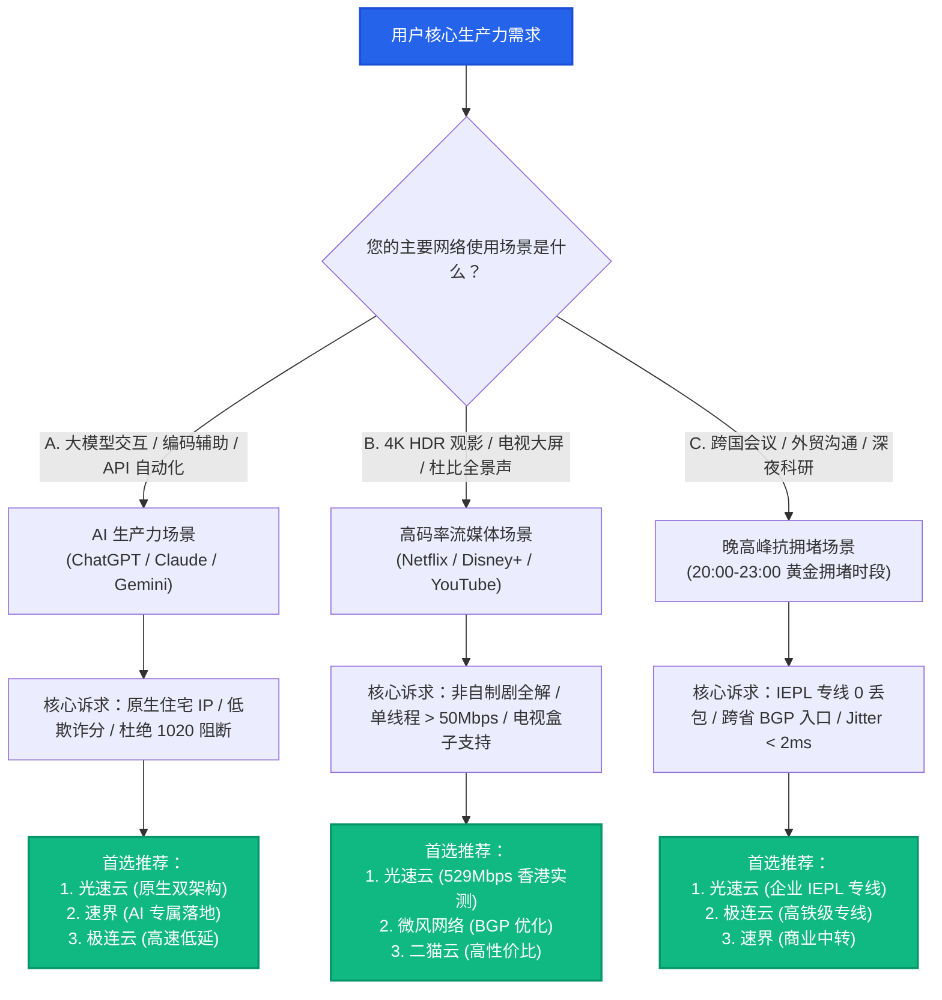

# 场景选型知识库全景：按真实生产力需求精准匹配最佳机场

场景选型枢纽 · AmyTelecom 实验室 2026 深度发布

选择跨境网络加速服务时，最忌讳的是“脱离具体业务场景谈配置”。很多用户盲目追求“峰值千兆跑满”，结果在日常写代码、与境外团队视频会议、或者深夜看 4K 电影时，频繁遭遇封号、缓冲与断流。

**不同的数字业务场景，对网络底层特性的严苛要求截然不同**：
- **AI 生产力场景 (ChatGPT / Claude / Gemini)**：核心瓶颈不在于带宽大小，而在于 **IP 原生性、IP 纯净度 (Fraud Score) 与长连接流式保活能力**；
- **4K / 8K 高清流媒体 (Netflix / Disney+ / YouTube)**：核心指标在于 **单线程吞吐量 (Single-Thread Throughput) 与丢包抖动控制**，以及针对好莱坞非自制剧的地理围栏绕过能力；
- **晚高峰抗拥堵 (20:00 - 23:00 黄金时段)**：核心决定因素在于 **底层物理链路介质**，究竟是公网 163 乞丐线路，还是真正的 **IEPL/IPLC 商业专线**。

本枢纽聚合了 AmyTelecom 实验室历时数月压测积累的实测白皮书，帮助您精准锁定最契合个人与企业生产力场景的最佳机场方案。

<PagefindSearch />

---

## 1. 三大核心场景特征与选型决策罗盘

---

## 2. 三大场景万字技术专著矩阵

点击下方专著卡片，进入由 AmyTelecom 实验室撰写的各场景万字深度解析与技术 SOP：

  AI 生产力专项
  <h3 style="margin: 0.5rem 0; font-size: 1.25rem;"><a href="/scenarios/ai-tools">ChatGPT & Claude 原生 IP 选型全攻略</a></h3>
  

    深度拆解 OpenAI / Anthropic 底层风控逻辑。详析机房 Hosting 与住宅 Residential IP 差异，彻底根除 Error 1020 与封号惨剧。
  

  <a href="/scenarios/ai-tools" style="color: #2563eb; font-weight: 600; text-decoration: none;">阅读万字技术专著 →</a>

  影音娱乐专项
  <h3 style="margin: 0.5rem 0; font-size: 1.25rem;"><a href="/scenarios/streaming">Netflix / Disney+ 4K 流媒体高码率解锁实测</a></h3>
  

    剖析非自制剧版权分区与 DRM L1/L3 认证体系。揭秘单线程吞吐对 4K 缓冲的决定性影响，提供 Apple TV 极简配置方案。
  

  <a href="/scenarios/streaming" style="color: #10b981; font-weight: 600; text-decoration: none;">阅读万字技术专著 →</a>

  抗拥堵专项
  <h3 style="margin: 0.5rem 0; font-size: 1.25rem;"><a href="/scenarios/peak-hours">晚高峰 20:00-23:00 骨干网抗拥堵压测</a></h3>
  

    深挖骨干网 WRED 强制丢包算法，全景对比 163、CN2 GIA、9929 与 IEPL 专线，并基于 Mathis 公式推导丢包对速度的毁灭性打击。
  

  <a href="/scenarios/peak-hours" style="color: #f59e0b; font-weight: 600; text-decoration: none;">阅读万字技术专著 →</a>

---

## 3. 42 家机场品牌场景能力综合对照矩阵

下表汇总了本站长期监测的重点品牌在各业务场景下的表现评级，方便跨场景综合比对：

| 品牌名称 | 线路架构 | 起步资费 | AI 生产力评级 | 4K 流媒体解锁 | 晚高峰抗拥堵 | 核心推荐场景 | 详情链接 |
|---|---|---|---|---|---|---|---|
| **光速云** | IEPL 双架构 | 9.9 元/月 (折合 8元) | ★★★★★ (原生落地) | ★★★★★ (全区非自制剧) | ★★★★★ (稳定 0 丢包) | **全场景通用主力旗舰** | [深度评测](/reviews/guangsu) |
| **速界** | 专线中转 | 15.0 元/月 | ★★★★☆ | ★★★★★ | ★★★★☆ | 程序员 / 极客影音 | [深度评测](/reviews/sujie) |
| **极连云** | 高铁级专线 | 12.0 元/月 | ★★★★☆ | ★★★★☆ | ★★★★☆ | 低延迟游戏 / 跨境电商 | [深度评测](/reviews/jilian) |
| **微风网络** | BGP 高速隧道 | 15.0 元/月 | ★★★★☆ | ★★★★☆ | ★★★★☆ | 均衡型日常办公 | [深度评测](/reviews/weifeng) |
| **二猫云** | 商业专线 | 12.0 元/月 | ★★★☆☆ | ★★★★☆ | ★★★☆☆ | 备用梯 / 高性价比学生党 | [深度评测](/reviews/ermao) |
| **闪电鼠** | 平价隧道 | 5.6 元/月 | ★★☆☆☆ | ★★★☆☆ | ★★☆☆☆ | 极致省钱 / 临时查资料 | [深度评测](/reviews/shandianshu) |

---

## 4. 全局导航与知识内链

- **底层专线网络技术解剖**：[IEPL vs IPLC 专线内网原理解密与 0 丢包真相](/protocols/iepl-iplc)
- **协议深度解构白皮书**：[VLESS XTLS-Reality 终极伪装原理与 DPI 探测防御](/protocols/vless-reality)
- **全平台客户端配置中心**：[Windows / macOS / iOS / Android / OpenWrt 客户端使用手册](/clients/)
- **避坑与安全防线**：[机场跑路前兆 10 大信号与防失联守则](/guides/runaway-warning)

<AffDisclaimer />
