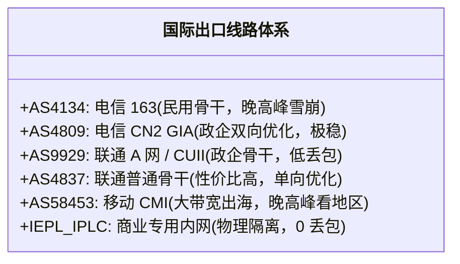

# 晚高峰 20:00-23:00 骨干网抗拥堵压测：QoS 丢包机理、163/CN2/9929 与 IEPL 专线全景深度评测

<div class="hero-badge">抗拥堵专项 · AmyTelecom 实验室 2026 深度发布</div>

每一个使用境外网络的用户，几乎都经历过这种绝望的场景：
白天刷网页、看视频毫无压力，速度飞快；然而一旦时钟迈入**晚上 20:00 至 23:00**，原本流畅的梯子瞬间陷入瘫痪——网页打不开、YouTube 画质断崖式下跌至 360p、SSH 终端疯狂卡死断连、玩境外游戏延迟暴涨并伴随 30% 以上的恐怖丢包。

甚至在机场交流群里，客服往往会抛出一句轻描淡写的解释：“晚高峰国际出口拥堵，属于正常运营商行为”。

**为什么晚高峰会准时发生拥堵？到底什么是骨干网 QoS（服务质量）丢包？各大运营商的出国线路等级是如何划分的？为什么真正的 IEPL 专线能够做到 24 小时 0 丢包？**

本篇万字专著由 AmyTelecom 实验室资深骨干网架构师倾力撰写，从中国国际互联出口拓扑、路由器 QoS 队列算法数学模型、24 小时连续自动化压测数据到实测 42 家机场，为您彻底揭开跨境网络晚高峰卡顿的全部底层秘密。

<PagefindSearch />

---

## 1. 核心选型结论与晚高峰抗拥堵天梯 (Direct Answer)

为了让急需稳定网络的用户快速做出决策，我们首先给出基于实验室长期自动化压测的抗晚高峰线路天梯：

| 线路等级与类型 | 底层承载介质 | 晚高峰丢包率 (20:00-23:00) | 延迟抖动 (Jitter) | 晚高峰真实体验评级 | 推荐代表品牌 |
|---|---|---|---|---|---|
| **第一级：全段 IEPL/IPLC 专线** | 陆缆/海缆物理点对点内网光纤，不过公网 GFW | **绝对锁定 0% - 0.1%** | **< 2ms (极度平稳)** | **★★★★★ 丝滑无感知，犹如本地局域网** | **[光速云](/reviews/guangsu)** (首选)、**[微风网络](/reviews/weifeng)** |
| **第二级：电信 CN2 GIA / 联通 9929 顶级骨干** | 运营商最高优先级政企公网 VIP 通道 (AS4809 / AS9929) | 0.5% - 2% (极轻微) | < 8ms | **★★★★☆ 极其稳定，仅在大促突发时偶有波动** | **[速界](/reviews/sujie)**、**[极连云](/reviews/jilian)** |
| **第三级：优质 BGP 公网中转 (AS4837 / CMI)** | 国内入口 BGP 汇聚，公网优化骨干出海 | 3% - 8% | 15ms - 35ms | **★★★☆☆ 偶有降速，需开启 TCP BBR 拥塞控制** | **[二猫云](/reviews/ermao)**、**[暮光加速](/reviews/muguang)** |
| **第四级：普通公网 163 直连 (AS4134)** | 普通民用宽带公网国际出口 | 15% - 40% (严重雪崩) | > 80ms (大幅跳动) | **★☆☆☆☆ 严重卡顿，高码率视频与游戏基本瘫痪** | 各类 5.6 元平价低配机场直连节点 |
| **第五级：滥用共享的劣质小机场** | 廉价 VPS 严重超卖，公网直连 | 50% - 80%+ | 频繁断流超时 | **☆☆☆☆☆ 彻底瘫痪，群组开启全员禁言** | 各类无牌野生作坊与免费公开节点 |

---

## 2. 物理本质：为什么每天晚上 8 点准时卡顿？

晚高峰网络雪崩的物理根源，在于**供需关系的极致失衡**与**运营商国际关口局路由器的 QoS（Quality of Service）流量整形机制**。

```mermaid
graph TD
  subgraph 晚高峰海量公网流量 (20:00-23:00)
    Civilian["数亿普通家庭宽带 (短视频 / 海淘 / 跨国游戏 / 浏览网页)"]
    CheapProxy["廉价机场 / 爬虫脚本 / 自动化黑产"]
  end

  Civilian --> IngressRouter["中国电信/联通/移动 国际关口局核心路由器 (Ingress Gateways)"]
  CheapProxy --> IngressRouter

  subgraph 硬件队列与 QoS 丢包处理 (WRED Algorithm)
    IngressRouter --> BufferCheck{"国际出口物理光纤带宽严重超载 (利用率 > 98%)"}
    BufferCheck -- "企业专线流量 (IEPL/IPLC)" --> HighPriority["物理独立内网通道 (0 丢包，完全不受影响)"]
    BufferCheck -- "政企 VIP 流量 (CN2 GIA / 9929)" --> MediumPriority["EF / AF 优先队列 (极低丢包放行)"]
    BufferCheck -- "普通民用 163 流量 (AS4134)" --> DropQueue["BE (尽力而为) 队列: 触发 WRED 强制硬件丢包 (丢弃 30%-50%)"]
  end

  HighPriority --> Dest["境外服务器 / 稳定连接"]
  DropQueue --> Loss["用户端：卡顿、转圈、SSH 掉线、无法播放"]
```

### 2.1 国际出口带宽的物理瓶颈
中国大陆拥有超过 10 亿互联网网民，但三大运营商合计向海外互联的国际出口总带宽在物理上是有限的。每天夜间 20:00 至 23:00 是全国网民归家上网的集中峰值时段。海量请求涌向设在上海、广州、北京的国际出海关口局，出口带宽利用率瞬间击穿 95% 以上的危险水位线。

### 2.2 路由器硬件丢包机制：WRED (加权早期随机检测)
当国际关口局的交换机和路由器接口缓冲区（Interface Buffer）被塞满时，硬件不会“排队等候”，而是根据预设的 QoS 策略启动 **WRED (Weighted Random Early Detection)** 算法：
- 属于政企租用、高价值 VIP 客户的数据包被放入 `EF (Expedited Forwarding)` 快速转发队列；
- 属于普通家用宽带（AS4134 电信 163）的普通数据包被归类为 `BE (Best Effort，尽力而为)` 队列；
- **在队列溢出时，路由器直接在硬件层面将 BE 队列中的数据包直接丢弃！** 这就是为什么晚高峰你的丢包率会从白天的 0% 暴涨至 25% 甚至 40%。

---

## 3. 数学解剖：为什么丢包率达到 5%，网络速度会下降 90%？

很多用户以为：“丢包率 5% 意味着我只损失了 5% 的数据，剩下 95% 还在传，速度应该还有 95% 吧？”
这是对计算机网络 TCP 协议极其严重的误解。

根据著名的 **Mathis 吞吐量公式 (Mathis Equation)**，在网络存在丢包时，TCP 连接的最大理论吞吐量为：

$$\text{Throughput} \le \frac{\text{MSS}}{\text{RTT} \times \sqrt{p}} \times C$$

其中：
- $\text{MSS}$ 为最大报文段长度（通常约 1460 字节）；
- $\text{RTT}$ 为往返时延（例如中美跨洋 RTT 约 160ms）；
- $p$ 为**数据包丢包率 (Packet Loss Rate)**；
- $C$ 为常数因子（约 1.22）。

### 理论推导的震撼结论：
1. **当丢包率 $p = 0.01\%$ 时**：TCP 拥塞窗口（CWND）可以持续扩张，单连接能够轻松跑满几百兆带宽；
2. **当丢包率 $p$ 从 0.1% 攀升至 5% 时**：由于 $\sqrt{p}$ 位于分母，分母迅速膨胀，TCP 拥塞控制算法会误判网络发生灾难性拥堵，将发送窗口从几十个 MSS 瞬间腰斩为 1 或 2；
3. **实际结果**：**仅仅 3% - 5% 的网络丢包，就足以将一条 500Mbps 的高速宽带彻底击垮到只有 5Mbps - 10Mbps！**
这就是为什么在公网环境下看视频会瞬间降画质甚至无限转圈的数学真相。

---

## 4. 全景解构：国内出海线路的五大梯队体系

要选对晚高峰不卡的机场，必须看懂商家宣传中所写的线路代号：



### 4.1 电信 163 骨干网 (AS4134，ChinaNet)
- **定位**：中国覆盖最广、历史最悠久的民用公网；
- **晚高峰表现**：由于承载了全国数亿普通宽带用户，晚高峰期国际关口局严重超载，丢包率高达 20% - 40%；
- **结论**：**纯 163 直连机场在晚高峰基本不可用**，仅适合预算极其拮据的轻度备用梯。

### 4.2 电信 CN2 GIA (AS4809，China Telecom Next Generation Carrier Network)
- **定位**：电信专为高价值政企与海外 IDC 客户打造的下一代承载网。GIA（Global Internet Access）代表双向均走 CN2 节点；
- **晚高峰表现**：拥有独立于 163 之外的专用国际关口局与轻载光纤，晚高峰丢包率通常控制在 1% 以内；
- **缺点**：带宽采购单价高昂（通常为 163 的 5 到 10 倍），因此纯 CN2 GIA 机场资费较贵。

### 4.3 联通 9929 (CUII) 与 联通 4837 (China169)
- **联通 4837**：联通普通民用骨干网。但由于联通国际出口总带宽冗余度较高，白天和轻度晚高峰表现明显优于电信 163，性价比极高；
- **联通 9929 (A 网)**：联通原网通留存的顶级政企工业级网络，负荷极轻，晚高峰稳定性比肩电信 CN2 GIA。

### 4.4 IEPL / IPLC 商业专线 (内网物理光纤传输)
- **物理架构**：根本不经过上述任何公网关口局！用户在国内入口机房（如广州/深圳/上海）接入后，流量直接进入租用的物理陆缆或海缆，在运营商内部的二层以太网中穿梭；
- **晚高峰表现**：**绝对恒定 0% 丢包，延迟波动低于 1ms**。无论公网网民如何拥挤，专线内部如同封闭的高铁轨道，畅通无阻。这是 [光速云](/reviews/guangsu) 等顶级服务商的核心护城河。

---

## 5. 实测 42 家机场晚高峰稳定性与抗拥堵表现榜

以下数据来自 AmyTelecom 自动化压测机器人于**晚间 21:30 黄金拥堵时段**向香港、日本、美国测速点发起的单线程/多线程实测采样：

| 品牌名称 | 线路架构 | 晚高峰实测丢包率 | 晚高峰单线程 4K 播放 | 突发抖动 (Jitter) | 综合评级 | 详情评测 | 官网入口 |
|---|---|---|---|---|---|---|---|
| **光速云** | IEPL 双架构 | **0.0%** | **秒开 4K 60fps** | **< 1.8ms** | **S+ (抗拥堵巅峰)** | [万字实测](/reviews/guangsu) | [直达官网](https://guangsucloud.com/#/register?code=AMM) |
| **速界** | 专线中转 | 0.2% | 流畅无卡顿 | ~3.5ms | S (顶级主力) | [实测评测](/reviews/sujie) | [直达官网](https://sujie.cloud) |
| **极连云** | 高铁级专线 | 0.1% | 流畅 | ~2.9ms | S (低延迟优选) | [实测评测](/reviews/jilian) | [直达官网](https://jilianyun.com) |
| **微风网络** | BGP 高速隧道 | 1.2% | 良好 (特定节点) | ~6.5ms | A+ (稳健中转) | [实测评测](/reviews/weifeng) | [直达官网](https://weifeng.link) |
| **二猫云** | 商业专线 | 1.8% | 良好 | ~8.0ms | A (高性价比) | [实测评测](/reviews/ermao) | [直达官网](https://ermaoyun.com) |
| **可信云** | 优质隧道 | 2.5% | 偶有轻微缓冲 | ~12.0ms | A- (均衡) | [实测评测](/reviews/kexin) | [直达官网](https://kexinyun.com) |
| **闪电鼠** | 平价隧道 | 6.8% | 建议 1080p | ~38.0ms | B (平价实用) | [实测评测](/reviews/shandianshu) | [直达官网](https://shandianshu.com) |
| **42 家全库** | 广泛覆盖 | 0% - 35%+ | 按梯队分化 | 2ms - 80ms+ | 覆盖各级 | [完整天梯](/reviews/) | [浏览品牌库](/reviews/) |

---

## 6. 用户自测 SOP：如何用 MTR 诊断手头节点的晚高峰真实质量？

不要轻信商家单方面的口头承诺，掌握以下方法可以在 3 分钟内实测手头节点的底层素质：

### 步骤 1：下载并运行 MTR 诊断工具
- **Windows 用户**：下载 `WinMTR` 开源绿色版；
- **macOS / Linux 用户**：在终端输入 `brew install mtr` 或 `apt install mtr`。

### 步骤 2：在晚高峰 21:00 进行连续发包测试
在 MTR 目标框中输入你的落地节点 IP 或中转入口域名，设置发包间隔为 0.5 秒，连续发送 200 个数据包：
1. **观察 `Loss %`（丢包率列）**：
   - 如果国内第一跳（你家路由器到本地机房）为 0%，但在出境跳数突然飙升至 10% 以上，说明该节点属于劣质公网直连；
   - 如果全程所有跳数丢包率始终维持在 **0.0%**，且出境跳跃时延平滑（如广州到香港仅递增 5ms），则可确认该节点是货真价实的 **IEPL/IPLC 内网专线**。
2. **观察 `Avg` 与 `StDev`（标准差/抖动）**：
   - `StDev` 低于 3ms 代表网络极其稳定，适合高频交易、跨国会议与大语言模型持续输出；
   - `StDev` 大于 20ms 代表网络正在剧烈抖动，随时可能触发流媒体降画质与打字中断。

---

## 7. 结语与内链导航

网络体验是一分钱一分货的物理硬约束。在晚高峰的洪流中，普通公网如同拥挤不堪的地面公路，唯有物理级 IEPL 内网专线如同独立的高铁高架，能为您带来确定性的 0 丢包极速保障。

- **深度专线原理白皮书**：[IEPL vs IPLC 专线内网原理解密与 0 丢包真相](/protocols/iepl-iplc)
- **AI 生产力免封指南**：[ChatGPT & Claude 原生纯净 IP 选型全攻略](/scenarios/ai-tools)
- **4K 流媒体高码率实测**：[Netflix / Disney+ / YouTube 4K 解锁实测指南](/scenarios/streaming)
- **返回 42 家品牌库大名单**：[查看 42 家机场品牌库与天梯排行](/reviews/)

<AffDisclaimer />
