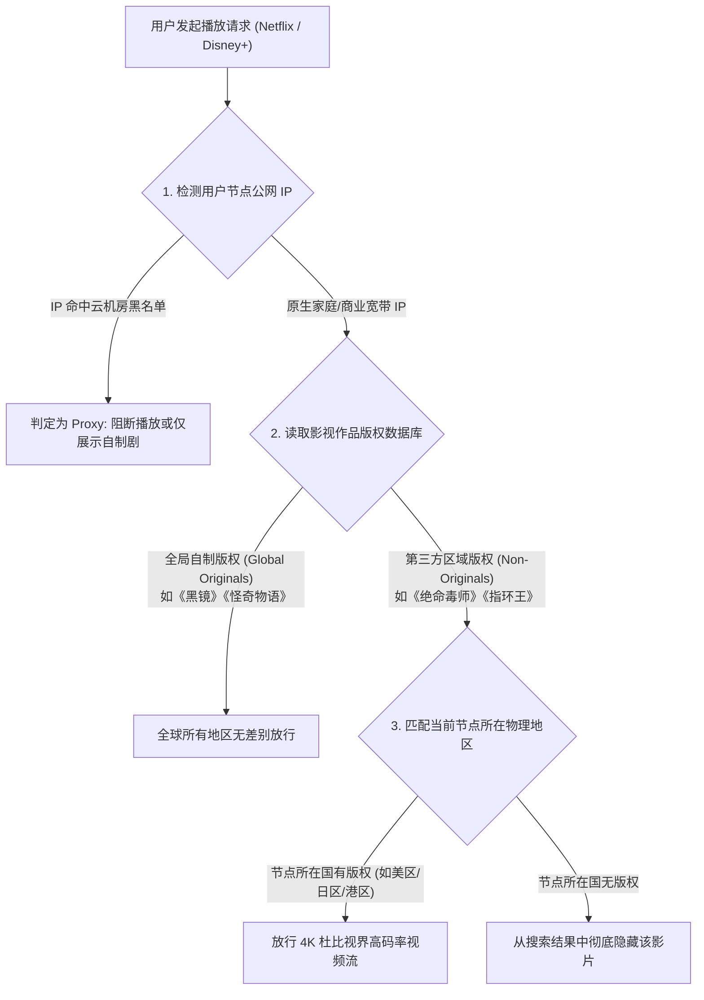
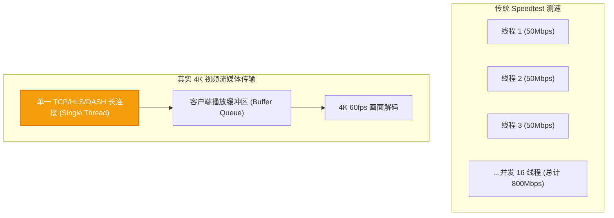

# Netflix / Disney+ / YouTube 4K 流媒体高码率解锁实测与机场选型指南

流媒体专项 · AmyTelecom 实验室 2026 深度发布

对于广大影音发烧友而言，订阅全球流媒体服务（Netflix、Disney+、Max/HBO、Amazon Prime Video、YouTube Premium）已经成为高品质数字生活的标配。

然而，在实际观影过程中，用户最常遇到的挫败感莫过于：
- 明明购买了号称“百兆专线”的机场，Speedtest 测速跑满几百兆，但在打开 Netflix 观看 4K 杜比视界（Dolby Vision）电影时，却频繁转圈缓冲，甚至画质被强制降级到模糊的 720p；
- 能够正常登录 Netflix，但搜索列表中只有《怪奇物语》《爱，死亡和机器人》等官方自制剧，而《绝命毒师》《老友记》等第三方版权影视剧却**彻底搜不到**；
- 电视盒子（如 Apple TV 4K、Chromecast with Google TV）在大屏幕播放时，频繁弹出“您似乎使用了代理或解锁服务，请关闭后重试”。

**为什么多线程测速很高，看 4K 视频却依然卡顿？到底什么是“非自制剧解锁”？Apple TV 该如何优雅配置代理？**

本篇万字专著由 AmyTelecom 实验室音视频流媒体评测组深度撰写，从视频编码码率需求、DRM 数字版权体系、流媒体解锁机理解构到 42 家机场实测，为您彻底扫清流媒体观影的一切障碍。

<PagefindSearch />

---

## 1. 核心选型结论与流媒体适配天梯 (Direct Answer)

| 梯队等级 | 节点特征 | Netflix 解锁能力 | Disney+ / Max 解锁 | YouTube 4K/8K 缓冲时延 | 推荐代表品牌 |
|---|---|---|---|---|---|
| **第一梯队：极清影音旗舰** | 双向企业级 IEPL 专线 + 原生大带宽出口 | **全库非自制剧秒解**，支持 4K HDR 杜比全景声 | **完美解锁**，支持 IMAX Enhanced | **< 300ms**，拖动进度条零等待 | **[光速云](/reviews/guangsu)** (首选)、**[速界](/reviews/sujie)** |
| **第一梯队：流媒体专线优化** | 高速 BGP 隧道 + 动态 DNS 流媒体分流组 | 绝大多数节点支持非自制剧 | 良好，支持港台/美日全区 | < 600ms，偶有轻微缓冲 | **[微风网络](/reviews/weifeng)**、**[极连云](/reviews/jilian)** |
| **第二梯队：性价比实用型** | 公网优化中转 + 共享流媒体解锁池 | 基础自制剧无压力，非自制剧需挑节点 | 需切换特定专区节点 | 1-2 秒缓冲，支持 1080p/4K 基础码率 | **[二猫云](/reviews/ermao)**、**[可信云](/reviews/kexin)** |
| **第三梯队：平价轻量型** | 5.6 元档或经济型线路 | 大多数仅能看自制剧，非自制剧常被屏蔽 | 经常触发代理警告 | 易受晚高峰丢包影响，建议降码率至 1080p | **[闪电鼠](/reviews/shandianshu)**、**[榴莲云](/reviews/liulianyun)** |
| **红线避坑：劣质公网直连** | 滥用机房 IP 的直连 VPS | **100% 弹出代理警告 (Proxy Error)** | **无法播放任何受版权保护内容** | 频繁缓冲，体验极度恶劣 | 各类公开免费订阅池 |

---

## 2. 深度解密：流媒体版权分区与防翻墙封锁机制

流媒体平台与一般网站不同，其背后背负着好莱坞各大电影制片厂极其严厉的“区域版权分销协议（Regional Licensing Agreements）”。因此，流媒体平台的风控逻辑远比普通网站复杂：

### 2.1 什么是“自制剧”与“非自制剧 (Non-Originals)”的区别？
很多新手用户会误以为“只要能打开 Netflix 就算是解锁了”。这是极大的误区：
- **Netflix 原创自制剧 (Netflix Originals)**：版权属于 Netflix 官方自身，面向全球 190 多个国家开放。即便你的节点 IP 质量较差（被识别为数据中心），Netflix 为了基本用户体验，仍然会允许你播放这部分自制剧；
- **第三方非自制剧 (Non-Originals)**：例如华纳、索尼、迪士尼授权给 Netflix 在特定国家放映的电影电视剧。**只有当你的节点 IP 被 Netflix 判定为该国家合法的家庭原生宽带时，这部分非自制剧才会出现在你的搜索列表里**。如果搜索特定影片（如经典港片或好莱坞大片）搜不到，说明你的机场节点仅仅处于“半解锁”状态。

### 2.2 DRM 数字版权等级：Widevine L1 vs L3
在移动端（Android / 电视盒子）观看流媒体时，除了网络节点外，还受到硬件安全等级的制约：
- **Google Widevine L1**：硬件级加密芯片支持，允许解密和串流 4K、1080p 高清视频；
- **Google Widevine L3**：仅软件级防护，即使你的机场网络速度达到 1000Mbps，Netflix APP 也会强行将画质锁定在最低的 540p / 720p。国产部分未过认证的手机或山寨外贸电视盒子常受此限制。

---

## 3. 破除迷信：为什么多线程测速几百兆，看 4K 依然卡顿？

在很多机场的测速频道中，用户经常看到“千兆跑满、彩虹图绚丽”的测速截图。但一旦到了晚高峰看 YouTube 4K 或 Netflix 4K，却依然不断转圈。这背后的核心工程原理是：**多线程并发测速吞吐量 ≠ 单线程视频流媒体吞吐量**。

### 3.1 视频串流的单线程工作模型
流媒体视频播放（无论是 Netflix 的 DASH 协议还是 YouTube 的 HLS 协议）本质上是通过**单一持久化的 TCP 线程**逐个拉取 2 秒到 6 秒的视频分片（Video Segments / .ts / .m4s）。
- 当线路存在 1% 的丢包时，TCP 拥塞控制算法（如 Cubic）会将传输窗口瞬间腰斩 50%；
- 多线程测速由于有数十个连接在并发拉取，个别连接丢包不会反映在总体带宽数字上；
- 但在单线程视频流中，一个数据包的重传就会导致缓冲区耗尽，播放器被迫暂停解码并呈现转圈缓冲；
- **结论**：4K 高码率观影真正依赖的不是盲目冲高的多线程峰值，而是**端到端绝对平稳、抖动（Jitter）低于 5ms、丢包率为 0% 的高品质专线**。这正是 [光速云 IEPL 专线](/reviews/guangsu) 在流媒体发烧友中口碑极高的技术根基。

---

## 4. 常见的流媒体解锁技术手段剖析

机场服务商为了实现流媒体解锁，通常采用以下三种底层技术架构：

| 解锁技术方案 | 底层实现机理 | 优势 | 潜在缺陷 | 适用机场梯队 |
|---|---|---|---|---|
| **DNS SNI 劫持分流 (Smart DNS)** | 入口机房拦截对 Netflix 域名的解析，将流媒体流量通过 SNI 代理转发给拥有原生 IP 的落地机 | 成本极低，一套解锁机可供全机场节点复用 | 延迟增加，高峰期一旦中继机拥堵则全盘崩溃 | 第二、三梯队机场广泛采用 |
| **IPv6 隧道解锁** | 通过 HE 隧道或特定提供商的干净 IPv6 地址访问流媒体 | 避开已被污染的 IPv4 地址段 | 很多流媒体服务已开始严格封锁数据中心 IPv6 | 部分中小机场过渡期使用 |
| **原生双 ISP 住宅出口 (Residential Egress)** | 在落地端直接采购当地真实宽带运营商（如香港 HKT、日本 NTT、美国 AT&T）的独享光纤 | **信任等级最高，永不封锁，全库完美解锁** | 硬件与带宽成本极其昂贵 | **[光速云](/reviews/guangsu)** 等顶级第一梯队机场 |

---

## 5. 电视大屏与家庭影音选型实操 (Apple TV / Google TV)

在大屏电视上看 4K HDR 杜比视界，是流媒体体验的巅峰。由于 Apple TV 原生不支持安装普通翻墙客户端，用户推荐采用以下两种成熟方案：

### 方案 A：Apple TV 安装专用客户端 (tvOS 17+)
自 tvOS 17 起，苹果官方开放了 VPN API，目前可以直接在 Apple TV 美区 App Store 下载：
- **Sing-box for tvOS** (完全免费且支持图形化导入订阅)；
- **Shadowrocket (小火箭 tvOS 版)**；
- **Loon / Surge tvOS 版**。
配置时只需扫描机场后台的二维码，将订阅导入 Apple TV，并在配置中选择“开启规则分流”，即可让电视流量直接在本地完成解密与加速。

### 方案 B：旁路由透明代理 (软路由 OpenClash)
对于拥有全屋智能家居和多台游戏机、电视盒子的家庭，最优解是在家庭局域网中部署一台软路由（如工控机或群晖 NAS 虚拟机）：
1. 运行 OpenClash，核心模式设为 `Fake-IP 混合模式`；
2. 将 Apple TV 的局域网网关与 DNS 指向软路由 IP；
3. Apple TV 本身无需安装任何软件或保持后台运行，开机即处于干净的海外网络环境，支持家庭所有成员无感知观影。详细部署指南请参考：[软路由与家庭网关科学上网配置指南](/clients/openwrt)。

---

## 6. 实测 42 家机场流媒体解锁表现全景表

| 品牌名称 | 线路架构 | 起步门槛 | Netflix 非自制剧 | Disney+ | YouTube 4K 拖拽缓冲 | 测速图与详情 |
|---|---|---|---|---|---|---|
| **光速云** | IEPL 双架构 | 9.9 元/月 (折合 8元) | **香港/日美全区全解** | **全解 (IMAX)** | **< 0.2 秒 (秒开)** | [查看实测测速图](/reviews/guangsu) |
| **速界** | 高速专线中转 | 15.0 元/月 | 全解 | 全解 | < 0.4 秒 | [查看实测测速图](/reviews/sujie) |
| **极连云** | 高铁级内网专线 | 12.0 元/月 | 全解 | 良好 | < 0.5 秒 | [查看实测测速图](/reviews/jilian) |
| **微风网络** | BGP 高速中转 | 15.0 元/月 | 良好 (特定节点) | 良好 | ~0.6 秒 | [查看实测测速图](/reviews/weifeng) |
| **二猫云** | 商业专线 | 12.0 元/月 | 良好 | 良好 | ~0.8 秒 | [查看实测测速图](/reviews/ermao) |
| **可信云** | 优质隧道 | 15.0 元/月 | 良好 | 中等 | ~0.8 秒 | [查看实测测速图](/reviews/kexin) |
| **闪电鼠** | 平价隧道 | 5.6 元/月 | 部分节点支持 | 偶有报错 | ~1.5 秒 | [查看实测](/reviews/shandianshu) |
| **42 家全库** | 全面覆盖 | 见品牌清单 | 参差不齐 | 参差不齐 | 0.2s - 3.0s+ | [浏览 42 家综合天梯](/reviews/) |

---

## 7. 高频故障排查字典

- **现象 1：Netflix 报错“您似乎使用了取消阻止程序或代理 (Error Code: m7111-5059)”**
  - **原因**：当前节点 IP 已被 Netflix 风控系统判定为代理服务器。
  - **解决**：在客户端切换至带有“原生”、“解锁”或“Streaming”标识的节点；如果是优质机场，直接联系在线客服，通常会在数分钟内自动调度切换新的干净出口 IP。
- **现象 2：为什么看 Netflix 只有中文字幕，没有繁体或英文？或者搜不到特定影片？**
  - **原因**：Netflix 显示的字幕语言与内容库取决于你的**节点落地所在国家**。例如连入香港节点，展示的是港区影视库与繁体字幕；连入新加坡节点，展示的是新区影视库与简繁双语；连入美国节点，则拥有全球最大的电影库，但部分影片可能仅有英文字幕。
- **现象 3：YouTube 画质自动锁定在 480p 或 720p，手动切 4K 就卡顿**
  - **原因**：节点在晚高峰遭遇国际出口 QoS 限速，TCP 丢包率飙升导致播放器自适应码率算法（ABR）强制降低画质。解决办法是升级至具备晚高峰 0 丢包保障的 IEPL 专线。

---

## 8. 结语与内链导航

在享受数字流媒体带来的震撼视听盛宴时，一套底层扎实、丢包率极低的专线网络是所有视听体验的生命线。

- **深度专线原理白皮书**：[IEPL vs IPLC 专线内网原理解密与 0 丢包真相](/protocols/iepl-iplc)
- **晚高峰压测与抗拥堵解析**：[晚高峰 20:00-23:00 骨干网 QoS 丢包机理全景剖析](/scenarios/peak-hours)
- **大屏观影与全屋代理**：[软路由 OpenClash 透明代理与 DNS 防泄漏终极指南](/clients/openwrt)
- **返回 42 家品牌库大名单**：[查看 42 家机场品牌库与天梯排行](/reviews/)

<AffDisclaimer />
