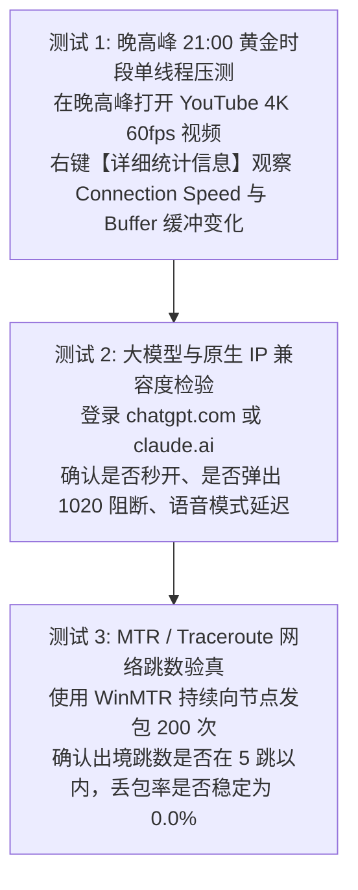

# 2026 最新支持免费试用与 1 元体验的机场全景白名单：零成本测速与避坑指南

免费试用专项 · AmyTelecom 实验室 2026 深度发布

在购买任何付费网络服务之前，**“先尝后买（Try Before You Buy）”** 永远是消费者保护自身权益、规避踩坑的最明智策略。

一家对自己的网络基础设施、专线带宽冗余度和节点稳定性拥有绝对信心的机场服务商，通常不会吝啬于向新用户提供**无门槛免费试用（Free Trial）**，或者提供 **1 元至几元钱的极低门槛体验套餐**。

相反，那些要求用户一上来就必须支付几十元甚至强制年付、且承诺“一经售出绝不退款”的商家，其背后的节点质量往往经不起实际推敲。

**2026 年全网究竟有哪些机场支持真实的免费试用与 1 元尝鲜？在短暂的试用期内，用户应该如何科学检测该机场的真实成色？如何提防“试用给专线、付款换公网超卖”的行业套路？**

本篇万字支柱专著由 AmyTelecom 实验室商务调研组联合编撰，为您呈现实测有效的 2026 机场试用全景白名单。

<PagefindSearch />

---

## 1. 2026 免费试用与极低门槛体验白名单 (Direct Answer)

| 品牌名称 | 体验试用形式 | 试用赠送额度 / 门槛 | 节点开放权限 | 专属优惠码 | 综合推荐评级 | 详情评测 | 官网入口 |
|---|---|---|---|---|---|---|---|
| **[光速云](/reviews/guangsu)** | **8元/月 超低月均体验** | 专线全节点开放 | **全段 IEPL 专线 + 原生 AI 落地** | `AMM` | **★★★★★ (第一首推主力)** | [万字深度评测](/reviews/guangsu) | [直达官网开通](https://guangsucloud.com/#/register?code=AMM) |
| **[闪电鼠](/reviews/shandianshu)** | **5.6 元超低单月尝鲜** | 100 GB / 月 | 开放全套多线中转节点 | `Amy666` | **★★★★☆ (平价试水首选)** | [深度评测](/reviews/shandianshu) | [直达官网开通](https://shandianshu.com) |
| **[可信云](/reviews/kexin)** | 新用户少量免费测试 | 注册领测试流量 | 开放基础节点组 | `Amy666` | ★★★★☆ | [深度评测](/reviews/kexin) | [直达官网开通](https://kexinyun.com) |
| **[飞猫云](/reviews/feimao)** | 7 元专属轻量套餐 | 专属客户端体验 | 优化专线中转 | `Amy666` | ★★★★☆ | [深度评测](/reviews/feimao) | [直达官网开通](https://feimaoyun.com) |
| **[无忧链接](/reviews/wuyou)** | 6 元尝鲜试用月付 | 基础测试流量 | 免转换通用节点 | `Amy666` | ★★★☆☆ | [深度评测](/reviews/wuyou) | [直达官网开通](https://wuyoulink.com) |
| **[大佬云](/reviews/dalaoyun)** | 5.6 元小额月付体验 | 80 GB / 月 | 平价共享节点 | `Amy666` | ★★★☆☆ | [深度评测](/reviews/dalaoyun) | [直达官网开通](https://dalaoyun.com) |

---

## 2. 为什么敢于提供试用的机场更具公信力？

在机场灰产的残酷博弈中，商家开放试用需要克服巨大的运营与风控成本：
1. **抵御黑产羊毛党的脚本狂刷**：公开无门槛注册试用，极易招致自动化黑产用海量临时邮箱批量注册，刷爆服务器带宽。敢于开放试用的商家，通常在前端部署了高等级的防刷风控（如手机验证码或 Turnstile 验证），具备成熟的企业级运维技术栈；
2. **对底层线路质量的绝对自信**：劣质超卖机场之所以不敢提供试用，是因为他们知道自己的公网节点一到晚高峰就会卡死，一旦用户试用就会露馅。而拥有真实自建 IEPL 专线的服务商（如 [光速云](/reviews/guangsu)），巴不得用户在晚高峰 21:00 前来压测，因为实测的 0 丢包数据就是最强有力的广告。

---

## 3. 试用期科学验真三部曲：把好最后一道防线

拿到试用节点后，切忌只是在白天随便刷刷网页就算完事。请在试用期内严格执行以下三项压力测试：

---

## 4. 两大试用避坑专题技术白皮书矩阵

点击下方卡片，进入由 AmyTelecom 实验室测试组撰写的试用专项手册：

  避坑专项
  <h3 style="margin: 0.5rem 0; font-size: 1.25rem;"><a href="/trials/low-cost-trial">1 元及小额体验包防坑指南</a></h3>
  

    深度揭秘“试用给专线、付款换公网超卖”的行业套路，剖析自动续费扣款陷阱与安全体验姿势。
  

  <a href="/trials/low-cost-trial" style="color: #2563eb; font-weight: 600; text-decoration: none;">阅读体验包防坑指南 →</a>

  实操验真专项
  <h3 style="margin: 0.5rem 0; font-size: 1.25rem;"><a href="/trials/verification-sop">试用期用 MTR 压测验明真假专线 SOP</a></h3>
  

    手把手教你使用 WinMTR 与 PingPlotter，在试用期内 3 分钟测出手头节点的真实丢包率、物理跳数与骨干网归属。
  

  <a href="/trials/verification-sop" style="color: #10b981; font-weight: 600; text-decoration: none;">阅读专线验真 SOP →</a>

---

## 5. 全局导航与知识内链

- **42 家综合选型天梯**：[2026 全球 42 家机场综合选型推荐总览](/recommendations/)
- **5.6 元平价高性价比榜**：[5.6 元平价高性价比学生党机场推荐榜](/recommendations/budget-ranking)
- **企业专线巅峰榜**：[企业级 IEPL/IPLC 专线推荐榜](/recommendations/iepl-ranking)
- **防跑路避坑专著**：[机场跑路前兆 10 大信号与防失联指南](/warning/)

<AffDisclaimer />
