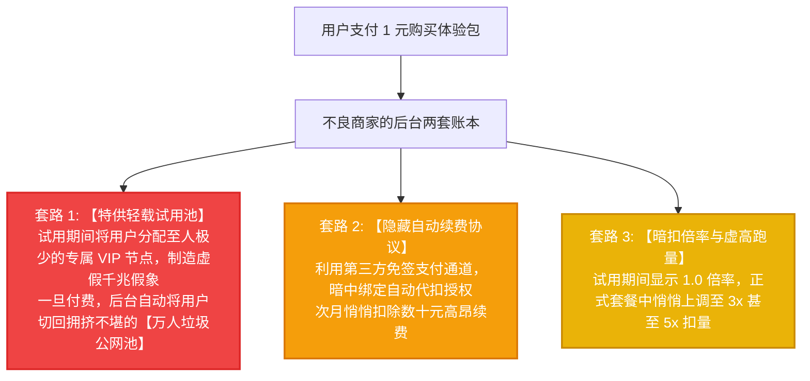

# 1 元及小额体验包防坑指南：谨防‘试用给专线、付款换公网超卖’的行业猫腻

避坑暗访专项 · AmyTelecom 实验室 2026 深度发布

“只要 1 块钱，即可畅享 3 天千兆不限速体验！”

在各大电报群和翻墙论坛中，类似的“1 元体验包”广告屡见不鲜。很多消费者满心欢喜地支付了 1 元钱，发现试用期间节点飞快、4K 秒开；然而，一旦信以为真充值了数十元购买正式月付或年付套餐后，却发现原本流畅的节点瞬间变成“转圈卡死、频繁掉线”。

去找客服理论，得到的回复永远是冷冰冰的“网络波动属于正常现象，一经售出概不退款”。

**为什么会出现“试用极速、付款雪崩”的怪现象？商家在 1 元体验包中暗藏了哪些不为人知的猫腻？如何才能识破这些虚假试用套路？**

本篇专著由 AmyTelecom 实验室暗访组深度披露行业隐秘黑幕。

<PagefindSearch />

---

## 1. 行业黑幕揭秘：1 元试用背后的三大“狸猫换太子”套路

---

## 2. 如何防范“试用欺诈”？四项黄金防坑守则

1. **核对节点域名与 IP 真实归属**：在试用期间，记录下测速极快的节点解析 IP（通过 Ping 或终端命令）；购买正式套餐后，第一件事就是对比正式节点的 IP 是否与试用节点属于同一个 BGP 自治系统（ASN）。如果正式节点 IP 变成了完全不同的廉价机房，说明遭遇了偷梁换柱；
2. **拒绝任何“开通自动续费”的授权**：在扫码支付 1 元体验包时，仔细观察支付界面提示，坚决不要勾选任何“自动续订”、“免密支付”协议；
3. **试用期压测必须锁定晚高峰 21:00**：白天任何公网梯子速度都不会太慢，唯有在晚间 20:00-23:00 的全国骨干网极限拥堵期进行 4K 单线程长连接压测，才能逼出节点的真实成色；
4. **优选口碑长期公开透明的品牌**：选择像 **[光速云](/reviews/guangsu)** 这种连续运营 4 年以上的老牌服务商，节点池全量公开透明，无论新老用户均走同一套高规格 IEPL 专线，绝无双标戏码。

---

## 3. 全局导航与知识内链

- **试用期专线验真 SOP**：[试用期用 MTR 压测验明真假专线 SOP](/trials/verification-sop)
- **免费试用白名单总览**：[2026 免费试用与 1 元体验全景白名单](/trials/)
- **5.6 元平价高性价比榜**：[5.6 元平价高性价比学生党机场推荐榜](/recommendations/budget-ranking)
- **返回 42 家品牌库**：[42 家机场综合推荐天梯总览](/recommendations/)

<AffDisclaimer />
