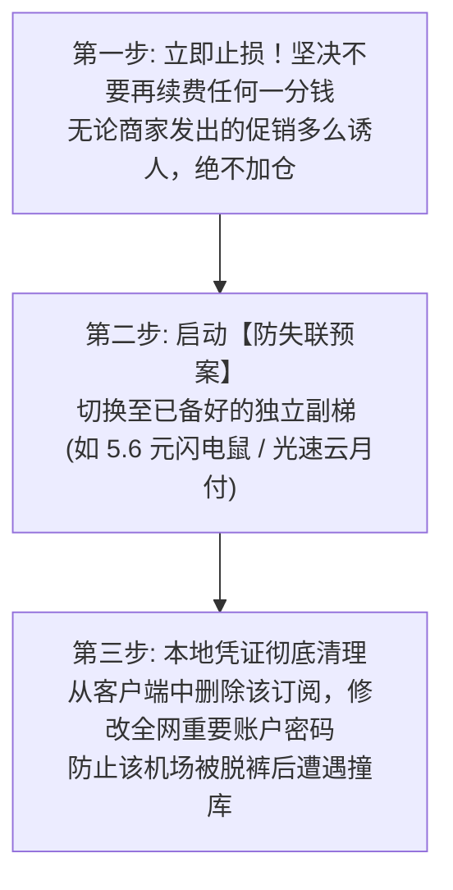

# 机场跑路前兆 10 大红线检测清单：突击骨折促销、全员禁言与工单失联深度透视

威胁情报专项 · AmyTelecom 实验室 2026 深度发布

没有任何一家机场会在首页挂出一块牌子写着“我们下周准备跑路”。相反，在卷款潜逃前夕，为了在关门前榨干最后一波现金流，商家的表面营销往往会达到前所未有的狂热高潮。

根据 AmyTelecom 实验室对过去三年中包括“速蛙云”、“速鹰 666”、“喵帕斯”在内的数十起大规模跑路案例的事后数字取证与时间线复盘，**95% 以上的跑路事件在彻底关停前 7 到 30 天内，均呈现出高度一致的 10 大异常红线信号**。

对照本清单，您可以随时对自己的手头机场进行“健康度自检”。

<PagefindSearch />

---

## 1. 机场跑路前夕 10 大危险红线检测清单

| 危险序号 | 异常异动表象 | 危险评级 | 真实幕后黑幕揭秘 |
|---|---|---|---|
| **信号 1** | **突然发起极其反常的“骨折级”促销** (如买一年送一年、终身 1 折、充 100 送 100) | 🚨🚨🚨🚨🚨 (极危) | **这是最经典的跑路前最后一次大规模敛财割韭菜！** 意图在删库关停前迅速套现最大额度的现金流。 |
| **信号 2** | **官方 Telegram 交流群突然开启“全员禁言”** 或开启长达数小时的超慢速发言 | 🚨🚨🚨🚨🚨 (极危) | 节点大面积瘫痪引发大量老用户维权投诉，管理人员无力也不愿解决，为了掩盖真相直接封堵言论。 |
| **信号 3** | **节点列表大面积报红叉超时，借口“上游被 DDoS 攻击”持续超过 2 周不修复** | 🚨🚨🚨🚨☆ (高危) | 实际上是因为拖欠 IDC 机房专线租金，被上游运营商强行停机拔线，商家根本无钱续约。 |
| **信号 4** | **工单系统从“数小时回复”变为“已读不回”，客服完全消失** | 🚨🚨🚨🚨☆ (高危) | 核心技术运维团队已经解散离职，仅留自动化脚本应付表面。 |
| **信号 5** | **频繁更换官网登录域名与收款个人二维码** | 🚨🚨🚨☆☆ (中高危) | 收款通道因涉及大量诈骗投诉被银行或第三方支付机构风控冻结，资金链处于崩溃边缘。 |
| **信号 6** | **悄悄下架所有“单月付”套餐，强制要求“季付、年付或三年付”起步** | 🚨🚨🚨🚨🚨 (极危) | 彻底放弃长期滚动运营，利用最后的流量强迫新老用户进行长期大额资金锁定。 |
| **信号 7** | **管理团队核心成员在群内公开吵架、退群或创始人转手卖站** | 🚨🚨🚨🚨☆ (高危) | 股东团队因分赃不均、合规风险或亏损产生内讧，通常数天内服务就会断崖猝死。 |
| **信号 8** | **突然发布公告声称“数据库被勒索黑客全面脱裤加密”，要求用户等待** | 🚨🚨🚨☆☆ (中危) | 很多不良站长自导自演“被黑”戏码，为合情合理跑路提供免责借口。 |
| **信号 9** | **大幅削减优质专线节点，全部换成劣质公网 VPS 直连** | 🚨🚨🚨☆☆ (中危) | 昂贵的物理 IEPL 专线已被退租，用一个月几十块钱的廉价公网 VPS 勉强支撑门面。 |
| **信号 10** | **网站后台的用户总数、流量审计等公开统计组件突然被隐藏** | 🚨🚨☆☆☆ (低中危) | 试图掩盖老用户大量流失、新用户断流的真实运营颓势。 |

---

## 2. 命中红线时的紧急处置三部曲

如果您发现自己购买的机场命中了上述 **2 条以上** 的危险信号，请立即执行以下紧急止损动作：

---

## 3. 全局导航与知识内链

- **主备双梯避难容灾守则**：[主备双梯 1 秒避难容灾守则与黑名单数据库](/warning/disaster-recovery)
- **跑路预警总览支柱页**：[全球翻墙机场跑路预警中心与健康度观测体系](/warning/)
- **第一主推安全老牌**：[光速云 (GuangSu) 4 年自建专线深度实测](/reviews/guangsu)
- **返回 42 家品牌库**：[42 家机场综合推荐天梯总览](/recommendations/)

<AffDisclaimer />
