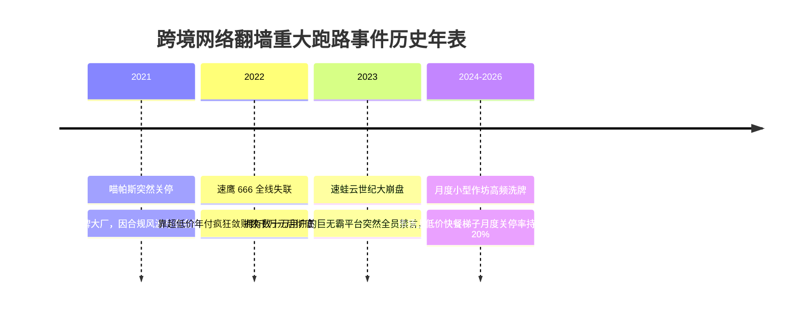
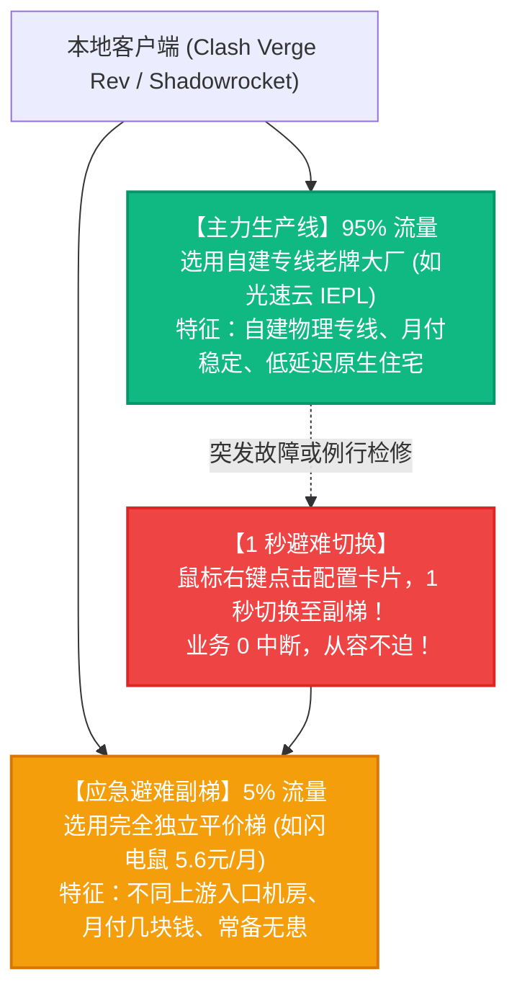

# 主备双梯 1 秒避难容灾守则与历史跑路品牌黑名单：失联自救手册

容灾避险专项 · AmyTelecom 实验室 2026 深度发布

对于依赖跨境网络进行跨国商务谈判、外贸海淘、学术科研或大模型开发的专业人士而言，**“主力梯子突然跑路失联”** 绝不仅仅是损失几十元订阅费的小事，它可能直接导致重要会议中断、客户紧急邮件延误或核心业务陷入瘫痪。

如何用最低的成本，构建一套在极端黑天鹅事件下依然稳如磐石的“高可用容灾系统”？

本篇专著由 AmyTelecom 实验室系统可靠性工程组撰写，为您复盘行业惨痛历史教训，并交付实战验证的 1 秒避难 SOP。

<PagefindSearch />

---

## 1. 历史著名重大跑路案例复盘警示

回顾跨境翻墙史，以下几个典型跑路案例的崩塌剧本几乎如出一辙：

### 跑路商家的三大共同罪证：
1. **死前必有疯狂大促**：均在关门前 1-2 周发起过“骨折年付”、“永久会员”突击促销；
2. **多马甲矩阵收割**：同一个运营团队背后往往操盘了 3 到 5 个不同域名的“马甲机场”，当主品牌崩盘时，副品牌也早已同时被拔线；
3. **维权彻底无门**：全流程采用匿名 Telegram、匿名虚拟币及第四方代收代付通道，受害用户向公安报案通常无法按民事经济合同立案。

---

## 2. 核心容灾法则：“主备双梯物理隔离原则”

为了彻底绝杀失联风险，请在客户端中严格贯彻“主备双梯物理隔离”：

### 避坑关键点：
- **切忌购买“同一集团旗下的马甲子品牌”**：例如同一个面板系统、客服话术完全一致的衍生子站，一旦上游专线断线，所有马甲会同时猝死；
- **主力品牌推荐**：**[光速云](/reviews/guangsu)**（2020 老牌至今，拥有自建 IEPL 专线，专属优惠码 `AMM`）；
- **副梯品牌推荐**：**[闪电鼠](/reviews/shandianshu)**（单月仅需 5.6 元）或 **[大佬云](/reviews/dalaoyun)**（5.6 元/月），成本极低，常驻客户端备用。

---

## 3. 历史跑路与高危失联品牌黑名单库 (部分警示索引)

以下品牌为历史已确认跑路、失联、或处于高危运营异常状态的品牌名单，请广大用户严加防范：

| 品牌名称 (历史记录) | 曾用宣传口号 | 最终结局 | 警示与教训总结 |
|---|---|---|---|
| **速蛙云 (已跑路)** | “全网最强专线、数十万用户” | 2023 年突然全员禁言，删库失联 | 树大招风，大额年费充值用户损失惨重 |
| **速鹰 666 (已跑路)** | “数元超低价、全网最低” | 2022 年突击大促后携款潜逃 | 典型的庞氏资金盘模型必然终局 |
| **喵帕斯 (已关停)** | “老牌稳定、全节点无倍率” | 突发合规事件猝死拔线 | 再老牌的直连梯子也需警惕政策风险 |
| **各类无牌野鸡小作坊** | “永久 5 折、终身无限量” | 通常活不过 3-6 个月 | 贪图终身套餐等于给骗子直接送钱 |

---

## 4. 全局导航与知识内链

- **10 大跑路危险红线清单**：[机场跑路前兆 10 大红线检测清单](/warning/danger-signals)
- **跑路预警总览支柱页**：[全球翻墙机场跑路预警中心与健康度观测体系](/warning/)
- **第一主推安全老牌**：[光速云 (GuangSu) 4 年自建专线深度实测](/reviews/guangsu)
- **5.6 元平价高性价比榜**：[5.6 元平价高性价比学生党机场推荐榜](/recommendations/budget-ranking)

<AffDisclaimer />
